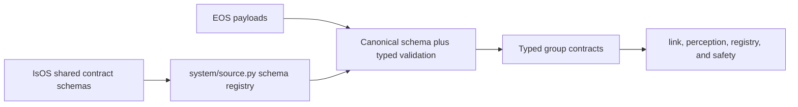

<!-- doc-navigation:start -->

Folder: ei/core/runtime

Browse documents and subfolders here.

- [Parent folder](../README.md)
- Documents in this folder:
  - [fleet](fleet.md)
  - [io](io.md)
  - [optional](optional.md)
  - [EI stage dataflow design](pipeline.md)
  - [registry](registry.md)
  - [EI runtime design](runtime.md)
  - [Sandbox layer](sandbox.md)
  - [Supervised task lifecycle](supervisor.md)

<!-- doc-navigation:end -->

[中文](../../../../docs_cn/ei/core/runtime/contracts.md)

## Contents

- [Architecture](#architecture)
- [Data flow](#data-flow)
- [Conditions](#conditions)
- [Related documentation](#related-documentation)

## Architecture

## Owned modules

IsOS maintains the shared southbound payload definitions under `contract/proto/` and their generated runtime JSON schemas under `contract/schemas/`. This EI package contains read-only loaders, validators, and typed consumer models. Canonical payload changes start in the shared contract source and regenerate its schema; EI does not write that shape.

EI contract modules follow the node groups that consume them: `io/link.py` holds EOS device, resource, primitive, command, acknowledgement, and numeric limit types; `evidence/perception.py` holds admitted body and world snapshot types; `governance/safety.py` holds action invocation, step context, and gate verdict values. Only these groups currently need typed consumer contracts.

The non-node `system/` modules provide shared mechanics: `source.py` resolves IsOS-managed JSON schemas through collision-checked `SharedResources`; `registry.py` maps admitted kinds to models and schema paths; `validate.py` applies canonical JSON Schema and Pydantic validation. These modules consume contract definitions but do not author them.

This layout passed the full EI suite (744 tests), Ruff, Pyright, four import rules, a clean wheel build, and documentation link checks on 2026-11-16. Reproduce from the repository root with `cd ei && .venv/bin/pytest -q`, `cd ei && .venv/bin/ruff check .`, `cd ei && .venv/bin/pyright`, `cd ei && PYTHONPATH=.:package .venv/bin/lint-imports --cache-dir ../data/cache/tools/import-linter-ei`, `uv build --project ei --wheel`, and `python3 scripts/check_doc_links.py --all`. The wheel build log is under ignored `data/test/20261116-ei-contract-groups/`.

## Data flow

Startup scans JSON below logical `contracts/` and `primitives/` and registers every non-empty `$id`. A southbound object is checked against its canonical schema and then converted to its typed model. Discovery combines protobuf common fields with the body contract selected by `device_class`; world resource payloads select their model by URI and discriminator.

Primitive discovery maps the exact `{name, version}` descriptor to the corresponding action schema. The descriptor version must be SemVer and equal that schema's `x-island-primitive-version`. Before egress, portable argument shape is validated and numeric values are checked against the selected device limits. EOS acknowledgements are validated, including `primitive_version`, before becoming safety verdicts or operator-visible results.

## Conditions

A normal payload produces exactly one typed body descriptor, world snapshot, command, or acknowledgement. Nullable world fields stay `null`; absence is not converted into healthy data. Body `configuration` and `operational_state` fields required by the selected class must be present, and explicit unknown values remain null only where that schema permits them.

Configuration fails when resources are used before `configure`, a logical file is missing, JSON is malformed or not an object, a schema lacks `$id`, two schemas reuse an `$id`, or a Draft 2020-12 registry cannot be built. Payload validation fails on canonical-schema or typed-model mismatch. Unknown device classes, primitive kinds or versions, resource kinds, and schema names are rejected rather than passed through.

Numeric ranges reject booleans and non-numbers, non-finite endpoints, ranges without an endpoint, exclusivity without its endpoint, empty intervals, missing required limit names, and unknown limit names. Invocation rejects an argument whose capability was not advertised or whose value falls outside the admitted interval.

Accepted acknowledgements require null rejection fields. Rejected acknowledgements require a non-empty `reason` and a canonical `reason_code`; all acknowledgements require an exact SemVer `primitive_version`. `speaker.play` rejects missing stream identity, invalid media types or base64, oversized chunks, negative sequence values, and unknown fields.

## Related documentation

See [EOS exchange design](io.md) for the EOS interface, [EI runtime interface](../../interfaces/server.md#runtime) for generated northbound schemas, [link design](../io/link.md) for transport, [perception design](../evidence/perception.md) for admission, [registry design](registry.md) for target binding, and [Island shared contracts](../../../isos/core/architecture.md#cross-owner-contracts) for resource-root ownership.
