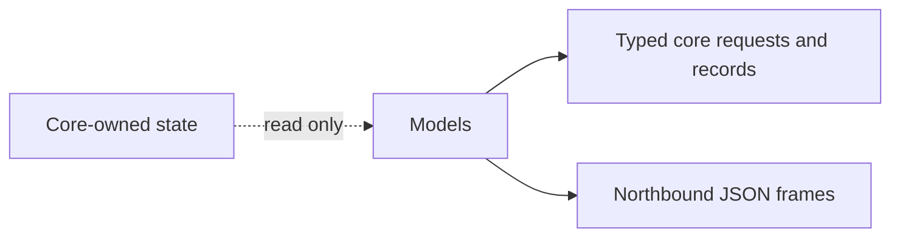
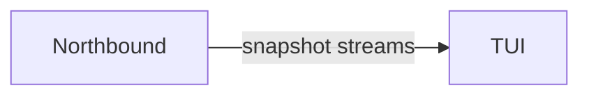

<!-- doc-navigation:start -->

Folder: ei/core/runtime

Browse documents and subfolders here.

- [Parent folder](../README.md)
- Documents in this folder:
  - [contracts](contracts.md)
  - [fleet](fleet.md)
  - [optional](optional.md)
  - [EI stage dataflow design](pipeline.md)
  - [registry](registry.md)
  - [EI runtime design](runtime.md)
  - [Sandbox layer](sandbox.md)
  - [Supervised task lifecycle](supervisor.md)

<!-- doc-navigation:end -->

[中文](../../../../docs_cn/ei/core/runtime/io.md)

## Published state

Injected stores hold replaceable snapshots for health, backends, missions, context, the planner prompt, model I/O, primitives, native skills, scene, and body parts. Streams send the latest snapshot and then newer versions. Source aliases and device IDs remain attached to multi-robot state.

## Operator input

- chat/hearing input becomes an admitted hearing observation;
- `/missions/command` admits server-attributed operator missions and performs revision-checked updates, priority changes, and cancellation of pending work;
- mission review enters the memory review path;
- `/primitive/invoke` creates an explicitly targeted primitive request and sends it through registry validation and the ordinary safety gate.
- `/skills/command` resolves a configured robot and proxies strict exact-identity skill operations to its dedicated EOS `SkillService` client;
- `/skills/execution` validates a single cursor request and relays complete ordered execution snapshots until the EOS watch ends.

Clients cannot supply mission source, origin, score, lifecycle state, or plans. Mission commands change planning input, not the execution boundary: no operator route bypasses primitive validation, policy, or safety. There is no Agent-local execution endpoint and no raster-map route.

## Readiness

See the [northbound wire reference](../../interfaces/server.md#runtime) for routes and payloads.

## Data lifecycle and conditions

Each replaceable store owns one immutable snapshot and a monotonically increasing in-process version. A subscriber receives the current snapshot first, then waits for a strictly newer version; replacement wakes all waiters. An empty store yields no domain value, polling observes shutdown at bounded intervals, and stop returns `None` rather than fabricating a final frame. Part state is keyed by stable robot and device identity, so replacement or removal cannot merge similarly named devices.

Catalog projection transforms the internal registry into operator-filtered primitive descriptors and a separately versioned native-skill availability view. Entries are deterministically sorted. Missing backends, optional skill unavailability, and an empty catalog are valid snapshots; malformed discovery data never reaches this layer because link admission rejects it atomically. Scene projection preserves attribution and distinguishes an empty scene from no scene received.

The server treats listener bind failure as startup failure. `/health` remains available during startup; other routes report unavailable until their producers exist. Connections with no `Origin` and the configured Web UI origins are accepted; disallowed origins and unknown paths close without invoking domain logic. Invalid JSON, invalid typed requests, queue saturation, missing plans or mission documents, revision conflicts, gate rejection, egress failure, and request timeout have distinct wire errors described in [EI runtime interface](../../interfaces/server.md#runtime).

Streams unsubscribe and cancel their wait tasks when a client closes. Periodic health and backend streams continue without state-version triggers; versioned streams emit only replacements. Binary input must decode as UTF-8 before JSON validation. A valid backend acknowledgement with `accepted=false` remains an invocation result, while transport or malformed acknowledgement is `egress_failed`; a full observation queue may drop the follow-up result observation without changing the acknowledgement already returned to the caller.

## Typed northbound models

Model relocation check (2026-11-16): Ruff, Pyright, all 744 EI tests, import rules, northbound schema comparison, documentation links, and a clean wheel build passed. The wheel contains no `ei/api` package. Reproducible commands and build output are in ignored `data/test/20261116-ei-io-models/`.

`ei/io` owns external transport handlers and serialization. `ei/io/models` holds external request, reply, and projection models. `ei/core/system/models` holds records that both core and IO use. Only `core/system/composition.py` and `core/system/launch.py` import the `io` adapter to wire startup; domain modules do not. EI implements this northbound wire interface. IsOS maintains the shared JSON Schemas under `contract/schemas/northbound/` and owns the graph and IsOS-to-EI owner exchange. EI checks its wire models against those schemas; `scripts/ei/check_northbound_schemas.py` is check-only.

### Overview

EI models define typed northbound requests, core records, and operator projections. The models validate commands and keep state ownership with their producers.

### Architecture

### Owned modules

`chat.py`, `invoke.py`, and `review.py` define command requests and their success or error replies. `mission.py` defines mission commands, lifecycle records, history, documents, and table snapshots. `plan.py` defines semantic plan graphs, edits, execution records, and operator projections.

`context.py`, `observation.py`, and `perceptions.py` describe bounded model context and admitted observation projections. `model_io.py` describes model messages, exchanges, activity, agent status, and the combined model-I/O frame.

`primitives.py`, `skills.py`, and `prompts.py` describe discovered catalogs and the static prompt projection. `skills.py` also owns strict tagged skill commands, cursor requests, acknowledgements, errors, and complete execution snapshots. `status.py` describes aggregate runtime health, subsystem health, safety state, backend connection state, and per-device status.

### Data flow

Northbound frames enter typed request models before EI changes core state.

Core records flow in the other direction. Projection models select operator-visible fields while preserving stable robot aliases, device IDs, correlation IDs, timestamps, revisions, results, and failure reasons. They do not become an independent source of truth; mission, memory, perception, and link owners retain canonical state.

Decision graphs require unique node IDs, known references, no self-reference, and an acyclic `after` dependency relation.

### Conditions

Normal input produces a typed value or a JSON frame with the exact documented enum literals and field names. Empty optional collections remain empty, optional snapshots may be absent until their producer publishes, and nullable result or reason fields retain their semantic distinction.

Malformed JSON is rejected by the northbound adapter before these models run. Structurally invalid values, unknown fields on strict command models, invalid enum values, bad bounds, inconsistent acknowledgement fields, duplicate graph nodes, unknown dependencies, self-dependencies, and dependency cycles fail validation and do not mutate core state.

### Related documentation

See [EI runtime interface](../../interfaces/server.md#runtime) for WebSocket routes, [mission design](../cognition/missions.md) for mission state, [decision design](../cognition/decision.md) for plan execution, and [memory design](../cognition/memory.md) for stored plan records.

## Terminal workbench projection

### Architecture

### Data flow

Process output and WebSocket frames are normalized into bounded display state. Rendering changes presentation only; stable robot IDs, device IDs, mission revisions, correlation IDs, and backend reasons remain attributable to their source.

### Conditions

An unavailable feed, refused connection, or reconnect delay affects that view without granting a fallback execution path. Command timeouts and server close code 1013 remain operator-visible. In attach mode the console owns no runtime child; in wrap mode a child startup failure is reported instead of being mistaken for a connected runtime.

### Related documentation

The shared terminal workbench is launched with `isos tui` through the IsOS server.

## Southbound operation handling

IsOS maintains the shared capability and operation wire contract in [`capabilities.proto`](../../../../contract/proto/capabilities.proto). EI consumes the generated binding and admits only a healthy capability whose robot, device, primitive, and version match the current discovered generation. The link preserves the durable operation ID across Submit, Watch, Get, and explicit Cancel. A successful Submit is pending, never evidence of physical completion. EI records success only after a matching terminal result and acknowledgement agree on operation identity, primitive, version, and acceptance. Rejected, failed, cancelled, timed out, and unknown outcomes do not become success. When the reply or watch is lost, EI queries the same operation ID and fences later writes if reconciliation remains uncertain. The safety and mission designs describe the resulting EI state; the EOS schema owns exact request and response fields.

## Eos Exchange

IsOS maintains the shared wire contract; EI and EOS consume its generated bindings. See the [EI–EOS contract boundary](../../../isos/core/architecture.md#cross-owner-contracts) and [operation handling](#southbound-operation-handling) for the exact flow.

## Data flow

\`\`\`mermaid
flowchart LR
  discover["Gateway discovery"] --> generation["Atomic robot/device generation"]
  capabilities["CapabilityService catalog"] --> binding["Exact ready capability join"]
  generation --> binding
  resources["Read/watch resources"] --> typed["Canonical schema validation"]
  binding --> registry["Executable registry"]
  typed --> perception["World + detection + ASR admission"]
  safety --> operation["SubmitOperation with operation_id"]
  operation --> terminal["WatchOperation terminal acknowledgement"]
  interrupt["Timeout or cancellation"] --> cancel["CancelOperation by operation_id"]
  cancel --> terminal
  terminal --> mission["Mission outcome + structured log"]
\`\`\`

Every executable binding must be healthy, match the installed schema at its exact version, and pass local policy. Unhealthy bindings remain visible for diagnostics but cannot execute. Refresh replaces the full generation atomically.

## Interface groups

- [Body](#body) covers robot/device identity, state, health, binding scope, rediscovery, and status.
- [World](#world) covers typed world state, detection, speech, resource watches, and camera capture.
- [Primitives](#primitives) covers action versions, durable operation identity, terminal outcomes, explicit cancellation, and uncertain results.
- [Skills](#skills) covers descriptors and asynchronous execution through the dedicated skill service.

## Body

The robot descriptor carries `id`, `name`, `model`, `description`, operational `state`, `health`, emergency-stop state, optional power percentage, and robot-scoped primitive bindings. A robot-scoped binding, including `robot.stop` or `safety.estop`, is called with an empty device ID.

Each device descriptor carries `id`, `class`, `part`, `description`, `state`, `health`, and device-scoped primitive bindings. Backend names, driver versions, endpoints, raw telemetry, configuration internals, and media do not cross this boundary.

Discovery failures do not replace the last complete generation. Successful rediscovery removes vanished devices, resources, skills, and primitive targets together. The monitor uses `GetStatus.started_at` as the EOS process-generation identity and performs bounded rediscovery so changed health and bindings cannot remain stale.

## World

|---|---|---|
| `robots/{robot}/world/state` | `world.snapshot@1` | fused entities and relations |
| `robots/{robot}/detection/state` | `detection.snapshot@1` | one model result with typed `human:*` and `obj:*` identities |
| `robots/{robot}/world/asr/state` | `asr.snapshot@1` | recognized external speech |

World and detection are distinct. World state may fuse observations over time, while detection retains the producing device/model source and `source_sequence`. Detection attributes are schema-bounded semantic facts; raw tensors, masks, boxes, landmarks, embeddings, audio, and provider payloads remain inside EOS.

## Primitives

The capability is joined to Gateway discovery by robot ID, primitive, exact version, and device ID. Schemas describe valid arguments; they do not independently admit actions. Device-scoped calls require the exact discovered device, while runtime-scoped actions have an empty device ID.

**Related:** [EOS operation handling](#southbound-operation-handling), [safety](../governance/safety.md), and [mission recovery](../cognition/missions.md).

## Skills

The generated transport also contains asynchronous execution RPCs. This integration stage uses the service for catalog discovery only; governed execution is introduced separately.
