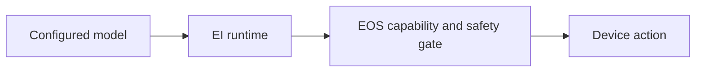
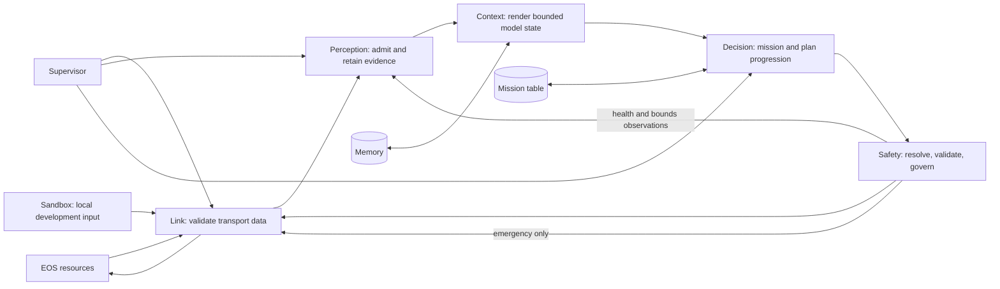
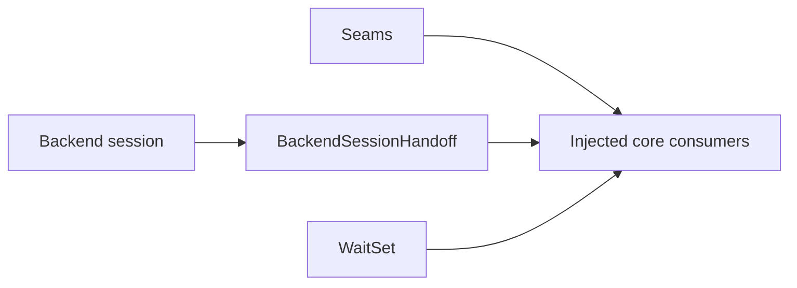

# EI runtime design

<!-- doc-navigation:start -->

Folder: ei/core/runtime

Browse documents and subfolders here.

- [Parent folder](../README.md)
- Documents in this folder:
  - [contracts](contracts.md)
  - [fleet](fleet.md)
  - [io](io.md)
  - [optional](optional.md)
  - [EI stage dataflow design](pipeline.md)
  - [registry](registry.md)
  - [Sandbox layer](sandbox.md)
  - [Supervised task lifecycle](supervisor.md)

<!-- doc-navigation:end -->

[中文](../../../../docs_cn/ei/core/runtime/runtime.md)

## EGI Agent terminology

**EGI** means **Embodied General Intelligence**. **EGI Agent** is the EI runtime in this repository. It hosts configured models and coordinates perception, context, planning, memory, missions, safety-gated primitives, and recovery.

EI owns cognition and its proposal gate. EOS owns device integration, final command admission, and physical safety. IsOS owns the saved graph and supervised process lifecycle. Public commands and configuration use the `ei` package and paths described in the [EI overview](../../README.md).

## Runtime composition and module boundaries

For the target graph hierarchy and per-kind operator behavior, start at the node catalog. This page records the **current Python module implementation** and its algorithm, without redefining stage payload contracts.

## Ownership map

| Module | Owns | Does not own | Focused reference |
|---|---|---|---|
| `core/io/link` | EOS channels, validated discovery generations, resource and call transport | planning or action policy | [Link](../io/link.md) |
| `core/evidence/perception` | admission queue, bounded observation history, current replaceable evidence | source truth or prompt wording | [Perception](../evidence/perception.md) |
| `core/cognition/context` | deterministic prompt sections and total dynamic-message budget | observation storage or model invocation | [Context](../cognition/context.md) |
| `core/system/registry` | resolved primitive catalog and planner-visible signatures | transport or native-skill execution | [Registry](registry.md) |
| `core/cognition/missions` | mission admission, priority, documents, checkpoints and lifecycle | plan inference or primitive execution | [Missions](../cognition/missions.md) |
| `core/cognition/decision` | model lanes, semantic plans, step progression and results | primitive authority | [Decision](../cognition/decision.md) |
| `core/cognition/decision` | optional profile DAG market, device bidders and zone leases | capability invention or gate bypass | [Coordination](../cognition/coordination.md) |
| `core/governance/safety` | workload admission, audit, health episodes, bounds, rate window and emergency latch | physical release guarantees | [Safety](../governance/safety.md) |
| `core/cognition/memory` | working, episodic and reviewed reference records, plus vector recall when available | mission authority | [Memory](../cognition/memory.md) |
| `core/system/sandbox` | isolated local development input process and media devices | production actuator authority | [Sandbox](sandbox.md) |
| `core/system/supervisor` | task start, readiness, restart observation and stop signaling | domain state | [Supervisor](supervisor.md) |
| `core/system/composition.py` | construct collaborators, register entries, close resources | subsystem algorithms | this page |

`core/system/` also holds EI's launch, setup, owner control, node registry, native node lifecycle, and local stage delivery implementations. The root keeps only the launch, setup, and safety command entrypoints; `reader_features.py` stays there so capability probing does not import the runtime.

The five root import aliases for isolated nodes, registry, node runtime, owner service, and stages were removed on 2026-11-16. Callers import their `ei.core.system` implementations directly. The full EI suite passed (744 tests); Pyright, Ruff, four import contracts, documentation links, and a clean wheel build also passed. Commands and output are in ignored `data/test/20261116-ei-root-alias-removal/`.

Root-module relocation check (2026-11-16): `cd ei && .venv/bin/ruff check . && .venv/bin/pyright && .venv/bin/pytest -q` passed (744 tests); `PYTHONPATH=.:package .venv/bin/lint-imports --cache-dir ../data/cache/tools/import-linter-ei` kept all four contracts. `python3 scripts/check_doc_links.py --all` found no broken relative links. A clean `uv build --project ei --wheel` included all eight system implementations and their root entrypoints. Full build output is in ignored `data/test/20261116-ei-root-merge/`.

## End-to-end data lifecycle

1. Composition resolves configuration and shared schemas, creates one client per stable backend alias, and builds stores beneath the resolved state/cache roots.
2. Link performs mandatory discovery. A complete validated generation replaces the prior backend snapshot; partial discovery is never published.
3. EOS resources and operator hearing become attributed `ObservationRecord`s. Event observations queue in order; replaceable state coalesces by identity.
4. Context reads snapshots and renders configured sections under one budget. Rendering may round or summarize values, but never mutates typed source state.
5. A bounded mission table selects one ordinary mission, or coordination admits multiple profile jobs when explicitly enabled. Model output remains a proposal.
6. Every workload invocation names a backend and device, resolves against the current registry, passes schema, device-limit, policy, runtime and rate checks, and only then reaches link. EOS acknowledgement is recorded as evidence.
7. Results return through perception, update plan/mission state, checkpoint working memory, and inform the next decision boundary. Concluded plans enter episodic memory; only an operator promotion enters reference memory.
8. Safety's separately supervised monitor task observes links, progress and measured bounds. Emergency escalation erects a fail-closed barrier and uses the dedicated stop route.

## Lifecycle and degradation

`launch()` composes only configured subsystems, starts them through the supervisor, waits for readiness, serves health while running, then signals one shared stop event and closes non-supervised resources. Optional skill/model discovery, vector recall, docs retrieval, proposer and coordination may degrade without changing the primitive authority chain. A required backend discovery, schema, configuration or storage failure is surfaced rather than replaced with invented data.

Empty observations render as absent sections; an empty mission table waits; unknown targets and malformed model actions fail closed. Oversized collections are bounded with explicit omission counts. Duplicates are either idempotently ignored by identity or rejected where uniqueness is contractual. Timeouts and cancellation never synthesize success. Restarted supervised tasks receive a new readiness event, while durable mission and memory recovery follow their focused documents. Raster-map contracts are reserved types only: there is no map source, storage, prompt section or northbound producer in the current runtime.

## Architectural invariants

- Stable backend aliases are routing identities; EOS UUIDs detect process generations and are not operator targets.
- I/O projects state and submits typed requests; it does not own core state.
- Safety's emergency path alone may bypass workload admission, and only for emergency stop.
- Mutable data is written below resolved `var/` roles, never source, config or shared-resource roots.
- The dependency contracts in `pyproject.toml` keep core logic behind injected protocols rather than provider SDKs or northbound handlers.

## Verification (2026-11-14)

From the repository root, `ei/.venv/bin/ruff check ei ei/tests`, `ei/.venv/bin/pyright -p ei/pyproject.toml`, `cd ei && PYTHONPATH=.:pkg .venv/bin/lint-imports`, and `cd ei && .venv/bin/pytest -q` passed. The full EI suite reported 758 passed. Complete outputs are under ignored `data/test/20261114-ei-layer-refactor/`.

## Layout verification (2026-11-16)

The source checkout loads the EI Python package directly from the outer `ei/` project directory. Generated EOS protocol bindings live under `ei/generated/eos`; these are checked-in Python protobuf and gRPC consumer files regenerated from `contract/proto/`, not an editable schema source; no `island` Python package is installed. Private external programs live under `ei/package`; the installed EI bundle places them beside the wheel in its `pkg` directory. The C demo stage source and ABI header remain under `ei/native` because the wheel compiles and ships `ei/native/libei_demo_stage.so`, which selected graphs reference as `native/libei_demo_stage.so`. The flattened layout passed 745 EI tests, Ruff, Pyright, four import contracts, wheel build, launcher capability probe, Rust generated-configuration tests, Clippy, formatting, and documentation link checks. Logs are under ignored `data/test/20261116-ei-flatten/`.

To verify generated EOS bindings without changing tracked files, run `ei/.venv/bin/python scripts/ei/generate_eos_proto.py --check` from the repository root. Run the same command without `--check` to update bindings after an IsOS contract change. Generation stages a complete package and swaps it into `ei/generated/eos` only after protoc succeeds. The 2026-11-16 cleanup removed stale package and lint entries; focused generator tests, Ruff, Pyright, and a clean wheel build passed. Build evidence is under ignored `data/test/20261116-ei-generated-cleanup/`.

After this boundary cleanup, the EI scripts live under repository `scripts/ei/`, and the former `internal` modules live in `lib`, `contracts`, or `core` according to their imports. Reproduce the current checks from the repository root with `cd ei && .venv/bin/pytest -q`, `cd ei && .venv/bin/ruff check .`, `cd ei && .venv/bin/pyright`, `cd ei && PYTHONPATH=.:package .venv/bin/lint-imports --cache-dir ../data/cache/tools/import-linter-ei`, `cargo test -p isos source_ei_inventory_excludes_build_and_test_trees --quiet`, `python3 -m unittest crates/isos/tests/test_product_installer.py -q`, `uv build --project ei --wheel`, and `python3 scripts/check_doc_links.py --all`. The EI suite reported 744 passed; Ruff, Pyright, four import contracts, the two affected IsOS checks, the clean wheel build, and documentation links passed. Complete EI test and wheel build logs are under ignored `data/test/20261116-ei-boundary/`.

## Internal protocols and handoff

## Architecture

## Owned modules

`core/backend_handoff.py` defines `BackendSessionHandoff`, the process-local handoff of admitted missions, an active plan, and bounded observation state across a backend rebind. `contracts/decision.py` defines `ActionInvocation`, `StepContext`, and `GateVerdict`, which carry one requested action through policy and safety to an optional backend acknowledgement.

`lib/model.py` defines the `DecisionModel` protocol consumed by planning without coupling core code to one provider. `lib/recall.py` defines the `RecallIndex` protocol used by memory with either the optional vector index or another implementation. `lib/notify.py` defines `WaitSet`, a small broadcast notification primitive used by replaceable stores. `lib/skills.py` holds the leaf skill protocol values. These placements remove the former `internal` package while preserving the leaf import rule for `lib`.

## Data flow

A producer constructs an internal value from already validated domain data and passes it across an injected protocol. An action invocation preserves the primitive name, stable robot and device target, arguments, and intent; step context adds mission origin and execution context; the gate returns a verdict that distinguishes admission, refusal, backend acknowledgement, and egress failure.

Before backend-owned clients, watchers, and registries are replaced, composition deep-copies admitted missions, the active plan, and bounded observation state into the handoff. The next session consumes isolated copies and clears the pending values; its monotonically increasing revision identifies a new capture. Model and recall calls return their protocol results to decision or memory owners, which decide persistence and operator projection. `WaitSet.notify_all` wakes current waiters after a store version changes; consumers always reread owner state after waking.

## Conditions

Normal calls preserve typed values without adding policy. Empty optional targets and acknowledgements remain explicit: an admitted verdict may carry a backend rejection acknowledgement, while an admitted verdict without an acknowledgement represents egress failure and must not be treated as success.

Malformed data should have been rejected at the owning boundary; protocol implementations may still raise their documented provider, storage, or transport failures. Missing implementations disable the dependent feature through composition rather than a hidden fallback. `WaitSet.wait` returns `False` on timeout and `True` on notification; callers must tolerate a wake followed by unchanged or replaced state.

Restart creates new protocol implementations and a new backend handoff; no object in this package is durable. Cancellation and shutdown are controlled by the owning subsystem. Recall implementations must close their resources, model implementations must release provider resources when applicable, and waiters must be allowed to exit through their owner's stop condition.

## Related documentation

See [module map](runtime.md) for dependency direction, [link design](../io/link.md) for backend sessions, [decision design](../cognition/decision.md) for model and action consumers, [safety design](../governance/safety.md) for gate verdicts, and [memory design](../cognition/memory.md) for recall implementations.

## Configuration, logging, and recovery

EI resolves its configuration root from `--etc` or `EI_ETC` before constructing runtime modules. A missing root aborts startup. `models.toml` defines model bindings and generation limits; `modes.toml` selects a profile under `profiles/`; profiles define EOS backends and operator primitive exposure. `prompts.toml` is the model-prompt source. `missions.toml` can define a strict whitelist of canonical named missions and protected plans; `[decision] load_mission_templates` defaults to `false`. `safety/gate.toml` defines deterministic egress bounds. IsOS selects component launch paths and passes the managed EI configuration root as `EI_ETC`; EI reads its declared shared resource roots to locate EOS contracts and schemas.

The dotenv reader treats a missing file as an empty overlay, ignores comments, blank lines, and malformed assignments, and preserves existing process variables. It reports only variable names loaded and never evaluates shell syntax. Secrets stay in environment lookup and are absent from structured config output.

## Logging and state

One sanitized event flows to the local core JSONL file and, for standalone runs, the configured console. Unknown logging keys fail validation. Before any sink sees an event, recursive sanitization redacts secret-bearing keys and URLs, excludes primitive arguments, arbitrary results, prompts, transcripts, provider payloads, images, and audio, and bounds nested data. Correlation and lifecycle context is scoped to a request or execution.

In a source checkout the single core file is `data/ei/log/<deployment>/ei.jsonl` (`local` for standalone runs). Each JSON line contains timestamp, level, source, message, and optional event code, run ID, correlation ID, and sanitized fields. The source is an EI node ID or `ei.owner_service.py@aether-v0.2.3` for system code. IsOS reads this file directly. The local file captures `DEBUG` and higher by default; the console normally starts at `WARNING` and shows startup and shutdown at `INFO`. `--log-level` and `[logging]` change verbosity.

The model client accepts text and supported images, converts images to MIME data URLs, and emits chat-completions requests. Non-stream replies require a usable choice; streaming consumes valid SSE deltas and closes the response. HTTP, URL, timeout, decode, malformed JSON, empty-choice, and interrupted-stream failures become `ModelClientError` with bounded details. Missing usage fields never alter returned text.

## Event mapping and durable recovery

The [owner event interface](../../../isos/interfaces/server/ei.md#events) defines the external record; the [JSONL fixture](../../../../ei/tests/fixtures/jsonl_events/README.md) shows representative records.

### Mapping and ordering

An owner-local 256-key monotonic table suppresses only repeated noncritical diagnostics for up to 60 seconds and reports a bounded count. Startup, ready, state changes, first warning/failure, latch, unknown outcome, terminal and safety-stop failures bypass suppression. The current `_RepeatSuppressor` has a 4,096-entry local-file policy; the closed lifecycle emitter keeps its separate typed-field and suppression rules. On table eviction and shutdown, flush safe counts without blocking stop. A shared write failure increments a bounded owner counter; that failure does not change EOS actuation state.

### A03 durable recovery and shared policy revision

`OperationLedger` reserves an ID atomically before EOS Submit and retains a pending entry after an uncertain transport outcome. Recovery queries `GetOperation` using that ID; a matching terminal receipt settles the checkpoint, while a missing or mismatched receipt remains unknown and blocks safety reset. Before estop egress, `SafetyState` writes the affected aliases and EOS robot IDs to an owner-only atomic file and syncs its directory. The local stop CLI uses the same exclusive runtime lock to write one-shot authorization; the next startup consumes it and checks every alias twice before persisting release.

The independent A03 review tightened crash boundaries. `safety-history.json` precedes the latch payload; an engaged marker with a missing payload fails closed. `operations-history.json` and each per-ID index precede the operation payload, so a missing checkpoint is detected. Both latch and one-shot authorization bind an episode ID and selected graph revision; an operation reservation also stores EOS robot identity and graph revision, and terminal state cannot be rewritten. The authorization is consumed immediately after taking the runtime lock, so configuration, discovery or mission checkpoint failures cannot leave it armed. Managed default startup does not clear incomplete missions before restoration.
