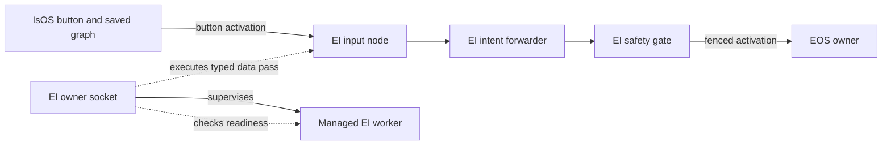

# EI architecture

EI is an independent owner service. Its private Unix socket validates the isolated `cores.ei` projection, owns a selected run, and supervises one managed worker at a time. IsOS owns the saved graph and calls Run, Status, Stop, and activation; exiting IsOS does not terminate EI. Graph `0.2.0` registers three EI activation nodes at input, intent, and safety, plus three arm-monitor nodes at input, state, and monitor. The former health and declaration-only wrapper types are no longer admitted.

## Runtime path

The owner executes the three typed data-pass stages for the MVP. Each carries the same `button_activation@v0.2` event; EI does not choose arm joint values or create an actuator route. At the safety stage the owner checks run identity, revision, declared node path, worker liveness, and the EOS owner endpoint. EOS admits and executes the arm command. The managed worker supplies process readiness and lifecycle separately from this owner-side pass. This health-only child holds no safety state or actuator authority, so it does not take the global EI safety-state lock; the full EI runtime still takes that lock. Separate IsOS deployments may therefore keep health workers alive concurrently without contending for one state root.

The owner verifies the worker digest and run identity before launch. Stop serializes with activation, reaps the worker, and closes admission; stale run identities are rejected. An uncertain downstream result is surfaced without retry. See the [setup and lifecycle interface](../interfaces/setup.md) and [node interface](../interfaces/node.md).

The read-only return path is EOS mock arm → EOS interface egress → EI input → EI state → EI monitor → IsOS UI monitor. EOS samples its mock arm at 100 Hz; EI requests the latest fenced sample at no more than 20 Hz; IsOS UI reads the final observation at up to 5 Hz. EI preserves EOS sequence, monotonic sample time, state, reason, joint names, and valid positions. A stale or fault sample remains an observation, never a command. Stop rejects later reads and clears the owner cache.

Concurrent-owner check, 2026-11-09: two real `ei --managed --health-only` children under separate owner sockets and the same `ISLAND_STATE` both remained running, then Stop reaped both. `ei/.venv/bin/pytest ei/tests -q` passed 744 tests; Ruff, Pyright, six import contracts, and the bilingual link audit passed. Complete outputs are in ignored `data/test/ei-arm-monitor-20261109/concurrent-health-*.log` and `links.log`.

## Future qualification

The Q03 owner qualification target measures the read-only vision ingress with a repeated stub stream. It does not extend the one-shot Q01 duplicate-generation test socket; the selected Q01 byte and identity comparison remains a separate prerequisite. The target ingress and Q01 replay still require implementation and their own replay evidence.
