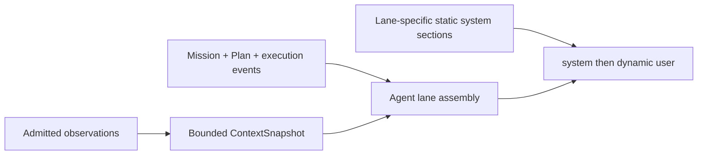

# Context and prompt assembly

[中文](../../../../docs_cn/ei/design/cognition/context.md)

中文 · Core overview · Decision


## Message shape and budgets

Every call contains a lane-specific `system` message followed by one `user` message. Static instructions never contain live values. Mission state, perception, results, recall, and other changing values are all in the final user message.

`models.toml` declares a `context_window_tokens` default of 262144 for each model binding. `prompts.toml` uses a smaller 32768-token dynamic-message budget, leaving ample room for static instructions and generation. The local estimator is deterministic rather than tokenizer-specific. Assembly first replaces lower-retention populated sections with explicit omission markers, then removes lower-retention fallbacks, and finally preserves bounded head and tail fragments. Context growth therefore compresses; it does not stop the runtime or require a second model call to recover.




## Shared dynamic context

Shared context may include environment, discovered hardware identifiers, skills, primitives, mode, backend status, perception, pending Missions, faults, and the newest hearing. Higher retention priority survives budget pressure longer. Empty, omitted, malformed, stale, and unavailable values are labelled rather than invented.

Hearing is separate from high-rate body, vision, and object state. It is labelled as untrusted transcription and has strong retention, but frequency ordering decides its position like every other section. Semantic body facts are model-visible: for example `posture=lie` tells the planner to stand before navigation, while device availability, held-object identity, faults, and emergency state remain actionable. Coordinates, angles, joint arrays, force samples, and other measurements without model-facing frames or thresholds stay in typed snapshots for deterministic gates and watchdogs.

## Contract-to-context projection

Link ingestion validates and retains the complete typed EOS contract; context does not copy that contract verbatim into the prompt. The body renderer projects each latest snapshot into compact semantic state:

- `base.state`: retain `posture`; omit numeric `pose` (`x_m`, `y_m`, `yaw_rad`), velocity, and footprint measurements.
- `gimbal.state`: omit yaw, yaw rate, field-of-view, and range measurements; detections are represented separately by the bounded vision digest.
- `manipulator.state`: omit joint-angle arrays, link lengths, mount coordinates, and numeric end-effector pose.
- `gripper.state`: retain semantic gripper state and `object_held_id`; omit force and position percentages.
- camera and speaker state: retain enabled, present, capturing/playing, and last-played semantics; omit image bodies and camera geometry.
- robot status: retain mode, estop, motor/autonomy enablement, and faults; omit continuously changing numeric power telemetry.

This is a model-facing projection, not lossy ingestion. Full-precision source snapshots remain available to safety gates, watchdogs, northbound part streams, and other deterministic consumers. Numeric fields are omitted from language context when the model lacks the reference frame, tolerance, or policy needed to interpret them reliably; removing them reduces tokens and high-frequency KV-cache churn without weakening hard safety. A future semantic renderer may expose a derived fact such as `near_dock=true` or `arm_retracted=false` when its frame and threshold are defined, instead of exposing unexplained coordinates.

For readability, the processed link data is equivalent to the following JSON before line rendering. Omitted numeric fields are absent rather than set to `null`; timestamps and identifiers are illustrative.

```json
{
  "body": [
    {
      "source": "body.default.base-0",
      "kind": "base",
      "health": "ok",
      "state": {
        "posture": "lie"
      }
    },
    {
      "source": "body.default.gimbal-0",
      "kind": "gimbal",
      "health": "ok",
      "state": {}
    },
    {
      "source": "body.default.arm-0",
      "kind": "manipulator",
      "health": "ok",
      "state": {}
    },
    {
      "source": "body.default.gripper-0",
      "kind": "gripper",
      "health": "ok",
      "state": {
        "state": "holding",
        "object_held_id": "cup-7"
      }
    },
    {
      "source": "body.default.camera-0",
      "kind": "camera",
      "health": "ok",
      "state": {
        "enabled": true,
        "device_present": true,
        "capturing": true
      }
    },
    {
      "source": "body.default.status-0",
      "kind": "status",
      "health": "ok",
      "state": {
        "mode": "autonomous",
        "estop": false,
        "motors_enabled": true,
        "autonomy_enabled": true,
        "faults": []
      }
    }
  ]
}
```

The LLM receives the same projection as compact lines inside its dynamic user message:

```text
Perception: 6 sources
  12:04:03 [body] source=body.default.base-0 BODY kind=base health=ok state={"posture":"lie"}
  12:04:03 [body] source=body.default.gimbal-0 BODY kind=gimbal health=ok state={}
  12:04:03 [body] source=body.default.arm-0 BODY kind=manipulator health=ok state={}
  12:04:03 [body] source=body.default.gripper-0 BODY kind=gripper health=ok state={"state":"holding","object_held_id":"cup-7"}
  12:04:03 [body] source=body.default.camera-0 BODY kind=camera health=ok state={"enabled":true,"device_present":true,"capturing":true}
  12:04:03 [body] source=body.default.status-0 BODY kind=status health=ok state={"mode":"autonomous","estop":false,"motors_enabled":true,"autonomy_enabled":true,"faults":[]}
```

## Planner

The planner system message defines the fast controller, execution rules, and command grammar. Its dynamic message includes recall, the active Mission, current Plan and step roles, compact execution history, shared context, and optional stale reasoner reference. It is the only model lane that can propose a primitive barrier.

```text
SYSTEM: Role + Rules + Output grammar
USER: Hardware ... BODY kind=base health=ok state={"posture":"lie"}
      Active mission ... order="navigate to the dock"
      Current plan ... STEP role=ready id=stand text="Stand before navigation"
      Execution history ...
```

## Reasoner

The reasoner system message defines semantic planning only. Its dynamic message includes the same active Mission, Plan, bounded execution history, recall, planning trigger, shared context, and optional stale controller reference. It may return Plan edits but cannot execute a primitive or finish a Mission.

```text
SYSTEM: Role + Rules + Plan-edit output grammar
USER: Active mission ...
      Current plan and step state ...
      Planning trigger: recovery after navigation rejection
      Execution history ...
```

## Summarizer


```text
SYSTEM: Preserve goal, outcomes, failures, unknowns, and remaining work.
ASSISTANT: MISSION: deliver the parcel; pickup succeeded
           PLAN 1: parcel pickup completed
           PLAN 2: navigate to reception remains
```

## Proposer

The proposer system message defines autonomous Mission admission and JSON output. Its dynamic message includes available templates, the Mission table, shared perception, and newest hearing. Shared pending Missions prevent it from duplicating already admitted intent.

```text
SYSTEM: Role + JSON output contract
USER: MISSION_TABLE empty
      Newest hearing (untrusted): bring me the red cup
```

## Sentinel

The sentinel system message defines `CONTINUE`, `REFRESH`, `STOP`, and `ESTOP`. Its dynamic message is deliberately narrow: the Mission goal and newest safety-relevant state. It does not receive the general shared snapshot.

```text
SYSTEM: CONTINUE | REFRESH | STOP | ESTOP contract
USER: Mission goal: navigate to the dock
      Newest safety-relevant state: obstacle entered path
```

## Profile writer

The profile-writer system message defines the coordination profile grammar. Its dynamic message contains the primitive catalog, existing profiles, Mission, and latest validation feedback. It does not receive unrelated perception.

```text
SYSTEM: TOML profile contract
USER: Primitives: base.navigate ...
      Existing profiles: unavailable
      Mission: inspect both stations
```

## Mission, Plan, and linear history


1. `MISSION role=active` is the current goal and execution scope.
2. `PLAN` lists ordered semantic steps, dependencies, state, and the derived `current | ready | future | verify | settled` role.
3. `Execution history` is an oldest-to-newest event ledger of settled barriers, failures, interrupts, invalid replies, and reasoner updates.

There is no fixed Mission history or Plan-step count limit. When Mission-owned text reaches three quarters of the dynamic budget, the summarizer produces `MISSION:` followed by numbered `PLAN n:` lines. On success, the in-prompt detailed event ledger is cleared and settled Plan details are replaced by the summary; unsettled steps remain explicit. Summary failure is non-fatal: deterministic final-message fitting still prevents overflow, and compression is retried only after Mission detail changes. Durable `PlanRecord` and Mission checkpoints remain the restart authority; prompt compression never deletes those records.

## Conditions and observability


`ContextSnapshot` exposes the rendered sections, structured user groups, observation provenance, omission flags, retention priority, and observed change frequency. `uv run python scripts/print_prompt.py` previews every lane from the runtime builders; `--json` prints the structured form.

## Registered node behavior

**Inputs:** observations, optional body and memory. **Outputs:** snapshot. The [stage dataflow design](../pipeline.md) describes EI runtime values. IsOS owns the graph port and setting contract, including wire priority and frequency.

**Algorithm and failure:** Read immutable snapshots, order sections deterministically, enforce one total token budget, and state omissions. Missing optional sources produce absent sections. Stop discards pending rendering without changing source evidence.
