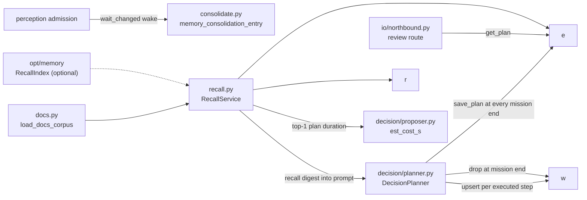
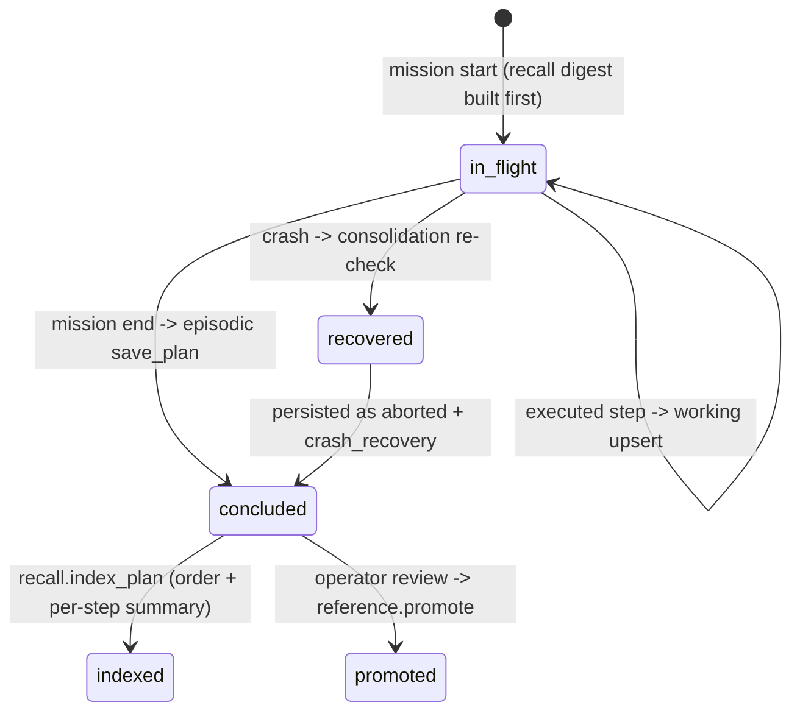

[中文](../../../../docs_cn/ei/design/cognition/memory.md)

## Contents

- [Architecture](#architecture)
- [API](#api)
- [Design](#design)
- [Testing](#testing)

## Overview


Boundaries: memory never judges plan outcomes (the planner writes `succeeded`/`failed`/`aborted`; only the operator review path writes `effective`/`ineffective`), never calls the model, and never touches `core/link`. Consumers are `decision` (planner writes and recalls, proposer estimates cost) and `io` (the operator review route promotes); see [`modules.md`](../runtime/modules.md) for the layering and [`decision.md`](decision.md) for the planner's side of the loop.

## Architecture




Schemas (created with `CREATE TABLE IF NOT EXISTS` in each store module):

- `store.py` episodic `records`: `id` (PK), `ts`, `kind`, `source`, `text`, `metadata` (JSON string) — one row per admitted observation.
- `store.py` episodic `plans`: `id` (PK), `mission_id`, `order_text`, `outcome`, `started_at`, `finished_at`, `record_json` — the full `PlanRecord` as JSON; the typed columns exist for structured queries.
- `working.py` `plans`: `mission_id` (PK), `plan_json`, `updated_at` — one row per running mission.
- `reference.py` `plans`: `plan_id` (PK), `order_text`, `outcome`, `reviewed_at`, `review_note` (nullable), `record_json`.

## API

### EpisodicStore (store.py)

`EpisodicStore(path)` opens (creating if needed) one SQLite file. `append(ObservationRecord)` inserts keyed on the record id and returns `False` for duplicates, so re-draining an unchanged queue is idempotent. `count()` and `recent(limit)` (newest first, `(ts, kind, text)` rows) serve audit and recall. `save_plan(PlanRecord)` is idempotent the same way and also returns `False` on a closed store — a mission aborting during shutdown cannot crash the pipeline (the wave-1 shutdown race; the plan is recoverable from the working store on the next launch). `get_plan(plan_id)`, `list_plans(limit)` (newest first), and `search_plans(query, limit)` — case-insensitive substring match on the order text (`LIKE ? COLLATE NOCASE`) — are the plans read side, the baseline the vector recall of §3.3 layers on. `close()` releases the file.

### WorkingStore (working.py)

`WorkingStore` keeps one replaceable plan row per running mission. The versioned Mission checkpoint remains authoritative for recovery.


### ReferenceStore (reference.py)

`ReferenceStore` retains the operator-reviewed subset of concluded plans, including the verdict and optional review note.


### RecallService (recall.py)

`RecallService(episodic, reference, index=None, docs=None)` is the planner's single recall entry point (§3.2–3.3). `search_plans(order, limit)` merges keyword hits from both stores with vector hits from the optional `RecallIndex` (rehydrated through the stores' `get_plan`); reference hits — keyword or vector — always rank ahead of episodic ones, ids are deduped first-occurrence-wins, and the result is truncated to `limit`. The `index` property exposes the index in use or `None` (the degraded configuration). `search_docs(query, limit)` returns `(doc_id, excerpt)` pairs for corpus passages nearest the query (excerpt: ~200 chars starting up to 50 chars before the earliest query-token match, else the file head); without an index — or without a loaded corpus mapping — it answers `[]`. Both degradations together are the §3.2 "no sqlite-vec" shape: keyword recall only, docs retrieval off, no import broken.

`index_plan(record)` indexes a concluded plan's text for vector recall and is a no-op without an index. The text is the order plus one line per step: the step's action names joined by `"; "` (or `final` for a step that issued no actions), then the outcome — the same rendering the planner's recall digest uses.

Minimal example — the recall digest the planner folds into the user message (caps as described under [Design](#design)):

```text
Prior similar plans:
- "dock the robot at the station" -> effective
  steps: base.velocity -> succeeded; final -> succeeded
  review note: worked in low light
Relevant docs:
```

### docs corpus (docs.py)

`load_docs_corpus(corpus_dir)` reads every `*.md`/`*.txt` (suffix case-insensitive) under the directory recursively into `{relative_posix_path: text}`; a missing directory logs `docs_corpus_missing` (only when a non-empty path was configured) and an empty or missing directory yields `{}` — docs RAG off, never a launch error. `index_docs_corpus(index, docs)` indexes the mapping into the vector index, returns the count, and logs `docs_corpus_indexed` for non-empty corpora. `core.launch` runs both at startup when `[launch] memory` is true, `[memory] docs_corpus` names a directory, and an index was built (default `docs_corpus = ""` disables docs retrieval).

### memory_consolidation_entry (consolidate.py)

`memory_consolidation_entry(queue, store, working, ready, stop, *, active_mission)` is the supervisor entry (subsystem `memory`). `ready` is set before the loop; the `finally` closes the episodic and working stores — the reference store has no loop of its own and closes in `core.launch` after the supervisor stops.

## Design

### Three tiers, three files

Working memory is a recall/diagnostic copy of the running mission's in-flight plan: one row, replaced per step, dropped at mission end. The versioned Mission JSON is authoritative for restart recovery. Startup removes working rows already claimed by restored mission checkpoints, preventing consolidation from misclassifying pending restored work as an aborted plan. Episodic memory is the append-only log of concluded work and observations. Reference memory is the distilled, human-reviewed subset.

### Plans-as-memory lifecycle



At mission start, before the first model call, the planner recalls prior plans; failed plans remain counter-examples and an empty digest is omitted. During execution, each completed primitive step checkpoints the working record. Every exit path saves an episodic `PlanRecord`, indexes it for recall, and drops the working row. Records retain mission priority, revision, explicit robot targeting, and primitive result payloads. Steps never attempted are absent.

### Recall digest construction (exact caps)


$$r = \texttt{recall\_limit} \in [0, 16],\quad \text{plans shown} \le r,\quad \text{docs shown} \le r$$

Per recalled plan, the order text renders in full when $\lvert\texttt{order}\rvert \le 80$, else the first 77 characters plus `"..."`. At most the first 6 steps are rendered — each as `action names joined by "; " -> outcome`, or `final -> outcome` for a step that issued no actions — with a trailing `...` entry when the plan has more than 6. The `review_note` line appears when the promoted record carries one. Each docs excerpt spans ~200 characters, starting up to $\lfloor 200/4 \rfloor = 50$ characters before the earliest query-token match (else the file head). Recall is advisory: both planner and proposer wrap the service calls in `try/except sqlite3.ProgrammingError` — a store closed mid-shutdown logs `plan_recall_failed` and the mission proceeds without the digest.


### index_plan rendering

`RecallService.index_plan` builds the indexed text as the order plus one line per step:

```python
names = [action.action for action in step.actions]
label = "; ".join(names) if names else "final"
lines.append(f"{label} -> {step.outcome.value}")
```


### Consolidation triggers and crash recovery

There is no timer: the loop wakes on every admission (`wait_changed(stop)`) and does two things per wake. First it drains `records()` (the current FIFO snapshot) into episodic with id-keyed `append` — an unchanged admission drains as a no-op, and the admission's capacity policy is reject-not-evict, so re-draining loses nothing (coalesced high-rate kinds degrade by design). Second it re-checks the working store — the MVP form of §3.3 plan re-checking. Rows reported by `list_stale` (every mission except the one `active_mission()` reports — the planner's `running_mission_id` provider in `core.launch`) belong to missions that died mid-write: if the plan id is not already in episodic, it is saved with outcome `aborted`, `finished_at` = now, and a `crash_recovery` annotation (`source="memory"`, `event="crash_recovery"`, log `plan_crash_recovered`); the stale row is dropped either way.


## Testing

Method: unit tests over real SQLite files in `tmp_path`, plus async loop tests driving `memory_consolidation_entry` with a real admission instance, and planner-level stubbed integration (`ScriptedModel` fake model + `AdmittingGate` fake gate) for the recall digest — mock input at the model/gate boundary, real stores and real planner.


Pass criteria: every test passes, or skips solely for the missing sqlite-vec extra; no unhandled `AttributeError` from `index_plan`.
