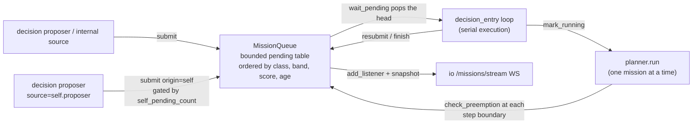
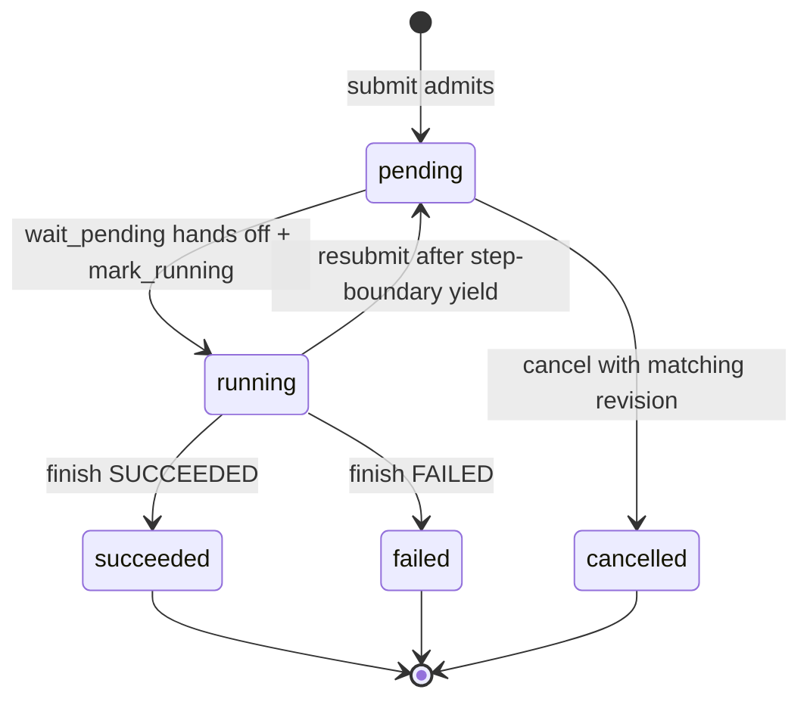

[中文](../../../../docs_cn/ei/design/cognition/missions.md)

## Contents

- [Architecture](#architecture)
- [API](#api)
- [Design](#design)
- [Testing](#testing)

## Architecture




## API


Admission and lifecycle:

- `await submit(order, *, source, correlation_id=None, origin="operator", priority_band=MissionPriorityBand.NORMAL, urgency=0.5, value=0.5, est_cost_s=None, template=None)` -> `MissionRecord | None`. `None` means the pending table is full — the order is rejected, logged WARNING `mission_rejected`, and leaves no record. `origin="self"` changes the priority class only, never the execution path. A plain admission seeds an empty editable document; a selected `MissionTemplateConfig` instead uses its canonical Mission, records its ID/version, and seeds its protected initial Plan.
- `await wait_pending(stop)` -> `MissionRecord | None` — blocks until something is pending, then **pops the table head** (it leaves `_pending` immediately); `None` once `stop` wins. The record's state stays `pending` until the caller runs `mark_running`.
- `mark_running(record)` — sets `RUNNING` and stamps `started_at`; `finish(record, *, state, result=|error=)` closes with `SUCCEEDED` or `FAILED` (`ValueError` for any other state).
- `resubmit(record)` -> `ResubmitOutcome` — returns a preempted mission to the table, incrementing `preempted_count`. Two rejection outcomes, both of which the caller (`decision_entry`) finishes as `FAILED` with the cause-specific error: `PREEMPTION_CAP` (past `max_preemptions`, error `"preempted too often"`) and `TABLE_FULL` (no room in the pending table, error `"preempted: mission table full"`). Neither rejection mutates the record — it keeps its `running` state until the caller finishes it.
- `check_preemption(running)` -> `MissionRecord | None` — the pending mission the running one should yield to; `best_pending()` -> the refreshed head without removing it.
- `restore_checkpoints(checkpoints)` -> `dict[str, PlanRecord]` — converts durable non-terminal missions to pending work, preserves mission identity/document revisions, and returns their latest plans for the planner resume seam. It fails when the durable backlog exceeds configured capacity.
- `get(mission_id)` -> `MissionRecord | None` — exact deep record snapshot by identity.
- `update_order(mission_id, order, *, expected_revision)` -> `MissionRecord` — compare-and-swap edit for an ordinary, physically pending mission whose work has never started. It increments the document revision and atomically synchronizes `MissionRecord.order`, `MissionDocument.order`, and a safe draft pending plan title. Named templates and started work are rejected.
- `reprioritize(mission_id, priority_band, *, expected_revision)` -> `MissionRecord` — compare-and-swap band change for any mission physically in the pending table, including preempted work. It increments the document revision and synchronizes the record and document band.
- `cancel(mission_id, *, expected_revision, reason="cancelled")` -> `MissionRecord` — compare-and-swap terminal cancellation for any physically pending mission. It removes the mission from scheduling only after its `CANCELLED` checkpoint is durable, records history, invokes the normal finished/archive callback, and notifies listeners. A cancelled checkpoint is never restored.

Mutation failures have stable domain types and `code` values: `MissionNotFoundError` (`mission_not_found`), `MissionConflictError` (`mission_revision_conflict`), `MissionNotPendingError` (`mission_not_pending`), `MissionProtectedError` (`mission_protected`), and `MissionStartedError` (`mission_started`). Validation not covered by a narrower type uses `MissionMutationError` (`mission_mutation_failed`). Persistence happens before live state, audit history, callbacks, or listener notification; a store failure leaves all of those unchanged.

Observables: `pending()` (snapshot of the pending table), `records()` (every admitted mission, oldest first, finished included), `history()` (the bounded lifecycle log), `self_pending_count()` (backs the proposer's `max_self_pending` cap), `add_listener(callback)` -> unsubscribe callable (sync callbacks fired on every successful table mutation — and every mission-document mutation — for the northbound stream), the `running_mission` property (the one `RUNNING` record, if any), and the `capacity` / `priority_config` properties.

Human INFO logging reports submission, selection, start, compact changed plan progress, finish, suspension, resubmission, and restore boundaries. `mission_progress` includes plan/document revisions, decision mode, step-state counts, current step, settled barrier count, and latest outcome, but is emitted only when its compact progress signature changes. DEBUG logging retains document mutation, raw plan synchronization, and step/action transitions. These events contain identifiers, states, revisions, indexes, counts, priority metadata, and booleans only; mission text, plans, primitive arguments, evidence, and result payloads remain outside logs.

Document surface (all methods return isolated deep copies; callers never see live state):

- `document(mission_id)` -> `MissionDocument | None` — the mission's current revision.
- `plan_steps(mission_id)` -> `list[PlanStep]` — the current root Plan projected back into planner API records; this is the initial-plan seam for template Missions.
- `sync_plan(plan)` — replaces the Mission document's root Plan with the planner's latest statuses, results, evidence, dependencies, and protection metadata, then checkpoints and notifies listeners.
- `revisions(mission_id)` -> `list[MissionRevision]` — every accepted revision, oldest first.
- `revise(document)` -> `MissionDocument` — accepts an edit of not-yet-started work: `validate_edit` runs first (`KeyError` for an unknown mission), the accepted document replaces the current one, a `MissionRevision` is appended, and listeners fire. Returns the accepted snapshot.
- `complete_action(mission_id, step_index, action_index, *, result=None, reason=None)` -> `MissionDocument` — records one terminal action outcome (`FAILED` when a reason is present, else `DONE`); when the step's last action closes, the step aggregates (any failed action fails the step, its reason the step's) and, when every step is terminal, the document itself resolves to `SUCCEEDED` or `FAILED` with an aggregate result.
- `await execute_next(mission_id, executor)` -> `MissionDocument | None` — runs the next eligible barrier: `begin_step`, then all of the step's actions launched concurrently through `asyncio.gather`, each as `await executor(action_snapshot)`, then `complete_action` per outcome. `None` when no step is pending. The `executor` is the safety/primitive boundary — it receives an isolated `MissionAction` snapshot, a returned value becomes the action result, and an exception is recorded as the action's failure reason; every invocation is made anew, so accepting a revision never bypasses safety admission.

`MissionStore(root)` persists one `<mission-id>.mission.json` file per mission. `clear` removes all checkpoint history for a fresh launch; `save_mission` preserves the latest plan while writing lifecycle/document changes; `save_plan` stores planner progress and an execution phase; `load` reads one checkpoint; `load_active` strictly validates every file and returns pending/running records in submission order. Unknown schema versions, identity mismatches, malformed revision chains, invalid UTF-8, and filename mismatches raise `MissionStoreError` rather than silently discarding work. Writes and clearing use directory `fsync`; writes additionally use a same-directory temporary file, file `fsync`, and `os.replace`.

The package re-exports the queue, store, and document types for consumers.

Minimal example — one operator admission and a hand-off:

```python
missions = MissionQueue(8)
record = await missions.submit("patrol the north dock", source="decision.proposer")
# MissionRecord(id=<uuid4>, order="patrol the north dock", state="pending",
#               origin="operator", priority=<§3.9 score>) — None when full
head = missions.best_pending()  # refreshed head; operator class first
mission = await missions.wait_pending(stop)  # pops the head, still "pending"
missions.mark_running(mission)  # now RUNNING with started_at stamped
```


## Design

### Named Mission templates


Template steps carry stable IDs, semantic outcomes, `required`, `after`, and `terminal` metadata. Required steps cannot be edited or removed by planner commands. A pending non-terminal step is ready only after all dependencies are `DONE`; a terminal cleanup step may run after dependencies settle as either `DONE` or `FAILED`. Successful primitive execution moves a required step to `VERIFYING`; only an explicit later `plan complete` with non-empty evidence makes it `DONE`, while `plan retry` returns it to `PENDING` and `plan fail` records a blocker. Finalization requires every required step to be `DONE` or `FAILED` and every terminal step to be `DONE`.

### Mission state in agent prompts

The mission table has two projections. `io` publishes the full structured table to the TUI and northbound `/missions/stream`; model lanes receive a compact deterministic `MISSION_TABLE` with the running Mission first and pending Missions in scheduler order. Each line explicitly names `role`, short ID, lifecycle `state`, origin, band, queue position, and quoted order. The active planner additionally receives its authoritative `MISSION role=active` line, `CURRENT_STEP`, and one `STEP` line per semantic outcome. Step lines use literal runtime state plus a derived role: `current`, `ready`, `future`, `verify`, or `settled`; primitive outcomes include the robot/device target. The shared table is rebuilt on every mission mutation, so admission, start, completion, and failure are visible without waiting for perception. The planner remains serial: the table is awareness, not a second execution channel, and only the active Mission may issue actions.

### Table lifecycle



There is no `preempted` or `aborted` mission state. `CANCELLED` is a durable terminal state used only for explicit cancellation while a mission is physically pending. Preemption is `running -> pending` through `resubmit`, and the aborted outcome lives on the **plan record**, not the mission record. On shutdown mid-mission, the current plan is saved `aborted` as a checkpoint and the mission returns to durable `PENDING`; a later launch resumes it only when mission preload is enabled. The plan is the mission's surviving execution artifact: the model edits pending semantic work, the runtime owns step status, and the table owns admission and ordering.

A resubmitted mission that wins selection again starts a fresh planner run from the latest Plan synchronized into its Mission document. Settled barriers remain execution history, and pending semantic work remains available to the new planner run; episodic plans-as-memory provide additional recall rather than the sole continuity mechanism.


### Mission documents


- `MissionDocument` — `mission_id`, `order`, dynamic `priority`, typed `priority_band`, `revision` (starts at 1, must increment), `state` (`MissionState`), `result`/`reason`, and the ordered `steps`. A model validator enforces unique, ascending step indexes. Its `completeness` property is the fraction of the document's actions in a terminal state (`DONE` or `FAILED`; an empty document is 0.0).
- `MissionPlan` — `plan_id`, title, revision, plan state, results/reason, ordered `steps`, and recursive `subplans`. The planner synchronizes its live `PlanRecord` into this graph after every barrier and at termination.
- `MissionStep` — `index` (>= 1), stable `step_id`, `state` (`StepState`: `pending -> executing -> verifying -> done | failed`), `required`, `after`, `terminal`, `evidence`, `result`/`reason`, and an `actions` list. The validator enforces the one-robot-per-step invariant (a `robot_id` may appear only once within a step), unique action indexes, and actions ordered by index.
- `MissionAction` — `index` (>= 1), an explicit `robot_id` (non-blank; never inferred from the action name), `action`, `arguments`, `intent`, `state` (`ActionState`: same four values as steps), `result`, `reason`.
- `MissionRevision` — `revision`, `accepted_at` (UTC), and the accepted `document` snapshot; the table keeps one per accepted edit, oldest first.
- `validate_edit(current, proposed)` — the edit contract, raising `ValueError` on violation: the `mission_id` cannot change, the `revision` must increment by exactly one, and any step that has left `PENDING` must remain unchanged. Required Plan steps remain unchanged even while pending, so generic document revision cannot bypass template protection; ordinary pending work remains editable.

### The §3.9 priority score

`score_mission` (pure, injected clock, no I/O) computes a weighted additive score per mission:

$$ \mathrm{score} = w_{\text{urgency}}\cdot\mathrm{urgency} + w_{\text{value}}\cdot\mathrm{value}
- w_{\text{cost}}\cdot\mathrm{est\_cost}
+ w_{\text{age}}\cdot\min\!\Big(\tfrac{\mathrm{age}}{\tau_{\text{age}}},\ 1\Big) $$


### Origin is a class, not a term

`class_rank("operator") = 0`, `class_rank("self") = 1`; `band_rank(low, normal, high, urgent) = (0, 1, 2, 3)`. The pending table orders by the ascending key (smaller taken first):

$$ \mathrm{key}(r) = \big(\mathrm{class\_rank}(r),\ -\mathrm{band\_rank}(r),\ -\mathrm{score}(r,\mathrm{now}),\ \mathrm{submitted\_at}(r)\big) $$

`MissionPriority.order_key` returns exactly this 4-tuple (the `submitted_at` component resolves same-band, same-score ties deterministically). Because class ranks first, **no band or score a self-proposed mission can reach crosses the class boundary**. Within one class, a higher band always wins; dynamic score and age only order work within the same band.

### Scores recompute at selection time

Every selection (`best_pending`, `wait_pending`'s `_pop_best`) re-sorts the pending table, and the sort recomputes each score with the current clock — the age term grows while a mission waits — then writes it back to `record.priority`. `check_preemption` does the same on both sides: it builds fresh `MissionPriority` entries for the running record and the refreshed head (`_entry`), so the yield decision never compares stale scores. Two consequences. The score a client sees in a `/missions/stream` frame is the value as of the last table sort, which may trail the true selection order by one mutation. And the age a mission banks while waiting counts at the next comparison — against a stream of fresh, slightly better-scoring arrivals each starting at age zero, a waiting mission's score keeps rising until the `w_age` term saturates, which is the anti-starvation property, and the banked age also counts toward `preempt_margin` against a later-started running mission.

### Preemption at step boundaries

`should_preempt(running, pending)` is lexicographic before score hysteresis: a lower origin class always wins and a higher class never does; within one class a higher band always preempts and a lower band never does; equal bands require

$$ \mathrm{pending.score} - \mathrm{running.score} \ge \mathrm{preempt\_margin} $$

The margin (`preempt_margin = 0.5`) is hysteresis — score noise around a tie cannot oscillate the planner between missions. The planner consults `check_preemption` at the top of every step, never during a primitive call. The world keeps the current step's consequences, the plan records the hand-off, and the mission returns through `resubmit`. `max_preemptions` caps round trips before the mission fails.

A full pending table also rejects the re-entry (`ResubmitOutcome.TABLE_FULL`): the capacity check runs before any mutation, so the record keeps its `preempted_count`, `running` state, and `started_at`, and `decision_entry` finishes it `FAILED` with `"preempted: mission table full"` — the real cause, not the cap's message (the rejection itself still logs WARNING `mission_resubmit_rejected`). The rejected re-entry leaves no history entry — the log jumps from `running` straight to `failed`.

### Serial execution, backpressure, and history

Serial execution is the safety property: `decision_entry` runs `wait_pending -> mark_running -> planner.run` in a single loop, so two orders never interleave primitive calls on one robot. The capacity bound applies to pending missions only, and a full table rejects rather than evicts waiting work.

The lifecycle history (`history()`) is bounded at 100 missions (least recently updated trimmed). It holds **one record per mission**: every lifecycle update overwrites that mission's state, timestamp, and detail, then moves the record to the newest position. The `/missions/stream` projection sends the complete bounded history, including each mission document's current revision, steps, and actions, plus the last 20 finished missions in the table. `records()` itself is session-unbounded: it grows with every admission for the lifetime of the process; only the history is trimmed.

Everything runs on one event loop with no locks. `submit`, `resubmit`, and the mutations in `wait_pending` contain no `await` between check and mutation, so each applies atomically within a loop turn and the synchronous readers never see a half-applied state. `wait_pending` is the clear-then-wait pattern over a single `asyncio.Event` raced against `stop`.

## Testing

Method: unit tests with stub input — plain `MissionQueue` instances (no server, no supervisor; `pyproject.toml` sets `asyncio_mode = "auto"`), with `priority.py` exercised as a pure function through injected `now` values.


Pass criteria: exit 0, all tests green. Both files are deterministic (injected clock, no I/O), so any failure is a contract break, not flakiness.

## Registered node behavior

**Inputs:** intent, optional result. **Outputs:** selected, lifecycle. The [stage dataflow design](../pipeline.md) describes EI runtime values. IsOS owns the graph port and setting contract, including wire priority and frequency.

**Algorithm and failure:** Validate identity, revision and queue capacity; checkpoint accepted transitions, then select eligible work by mission policy. Empty queue waits. Stale revisions fail; shutdown persists terminal or suspended state.
