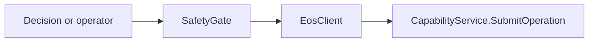

[中文](../../../../docs_cn/ei/design/governance/safety.md)

中文 · Core overview

All planner and operator actions pass through `SafetyGate`. Remote calls resolve against the current discovery catalog by the exact triple `(robot alias, device_id, primitive name)`. Missing, ambiguous, unknown, or stale targets are rejected before transport. The MVP has no Agent-local execution path.

## Implementation map and outputs

`gate.py` owns ordinary admission and returns a verdict with admission, reason and optional EOS acknowledgement. `audit.py` consumes fault observations, coalesces recovered episodes and escalates unrecovered conditions through the monitor-owned latch. `action_list.py` is a pure advisory conflict assessment; it does not execute or reserve devices. The gate reserves an owner-only operation ID checkpoint before SubmitOperation and settles it only from a terminal EOS receipt. Startup queries pending IDs with GetOperation; it never resubmits them.

An EOS acknowledgement has two distinct admission levels:

- `primitive.ack.accepted` says EOS admitted the release.

A backend refusal is a normal result. A transport or malformed-ack failure is reported as `egress_failed` without synthesizing an acknowledgement.

## Primitive visibility

- standard primitives discovered from EOS are planner-visible;
- operator primitives require EOS exposure and `primitives.expose_operator = true`;
- privileged `motion.stop` and `safety.estop` are never planner-visible.

The operator WebSocket invokes the same gate and cannot bypass these rules.

## Fleet emergency sequence

1. sends `motion.stop` to every discovered device whose class is `base`, `arm`, or `gimbal`;
2. sends one process-wide `safety.estop` with an empty device target;
3. records the endpoint's current EOS UUID in the fleet latch.

Calls are best effort across the entire fleet: a failed call is recorded and does not prevent attempts against other devices or endpoints. Re-engaging an already engaged latch is idempotent.

## Monitor interaction

The monitor owns emergency escalation and may call the link directly for stop operations. Ordinary work still follows:

## Gate order and conditions

The gate evaluates the emergency latch, caller visibility, primitive and target resolution, canonical argument schema, device limits, configured policy, runtime state constraints, and rate or cooldown limits before transport. The first failed check returns a stable rejection reason and writes an audit observation; later checks and transport do not run. Missing, duplicated, stale, or ambiguous registry entries fail closed. Boolean values do not pass numeric checks, non-finite values are invalid, and a required limit that the device omits makes that invocation unavailable.

Emergency engagement creates a barrier before stop calls begin, preventing new workload from racing the fleet stop. Unknown or vanished targets, partial fleet discovery, backend refusal, timeout, and transport failure are recorded independently and cannot clear the barrier. The action-list conflict checker is currently advisory scaffolding; it does not add a second execution path or weaken the gate.

## Registered node behavior

**Inputs:** proposal, registry, latch. **Outputs:** admission, rejection. The [stage dataflow design](../pipeline.md) describes EI runtime values. IsOS owns the graph port and setting contract, including wire priority and frequency.

**Algorithm and failure:** Check latch, target identity, exact capability, argument schema, device limits, policy, runtime state and rate window in order; record the first stable denial. Only admitted requests use the fixed internal link route. EOS performs final physical admission.
