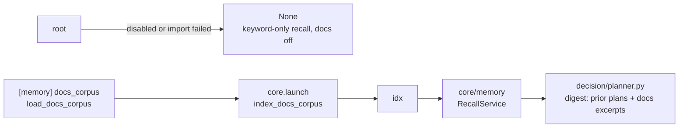

[中文](../../../../docs_cn/ei/design/optional/memory.md)

## Contents

- [Architecture](#architecture)
- [API](#api)
- [Design](#design)
- [Testing](#testing)

## Architecture




- `plans_ids` / `documents_ids`: `id TEXT PRIMARY KEY` — the id-mapping tables bridging caller-chosen string ids to integer rowids.
- `plans_vec` / `documents_vec`: `CREATE VIRTUAL TABLE ... USING vec0(embedding float[<dim>])` — the two `vec0` virtual tables.

## API

`SqliteVecIndex(path, *, dim=256)` opens (creating if needed) the database and loads the sqlite-vec extension. The five Protocol methods:

- `index_plan(plan_id, text)` / `index_document(doc_id, text)` — add or replace the entry's embedding of `text` under the string id.
- `search_plans(query, limit)` / `search_documents(query, limit)` — the `limit` ids nearest to `query`, best first; `[]` for `limit <= 0`.
- `close()` — release the connection (part of the `RecallIndex` Protocol).

`embed_text(text, dim=256)` is the deterministic embedder (exported for tests and reuse); `EMBEDDING_DIM = 256` the default dimensionality. The module raises `ImportError` on import when sqlite-vec is absent — the message names the `vec` extra and the degradation.

Minimal example — indexing and searching one plan row:

```python

index.index_plan("p-1", "dock the robot at the station")
# plans_ids: ("p-1") -> rowid N;  plans_vec: (rowid N, embedding float[256])
index.search_plans("dock at the station", 2)  # -> ["p-1", ...] best-first
index.close()
```

## Design

### Embedding input construction

The index is text-agnostic: callers provide a string. Documents are indexed whole. Plan text is assembled from the order plus one `primitive action(s) -> outcome` line per step; a final-only step renders `final -> outcome`. Document retrieval is independent of the persisted plan shape.

### The hashing embedder

`embed_text` is a deterministic local signed-hashing embedder — the offline MVP. Tokens are lowercase alphanumeric runs (`[a-z0-9]+`); each token contributes $\pm 1$ at one hashed slot, then the vector is L2-normalized:

$$ \text{slot}(t) = \operatorname{int}(\text{sha256}(t)[:4]) \bmod d,\qquad v_{\text{slot}(t)} \mathrel{+}= \begin{cases}+1 & \text{sha256}(t)[4]\ \text{even}\\ -1 & \text{odd}\end{cases},\qquad \hat{v} = \frac{v}{\lVert v\rVert_2} $$


### Query path

`_search` embeds the query with the same embedder and runs one KNN query per table:

```sql
SELECT v.rowid, i.id FROM {table}_vec v
JOIN {table}_ids i ON i.rowid = v.rowid
WHERE v.embedding MATCH ? AND k = ?
ORDER BY v.distance
```

with the query vector serialized via `sqlite_vec.serialize_float32`. Because indexed and query vectors are L2-normalized, ordering by L2 distance is cosine-equivalent ($\lVert u-v\rVert^2 = 2 - 2\cos(u,v)$ for unit vectors). `limit <= 0` short-circuits to `[]`.

### Replace semantics

`_index` keeps the id-mapping rowid and the `vec0` rowid paired: an existing id's vec row and mapping row are deleted, a fresh mapping row is inserted, and the embedding is written under its `cursor.lastrowid`. Re-indexing an id therefore replaces its entry — the Protocol contract — without accumulating stale vectors.

### Degradation without the extra

If sqlite-vec is unavailable, composition builds no index. `RecallService` continues with keyword plan search, disables docs retrieval, and treats `index_plan` as a no-op; startup does not fail.


## Testing

Method: unit tests over a real sqlite-vec database in `tmp_path`, plus planner-level stubbed integration (fake model + admitting gate, real stores and index) and composition-root tests that monkeypatch `sys.modules` to simulate a broken opt import.


- embedder determinism (case-insensitive tokens), L2 normalization, and the zero vector for tokenless text;
- vector ranking where keyword `LIKE` on the full order string misses both candidates;
- `RecallService` merging vector hits reference-first and deduping across stores and channels;
- degradation with no index (keyword-only, docs off, `index_plan` no-op);
- the planner's "Relevant docs:" prompt section, and the concluded plan being indexed for the next mission's vector recall.

Run (the extra is required for anything to execute rather than skip):


Pass criteria: with the extra, all tests pass; without it, the vec-dependent tests skip and the two `build_recall_index` degradation tests still run and pass. The skip semantics are guardrails, not masking: `RecallService.index_plan` behavior on stepped plans is pinned by `test_index_plan_renders_v2_steps` with a stub index (it runs in the default environment too), while the sqlite-vec-backed query paths (`test_vec_recall.py`'s KNN and replace tests) skip until the extra is installed.
