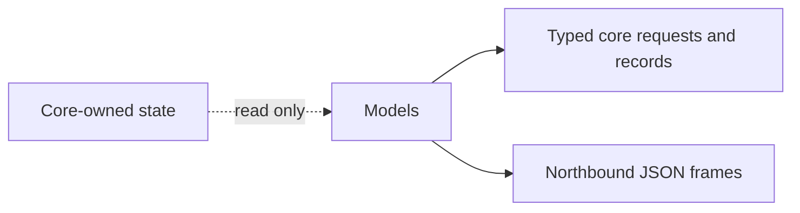

[中文](../../../../docs_cn/ei/design/runtime/api.md)

## Contents

- [Architecture](#architecture)
- [Data flow](#data-flow)
- [Conditions](#conditions)
- [Related documentation](#related-documentation)

## Overview

EI models define typed northbound requests, core records, and operator projections. The models validate commands and keep state ownership with their producers.

## Architecture

## Owned modules

`chat.py`, `invoke.py`, and `review.py` define command requests and their success or error replies. `mission.py` defines mission commands, lifecycle records, history, documents, and table snapshots. `plan.py` defines semantic plan graphs, edits, execution records, and operator projections.

`context.py`, `observation.py`, and `perceptions.py` describe bounded model context and admitted observation projections. `model_io.py` describes model messages, exchanges, activity, agent status, and the combined model-I/O frame.

`primitives.py`, `skills.py`, and `prompts.py` describe discovered catalogs and the static prompt projection. `skills.py` also owns strict tagged skill commands, cursor requests, acknowledgements, errors, and complete execution snapshots. `status.py` describes aggregate runtime health, subsystem health, safety state, backend connection state, and per-device status.

## Data flow

Northbound frames enter typed request models before EI changes core state.

Core records flow in the other direction. Projection models select operator-visible fields while preserving stable robot aliases, device IDs, correlation IDs, timestamps, revisions, results, and failure reasons. They do not become an independent source of truth; mission, memory, perception, and link owners retain canonical state.

Decision graphs require unique node IDs, known references, no self-reference, and an acyclic `after` dependency relation.

## Conditions

Normal input produces a typed value or a JSON frame with the exact documented enum literals and field names. Empty optional collections remain empty, optional snapshots may be absent until their producer publishes, and nullable result or reason fields retain their semantic distinction.

Malformed JSON is rejected by the northbound adapter before these models run. Structurally invalid values, unknown fields on strict command models, invalid enum values, bad bounds, inconsistent acknowledgement fields, duplicate graph nodes, unknown dependencies, self-dependencies, and dependency cycles fail validation and do not mutate core state.

## Related documentation

See [EI runtime interface](../../interfaces/runtime.md) for WebSocket routes, [runtime IO design](io.md) for adapter ownership, [mission design](../cognition/missions.md) for mission state, [decision design](../cognition/decision.md) for plan execution, and [memory design](../cognition/memory.md) for stored plan records.
