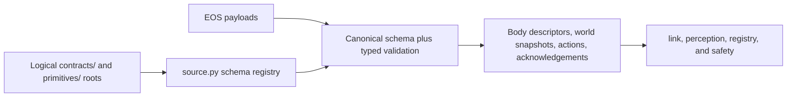

[中文](../../../../docs_cn/ei/design/runtime/contracts.md)

## Contents

- [Architecture](#architecture)
- [Data flow](#data-flow)
- [Conditions](#conditions)
- [Related documentation](#related-documentation)

## Architecture

## Owned modules

`source.py` resolves JSON documents through collision-checked `SharedResources`, loads every schema, and builds the cross-schema registry. `validate.py` applies canonical JSON Schema and Pydantic validation. `registry.py` maps resource and primitive kinds to schema paths and Python models. `endpoints.py` classifies world-resource URIs and declares supported resource and primitive kinds. `limits.py` parses numeric capability intervals and checks invocation arguments.

## Data flow

Startup scans JSON below logical `contracts/` and `primitives/` and registers every non-empty `$id`. A southbound object is checked against its canonical schema and then converted to its typed model. Discovery combines protobuf common fields with the body contract selected by `device_class`; world resource payloads select their model by URI and discriminator.

Primitive discovery maps the exact `{name, version}` descriptor to the corresponding action schema. The descriptor version must be SemVer and equal that schema's `x-island-primitive-version`. Before egress, portable argument shape is validated and numeric values are checked against the selected device limits. EOS acknowledgements are validated, including `primitive_version`, before becoming safety verdicts or operator-visible results.

## Conditions

A normal payload produces exactly one typed body descriptor, world snapshot, command, or acknowledgement. Nullable world fields stay `null`; absence is not converted into healthy data. Body `configuration` and `operational_state` fields required by the selected class must be present, and explicit unknown values remain null only where that schema permits them.

Configuration fails when resources are used before `configure`, a logical file is missing, JSON is malformed or not an object, a schema lacks `$id`, two schemas reuse an `$id`, or a Draft 2020-12 registry cannot be built. Payload validation fails on canonical-schema or typed-model mismatch. Unknown device classes, primitive kinds or versions, resource kinds, and schema names are rejected rather than passed through.

Numeric ranges reject booleans and non-numbers, non-finite endpoints, ranges without an endpoint, exclusivity without its endpoint, empty intervals, missing required limit names, and unknown limit names. Invocation rejects an argument whose capability was not advertised or whose value falls outside the admitted interval.

Accepted acknowledgements require null rejection fields. Rejected acknowledgements require a non-empty `reason` and a canonical `reason_code`; all acknowledgements require an exact SemVer `primitive_version`. `speaker.play` rejects missing stream identity, invalid media types or base64, oversized chunks, negative sequence values, and unknown fields.

## Related documentation

See [EOS exchange design](../io/eos-exchange.md) for the EOS interface, [EI runtime interface](../../interfaces/runtime.md) for generated northbound schemas, [link design](../io/link.md) for transport, [perception design](../evidence/perception.md) for admission, [registry design](../io/registry.md) for target binding, and [Island shared contracts](../../../island/architecture.md#cross-owner-contracts) for resource-root ownership.
