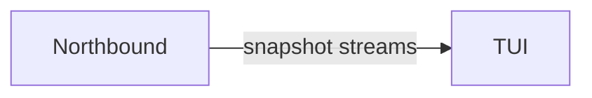

[中文](../../../../docs_cn/ei/design/runtime/extensions.md)

## Contents

- [Architecture](#architecture)
- [Data flow](#data-flow)
- [Conditions](#conditions)
- [Related documentation](#related-documentation)

## Architecture

## Data flow

Process output and WebSocket frames are normalized into bounded display state. Rendering changes presentation only; stable robot IDs, device IDs, mission revisions, correlation IDs, and backend reasons remain attributable to their source.

## Conditions

An unavailable feed, refused connection, or reconnect delay affects that view without granting a fallback execution path. Command timeouts and server close code 1013 remain operator-visible. In attach mode the console owns no runtime child; in wrap mode a child startup failure is reported instead of being mistaken for a connected runtime.

## Related documentation

The shared terminal workbench is launched with `isos tui` through the IsOS server.
