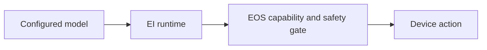

# EGI Agent terminology

[中文](../../../docs_cn/ei/design/terminology.md) · [EI overview](../README.md) · [EOS interface](../interfaces/eos.md)

**EGI** means **Embodied General Intelligence**. **EGI Agent** is the EI runtime in this repository. It hosts configured models and coordinates perception, context, planning, memory, missions, safety-gated primitives, and recovery.

EI owns cognition and its proposal gate. EOS owns device integration, final command admission, and physical safety. IsOS owns the saved graph and supervised process lifecycle. Public commands and configuration use the `ei` package and paths described in the [EI overview](../README.md).
