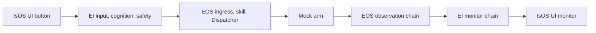

# IsOS architecture

<!-- doc-navigation:start -->

Folder: isos/core

Browse documents and subfolders here.

- [Parent folder](../README.md)
- Documents in this folder:
  - [IsOS core](README.md)
  - [IsOS CLI](cli.md)
  - [IsOS configuration](config.md)
  - [Local core logs](logger.md)
  - [IsOS packages](pkg.md)
  - [IsOS roadmap](roadmap.md)
  - [IsOS server](server.md)
  - [IslandOS services](service.md)
- Subfolders:
  - [ui/](ui/)

<!-- doc-navigation:end -->

[中文](../../../docs_cn/isos/core/architecture_cn.md) · [Design index](README.md) · [Interfaces](../interfaces/README.md)

IsOS owns the saved graph revision, exact package verification, Apply, the local API, and deployment run identity. It is the control plane for a robot runtime: registered node types describe placement and typed ports, instances supply identity and settings, and each owner runs only its admitted projection. The owning [node](../interfaces/node/README.md), [package](../interfaces/package/README.md), and [manager](../interfaces/manager.md) contracts define fields and wire behavior.

## Current runtime boundary

Graph `0.2.1` contains `isos`, `ei`, and `eos` cores. IsOS merges owner catalogs, validates the package-free 17-node [starter graph](../../../crates/isos/templates/generic-graph.toml) or the 17-node [mixed example](../../../examples/mixed-mujoco.nodes.json), and sends EI and EOS only their own projections. The mixed example requires the verified `island/mujoco-sim@0.2.4` package and its configuration. The starter graph's command chain runs from the UI button through EI's gate to EOS's Dispatcher and mock arm. The mixed example leaves that chain without an activation source, so it cannot command the arm. A separate read-only chain returns arm observations through EOS and EI to the UI monitor; it creates no actuator route.

EOS durably accepts each command event before replying and exposes its eventual result by event ID. EOS checks its local arm sample independently of UI readers. EI and EOS each supervise a persistent owner service and a worker; IsOS starts or reconnects to those services, queries their Status separately, and records their Stop confirmations. Stop and run replacement clear old monitor values. See [owner health](server.md) and the [control path](server.md) for current mechanisms.

## Cross-owner contracts

IsOS admits the complete typed graph and distributes owner projections. Each owner revalidates its own payloads, run identity, and revision; a graph edge alone never grants another core actuator authority. The graph declares routes, while owner services carry live values. IsOS aggregates owner status and logs without replacing EI's safety gate or EOS's Dispatcher. The exact wire behavior remains in the owning interface trees.

IsOS maintains the shared contract source in `contract/`: saved graph and registered node schemas under `node/`, and cross-owner EOS service and payload definitions under `proto/`. Generated runtime schemas live under `schemas/actions/`, `schemas/body/`, and `schemas/world/`, EI northbound schemas under `schemas/northbound/`, and North HTTP OpenAPI under `schemas/north-http.openapi.json`. EI and EOS consume these definitions read-only, validate their selected projections and payloads, and retain responsibility for safety and execution. Protobuf package names and JSON Schema IDs remain independent of the source directory. EI's northbound WebSocket models and transport live in `ei/io`; shared EI runtime records live in `ei/core/system/models`. IsOS remains the authority for shared schema edits, the graph, and deployment state.

For the source move, run `ei/.venv/bin/python scripts/generate_eos_contracts.py --check`, `ei/.venv/bin/python scripts/generate_north_http_openapi.py --check`, `ei/.venv/bin/python scripts/ei/check_northbound_schemas.py`, `cd ei && .venv/bin/pytest -q`, `python3 -m unittest crates/isos/tests/test_product_installer.py -q`, and `python3 scripts/check_doc_links.py --all`. These checks passed on 2026-11-16 (EI: 744 tests). A full `cargo test --workspace --quiet` compiled the workspace but failed in two existing `aether-runtime` `package_observer` cases because their fixture graph connects mismatched data classes; the contract source move does not change those fixtures. The complete Rust output is under ignored `data/test/20261116-ei-boundary/shared-contract-cargo.log`.

Future direction: [roadmap](roadmap.md).
