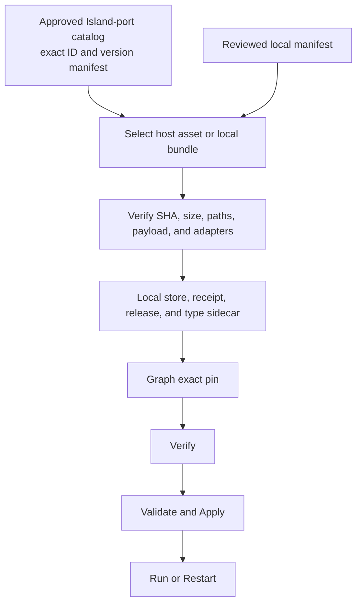

# IsOS packages

<!-- doc-navigation:start -->
<details>
<summary>Folder: isos/core</summary>

Browse documents and subfolders here.

- [Parent folder](../README.md)
- Documents in this folder:
  - [IsOS core](README.md)
  - [IsOS architecture](architecture.md)
  - [IsOS CLI](cli.md)
  - [IsOS configuration](config.md)
  - [Local core logs](logger.md)
  - [IsOS roadmap](roadmap.md)
  - [IsOS server](server.md)
  - [IslandOS services](service.md)
- Subfolders:
  - [ui/](ui/)

</details>
<!-- doc-navigation:end -->

[中文](../../../docs_cn/isos/core/pkg_cn.md) · [Core index](README.md)

## IsOS package manager: current path and future design

[中文](../../../docs_cn/isos/core/pkg_cn.md) · [Current package admission](README.md) · [Release contract](../interfaces/package/README.md#release) · [Architecture targets](roadmap.md#target-architecture-not-implemented)

**Status:** current package behavior and marked future design. Sections labeled as targets do not describe implemented behavior. Package, graph, node profile, process, simulator, and IsOS product versions are independent.

## Current package manager, as implemented



IsOS currently calls the Island-port catalog at `https://www.os-island.com/api/packages/v1` for search and exact release metadata. `isos pkg install` selects a platform asset from a release, downloads over HTTPS, checks its declared size and SHA-256, rejects unsafe archive paths and symlinks, validates declared executables/resources/adapter libraries, and atomically publishes a store directory. `isos pkg link` accepts an explicit local bundle and manifest, records its fingerprint, and requires relinking after changed bytes. `isos pkg install --source <absolute-checkout> --allow-source-build --version <exact-version>` records a local source checkout. Apply and Run reuse the installed candidate when the checkout is clean, HEAD matches the receipt, and installed bytes pass verification; a changed source commit rebuilds before admission. A failed build leaves the previous candidate intact and rejects that operation. The store uses the user's data directory under `packages/<namespace>/<name>/<version>`, with a schema-2 receipt, canonical `release.json`, and optional generated `node-types.json` sidecar. Nothing is installed or started merely because it appears in search results.

These are two distinct install modes for an exact pin. A source install keeps `source_kind=local_source` and checks the clean checkout and verified installed payload before graph admission; `isos pkg refresh-sources` does the same for source pins in the bound graph on demand. An explicit `isos pkg install --source` rebuilds even when HEAD is unchanged. A catalog install keeps the verified downloaded release bytes and never switches to a local checkout. `./install_dev.sh` refreshes the bound graph's source pins by default after building IsOS, EI, and UI; pass `--no-source-refresh` to skip that step. Catalog-installed releases are never refreshed by this command.

The 2026-11-18 local cache replay is under ignored `data/test/20261118-source-build-cache/`. After one changed-HEAD Apply, `target/debug/isos --deployment default pkg refresh-sources` reused the verified MuJoCo package in 0.80 seconds, and an unchanged Apply logged `source_build_cached`. An untracked checkout file was rejected. The subsequent Run started EOS, EI, and the package service without a source build; its 28.47 seconds include owner and service startup. Reproduce the code checks with `cargo fmt --all -- --check`, `cargo clippy -p isos --bin isos -- -D warnings`, and `cargo test -p isos source_install_tests`.

Graph nodes select an exact package `{id, version}`. IsOS rechecks the receipt, release hash, complete payload hash, sidecar, registered node type, resource IDs, owner, and lifecycle capability during graph admission and Run/Restart. Removal is refused while saved or active graph state refers to that exact pin. The package ID and executable filename do not select special runtime behavior. EOS owns its hardware adapters and command admission; an IsOS-verified package declaration does not grant an actuator route. Numeric legacy manifests are rejected; installed packages must supply the current contract.

Current CLI includes search, info, install, link, list, verify, remove, update, upgrade, node-set preview, check, release, publish, and upload. Current HTTP includes list, install, link, and preview-link under `/api/isos/v1`. The published package contract is `isos.package@v1` with manifest schema `0.1.0`. There is **no general dependency solver, transactional graph/package upgrade, offline registry trust cache, or signed registry trust root** yet. `isos update` lists unified GitHub releases; `isos upgrade` checks and installs a newer verified product bundle. `isos doctor` reports local identity and readiness.

`pkg update` derives its query set from distinct verified local package IDs and probes only that ID's next contiguous approved exact patch releases, capped at 32 requests. It starts at the highest installed stable semantic version, stops at the first missing patch, and does not discover other major/minor lines. It compares the last verified result against the installed version and writes bounded schema-1 discovery state at `state/package-updates.json` under the selected IsOS data directory. Per-ID catalog failure remains visible without preventing checks for other IDs. The snapshot has no TTL because `pkg upgrade` re-fetches the selected exact release; the snapshot cannot authorize a download. `pkg upgrade` checks that the complete verified installed inventory still matches the snapshot, then reuses exact release preview, asset-bound consent, and the install verifier. The new version is stored beside existing pins. Neither command edits graph revisions, Applied state, or active workers. The [package CLI contract](../interfaces/package/README.md) owns the operator behavior.

A published GitHub release with incomplete Island-port submission can recover the exact older version even after later releases exist; a draft or missing exact GitHub release cannot use this path. The recovery rechecks the published asset bytes and managed replay before catalog submission. Focused release-sequence tests, the full IsOS suite, formatting, Clippy, and bilingual links passed on 2026-11-13; complete commands and output are under ignored `data/test/20261113-release-recovery-order/`.

The catalog is populated only after the checked publication path completes. The release gate advances one patch at a time from the latest remote `v0.2.x` tag and checks that the exact catalog record is absent. A checked `0.2.3` candidate cannot bypass an unpublished `0.2.2`; each version needs its own checked source commit, immutable `v<version>` tag, matching qualification, exact-byte rebuild and download verification, and successful catalog submission. This publication order is independent of local side-by-side installs and of graph repinning. The [package interface](../interfaces/package/README.md) defines the executable gate.

Before any remote package download, IsOS previews the exact release and requires an explicit operator approval bound to that preview. A changed release, digest, or asset invalidates the approval. Local `link` does not download. A `v0.2.x` source release is qualified with `isos pkg check --source <absolute-checkout> --version <exact-version> --output <empty-absolute-directory> --graph <candidate-graph>`; schema `0.2.1` repeats `--graph` for every declared runtime service and adds `--package-config <absolute-TOML-file>`. The check rebuilds, installs in isolation, probes the required native ABI, validates exact configuration and preset coverage, then replays service startup, EOS readiness, all selected observations and command modes, rejection, run-fenced logs, Stop proof, and socket cleanup. `isos pkg release --checked <directory>` requires the passing qualification and matching immutable tag, repeats the replay against freshly downloaded assets, then publishes GitHub and Island-port metadata. A published fix uses the next patch number. See the [package interface](../interfaces/package/README.md) for the exact gate and failure behavior.

## Target ownership map

| Owner | May do | Must not do |
| --- | --- | --- |
| IsOS package manager | Verify registry metadata, manifests, assets, local receipts, compatibility, graph references, and staged updates; maintain installed inventory and audit evidence. | Interpret an opaque hardware payload as authority, start an unadmitted process, silently change an applied graph. |
| IsOS graph manager | Pin exact package releases and node/profile versions; atomically validate and apply revisions. | Resolve `latest` at Run, auto-rewrite user graph settings, or bypass package verification. |
| EOS | Validate EOS-owned package contributions, supervise its simulator/backend child when required, and control all actuator admission and Stop through Dispatcher. | Trust package metadata alone as a device grant or create a second actuator route. |
| EI | Validate EI-owned extensions and run intelligence workloads under its lifecycle contract. | Directly write the applied graph or actuators. |
| Public registry | Publish reviewed, non-sensitive release metadata and immutable assets for public packages. | Hold real hardware setup, secrets, calibration, device identities, or private debug evidence. |
| Private registry / integration repository | Hold access-controlled hardware packages and setup evidence, with the same package contract and verification rules. | Leak private metadata into the public index, source snapshot, logs, or release notes. |
| IsosUI | Present search, installed inventory, plans, verification and update consent through IsOS APIs. | Download, install, or start packages independently of IsOS. |

The private integration repository holds hardware-specific source. A private package registry is a separately controlled distribution channel; the source repository itself is not automatically a safe package registry. Registry credentials live in the user's credential store, never in graph files or tracked configuration.

## Version and support map

A checked-in `config/version-support.toml` is the local compatibility authority for the IsOS build. It is generated or verified against the actual registered contracts in CI. It names the product version, accepted graph formats, exact package manifest identities, node/profile versions, IsOS↔owner process contracts, EOS/EI interface contracts, and package constraints. The runtime uses this map whether online or offline. Registry metadata can offer an update but cannot widen compatibility for an already installed binary.

**Current implementation slice:** the bundled map reports product, target graph, HTTP, and package contract identities through the CLI and HTTP version surfaces. Package manifest admission reads the map for its contract and schema. IsOS setup identity requires the selected EOS/EI product versions before launch and readiness. Apply/Run graph and owner checks use their current validators; wider admission integration remains target work.

| Identity | Example/current value | Target check |
| --- | --- | --- |
| IsOS product | `0.2.3` | Display, provenance, and release selection; never a substitute for interface checks. |
| Registered type/profile | `isos.<layer>.<name>@v0.2` | Exact type ID, placement, settings, ports, capability and owner. |
| Package manifest | `isos.package@v1`, schema `0.2.1` today | Exact contract/schema accepted by the importer; live store contains normalized current records. |
| Package release | `{id, version, source commit, asset digest}` | Exact immutable pin and host-matched asset. |
| EOS/EI/process wire | Independently versioned contracts | Handshake on exact supported contract set before ready; reject mismatches and stale revision/generation. |


## Registry model

For v0.2.1, keep **Island-port as the public package metadata catalog**, use **GitHub for the public IsOS product release and approved package assets where appropriate**, and use a separate authenticated channel for private hardware packages. The registry client interface remains independent of the host. Use two package channels under that client contract:

1. **Public:** a reviewed, immutable release index for non-sensitive packages, with search/discovery, exact release metadata, asset digest/size/platform, contract declarations, publisher provenance, review status, and revocation status. Anonymous reads can work if available; author publication requires authentication and review.
2. **Private:** an access-controlled index for real hardware packages, driver builds, calibration-dependent adapters, and field evidence. Login grants discovery and download; a package's presence is not authority to control a device. The public search response must not reveal private package names or metadata.

A registry entry is metadata, not executable trust. The target trust chain is a pinned registry trust root plus signed, expiring index/release metadata and content-addressed assets. CI and clients verify signatures, freshness, rollback protection, asset digests, and publisher/review policy. Until this trust chain is implemented, the existing exact approved catalog and digest verification remain the documented current boundary; do not claim signatures are present. An offline cached index may be used only within its signed validity period. A stale cache can display inventory but cannot authorize a new install. Installed exact pins remain usable offline after full local verification if their policy has not been revoked in the last trusted snapshot; define revocation expiry explicitly before implementation.

**Publication workflow:**


Corrections create a new release; do not overwrite bytes under an existing `{id,version}`. Revocation marks a bad release unavailable for new installs and gives a bounded reason; it does not silently delete an installed package or stop a running actuator without an explicit safety policy.

## Operator workflow map

```mermaid
flowchart TD
  source["Discover or select local source"] --> inspect["Inspect exact release, channel, contracts, platform, and provenance"]
  inspect --> plan["Compare support map, graph pins, owner capability, and dependencies"]
  plan -->|Incompatible| incompatible["Report exact field; no mutation"]
  plan -->|Compatible| consent["Consent to install, link, or update"]
  consent --> stage["Fetch to staging and verify policy, manifest, digest, and safe tree"]
  stage -->|Failure| cleanup["Delete staging; installed package, graph, and run unchanged"]
  stage -->|Verified| publish["Atomically publish immutable package version and receipt"]
  publish --> graph["Validate proposed graph revision and owner projections"]
  graph -->|Failure| unselected["Keep package installed but unselected; run unchanged"]
  graph -->|Valid| apply["Apply exact revision"] --> ready["Readiness preflight"] --> run["Run or Restart"]
  run --> monitor["Monitor, safely Stop, then explicitly remove unreferenced old packages"]
```

| Operation | Required inputs | State effect | Rejection behavior |
| --- | --- | --- | --- |
| Search/info | Channel, query or exact ID/version | Read only. Online result is discovery, not approval. | Offline/auth failure reports status; local inventory still works. |
| Plan install | Exact release, platform, local support map | Read-only compatibility and dependency plan. | Precise unsupported contract, missing dependency, platform, or policy path. |
| Install | Exact release and operator consent | Publish immutable verified store version; graph/run unchanged. | Remove staging, keep prior version. |
| Link (development/private) | Exact local manifest and bundle | Record verified local fingerprint; graph/run unchanged. | Changed bytes require explicit relink; no automatic trust of a local path. |
| Verify | Exact installed pin or all selected pins | Read only; hash receipt, manifest, payload, sidecar, adapter files. | Fail closed with bounded diagnostic; no attempted repair in Run. |
| Select / Apply | Exact graph pin and revision | Atomically changes desired graph only after all owners validate. | Saved bytes/revision and active run unchanged. |
| Run / Restart | Applied revision, verified exact pins and owner readiness | Starts a revision-bound generation; EOS controls actuator safety. | No partial healthy result; safe Stop/uncertain outcome rules apply. |
| Remove | Exact installed pin | Delete only if no saved/active/recovery reference. | Refuse referenced package and name each reference. |


## IsOS product update versus package update

`isos update check` compares the installed IsOS product version with the latest **published** public `Island-Team/isos` release when network is available. IsosUI offers the same explicit check action; neither performs an automatic startup check. If GitHub access requires login, prompt for GitHub login; startup, Run, and local compatibility checks do not require login. If offline or unauthenticated, report `online status unknown` and evaluate the local support map. Never imply that a GitHub release alone makes local graph, packages, or wire contracts compatible.


## Hardware information and public disclosure

All **real hardware-specific** information belongs in the private integration repository or a more restricted private store: robot IDs/serials, calibration, device profiles, driver endpoints and LAN topology, credentials, field logs, captures, and debugging traces that identify a physical setup. Public `isos` may contain generic hardware interfaces, synthetic fixtures, mock adapters, redacted examples, and reproducible tests that use no real device identity. The public snapshot process must scan tracked source, every new commit, archives, generated bindings, docs, and fixtures; review each finding by owner. Do not use absolute user paths or true deployment configuration in either repository's reusable examples. Supply `.example` files and documented defaults, and keep active setup files ignored.

## Generic EOS process admission (2026-11-11)

IsOS now verifies a contributed `eos/process/...` node against its exact package bytes, resource selector, owner, and lifecycle adapter, then binds the accepted process to one run. It rejects a second EOS package process before selecting a backend for launch or Stop. At the earlier handoff checkpoint, the published `0.1.1` bridge remained readable but not executable, and a local `0.1.2` candidate could not pass execution admission. The current verified `v0.2.x` camera observer route is described in the [EOS package observer contract](../interfaces/server/eos.md#package_observer); package actuators remain gated.

From the repository root, `ISOS_AETHER_BIN_DIR="$PWD/target/debug" cargo test -p isos --bin isos`, `cargo clippy -p aether-node-profile -p aether-runtime -p isos --all-targets -- -D warnings`, and `python3 scripts/check_doc_links.py --all` passed. IsOS tests cover package process projection, duplicate-process rejection, lifecycle admission, direct-child handoff, and Stop accounting. Complete output and the replay script are in ignored `data/test/20261111-general-hal/`; the simulator bundle and link evidence are in its own ignored `data/test/20261111-general-hal/`.

## Download consent and source check evidence (2026-11-11)

The current checked release path verifies the immutable tag, source and archive bytes, qualification evidence, and freshly downloaded published assets before submitting metadata to Island-port. Schema `0.2.1` service packages replay all selected service graphs, observations, commands, rejection cases, logs, and confirmed Stop. See the [package release contract](../interfaces/package/README.md) for the executable procedure and recovery rules.

The generic package and core boundary was checked with `cargo fmt --all -- --check`, `cargo clippy --workspace --all-targets -- -D warnings`, `cargo test -p aether-node-profile --tests`, `cargo test -p aether-runtime --test profile_setup_packages`, `python3 scripts/check_doc_links.py --all`, and `python3 crates/isos/tools/check_isos_docs.py`. IsosUI passed typecheck, 212 tests, and local, hosted, and terminal builds. A serial workspace run passed with seven graph-file tests excluded because the pre-existing local edit to `config/graph-pool/demo.nodes.json` adds an unregistered camera instance; the full unfiltered run records those failures. Complete outputs are under ignored `data/test/20261112-generic-package-core-boundary/`.

From this branch, `cargo build -p aether-runtime --bin aether-profile`, `cargo fmt --all -- --check`, `cargo clippy -p isos --bin isos -- -D warnings`, `ISOS_AETHER_BIN_DIR="$PWD/target/debug" cargo test -p isos --bin isos --quiet` (300 passed, 2 ignored), `python3 scripts/check_doc_links.py --all` (378 files, 0 broken), `npm run typecheck`, and `npx vitest run src/services/isos/node-graph.test.ts` (23 passed) completed. The UI test environment used the locally installed dependencies; the host Node 18 is below the repository's Node 22 target and should be rechecked on Node 22 before merge.

## Implementation slices and acceptance

2. **Support map:** add the versioned file/schema, parser, consistency check against registered contracts, local CLI/HTTP status, mismatch diagnostics, and offline tests.
3. **Registry boundary:** separate public/private channels, authenticated private discovery, signed metadata and cache policy, immutable releases, revocation, and disclosure review. Do not couple registry login to IsOS startup.
4. **Package plan/update:** exact dependency and compatibility plan, side-by-side staging, operator consent, graph revision update, safe restart, rollback/uncertain outcome tests.
5. **Product update:** optional GitHub check and login, release verification, consent, staging, safe switch, rollback, offline fallback.
6. **Qualification:** clean-home install/link → graph Validate/Apply → owner readiness → camera/admitted control → failure/restart → Stop; test changed payload, stale index, wrong signature/digest/platform/contract, expired cache, revoked release, failed owner, and uncertain Stop. Save complete logs under `data/test/<run-id>/`.

## Package-owned hardware registration replay (2026-11-12)

The EOS built-in catalog now contains only mock hardware; verified releases own other hardware type definitions, including their layer and group placement. IsOS accepts `isos_node_v2` declarations and requires a verified type definition at Apply; historical service lists alone do not register types. The MuJoCo 0.2.2 candidate declares seven types and pins each instance at the type and adapter boundaries. This does not alter the published 0.2.1 bytes.

From the repository root, `cargo fmt --all -- --check`, `cargo clippy -p isos -p aether-node-profile -p aether-runtime --all-targets -- -D warnings`, `ISOS_AETHER_BIN_DIR="$PWD/target/debug" cargo test -p isos`, `cargo test -p aether-node-profile`, `cargo test -p aether-runtime --tests`, `python3 scripts/check_doc_links.py --all`, and the UI typecheck, test, and build commands passed. `isos pkg check --source "$PWD/../isos-mujoco-sim" --version 0.2.2 --output "$PWD/data/test/20261112-package-node-mvp/qualification" --graph "$PWD/data/test/20261112-package-node-mvp/native-candidate-graph.json" --graph "$PWD/data/test/20261112-package-node-mvp/robocasa-candidate-graph.json" --package-config "$PWD/data/test/20261112-full-mujoco-ui/package.toml"` reported `qualified:true`, including Apply, readiness, interface commands, rejection, logs, and Stop for both graphs. Complete output is under ignored `data/test/20261112-package-node-mvp/`.

## Installed-package update CLI verification (2026-11-13)

From the repository root, `cargo fmt --all -- --check`, `cargo clippy -p isos --all-targets -- -D warnings`, `ISOS_AETHER_BIN_DIR="$PWD/target/debug" RUST_TEST_THREADS=1 cargo test -p isos`, and `python3 scripts/check_doc_links.py --all` passed. `ISOS_HOME=<empty-test-home> target/debug/isos pkg update` wrote an empty local snapshot without a catalog request; the corresponding `pkg upgrade` reported no catalog upgrades. Unit tests cover highest-version comparison, query scope, per-ID catalog failure, stale and duplicate snapshot rejection, catalog identity, and unscoped approval rejection. Complete output is under ignored `data/test/20261113-pkg-update-upgrade/`.

The `20261113-pkg-update-patch-discovery` check used `cargo fmt --all -- --check`, `cargo clippy -p isos --all-targets -- -D warnings`, `ISOS_AETHER_BIN_DIR=<source-checkout>/target/debug RUST_TEST_THREADS=1 cargo test -p isos`, and `python3 scripts/check_doc_links.py --all`. It also used the worktree binary with `ISOS_HOME=<source-checkout>` to confirm that locally installed `island/mujoco-sim@0.2.2` discovers approved `0.2.3`. Complete outputs are under ignored `data/test/20261113-pkg-update-patch-discovery/`. An initial full-test run without `ISOS_AETHER_BIN_DIR` failed five EOS-dependent tests due to the absent worktree binary; the configured rerun passed.

## Package admission and launch

This design explains the implemented path from an exact package pin to a run candidate. The [release](../interfaces/package/README.md#release), [resource](../interfaces/package/README.md#resources), and [process](../interfaces/package/README.md#process) pages own the public fields.

IsOS verifies the release and payload, resolves the registered node type and declared resource IDs, checks contained file digests, and selects the owner from registered placement. It uses the same exact-pin verifier during graph admission and launch. A package ID, executable filename, or metadata extension never selects a special parser. The owning core validates its lifecycle adapter and package-specific semantics before readiness.

The current typed Start/Restart wrapper groups the saved revision, ordered process specifications, resolved inputs, and ownership mode. The supervisor creates the run ID and manages readiness and stop. The bound handoff carries the verified executable and resources, selected owner, run ID, and revision. Only IsOS-owned direct children are supervised by IsOS. Today, package process handoff is supported for EOS; other owners return a typed unavailable error. Further plan consolidation and owner integrations are described in [architecture targets](roadmap.md#target-architecture-not-implemented).

Missing registered inputs are collected after connected-edge admission as warnings. Apply still runs package and owner validation, then publishes the authored graph unchanged. The saved graph read returns warnings independently from fatal diagnostics, so the workbench does not become read-only for an incomplete path.

Verification on 2026-11-14: `cargo fmt --all && cargo fmt --all -- --check`, `cargo test -p isos --bin isos -- --test-threads=1` (348 passed, 2 ignored), `cargo test -p isos --test edge_admission`, `cargo test -p aether-node-profile --test profile`, and `cargo test -p aether-runtime --bin aether-profile`, `cargo clippy -p isos -p aether-node-profile -p aether-runtime --all-targets -- -D warnings`, `ei/.venv/bin/pytest ei/tests -q` (757 passed), EI Ruff, Pyright and import rules, `cd ui && npm test && npm run typecheck && npm run build` (236 UI tests), and `python3 scripts/check_doc_links.py --all` passed. In an isolated dev home, a graph with disconnected EI and EOS activation inputs validated, Applied, reached Run readiness, rejected direct EOS activation with `activation_path_incomplete`, rejected a monitor read on a fully disconnected EOS chain with `monitor_path_incomplete`, and returned confirmed EI/EOS Stop. The full IsOS binary suite used `ISOS_AETHER_BIN_DIR=target/debug`, `ISOS_EI_BIN_DIR=ei/bin`, and `EI_PYTHON=ei/.venv/bin/python` as absolute paths. Complete outputs and the applied fixture are in ignored `data/test/20261114-incomplete-chain-warning/`.

## External package runtime follow-up

[中文](../../../docs_cn/isos/core/pkg_cn.md) · [Release contract](../interfaces/package/README.md#release) · [EOS node contributions](../interfaces/server/eos.md#node_contributions)

## Current support

IsOS verifies exact package pins, release and payload digests, contributed node types, and selected resources. The qualified in-process node ABI is `isos_node_v1` in a Linux `.so` built from C or C++. EOS can load contributed software nodes through this ABI. Owner processes are supervised outside the host process and admitted only when their lifecycle adapter is available. A package build file by itself does not establish ABI or runtime support. Unsupported owners, adapters, libraries, and platform assets fail closed.

## Future work

- Add an IsOS-owned external node capability probe and worker before accepting packages that require IsOS in-process node execution.
- Add a supervised Python process adapter with explicit interpreter, environment, startup, health, input, output, and Stop contracts. Do not embed Python in an IsOS, EI, or EOS host process; this avoids interpreter ownership and GIL coupling.
- Qualify other language bindings only after their generated C ABI tables, ownership rules, and failure tests pass against `isos_node_v1`.
- Add platform-specific library loaders and asset tags for non-Linux hosts. Until then, Windows and macOS native node assets remain unsupported, even if a package includes their build files.
- Add package check fixtures for each newly supported owner or platform, including ABI mismatch, changed bytes, missing dependencies, rejection, crash, and uncertain Stop.
