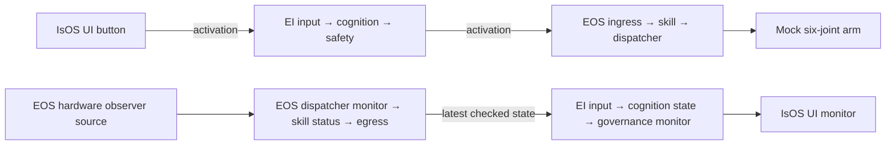

# IsOS architecture

[中文](../../../docs_cn/isos/design/architecture_cn.md) · [Design index](README.md) · [Interfaces](../interfaces/README.md)

IsOS owns the saved graph revision, exact package verification, Apply, the local API, and deployment run identity. Graph `0.2.0` contains `isos`, `ei`, and `eos` cores. IsOS merges owner node catalogs, validates the full 16-node graph and its 14 typed edges in two separate chains, then sends EI and EOS only their own core projections. The [starter graph](../../../crates/isos/templates/generic-graph.toml) and [node contract](../interfaces/node/README.md) define the current instance and type rules.

The button path is an admitted command route. EOS durably accepts the event before replying; its worker executes it independently and exposes a correlated result by event ID. The monitor chain has no graph edge from the command chain; its source reads the same mock adapter locally without another actuator. EOS checks local samples at 100 Hz and blocks movement on stale or invalid state until a fresh valid sample recovers it. EI refreshes one run-scoped latest snapshot at up to 20 Hz independently of readers. IsOS shares one validated EI snapshot for up to 200 ms among UI readers; the UI refreshes at up to 5 Hz. The owner exchanges fence run and revision, and Stop or run replacement clears prior values. IsOS does not make the arm's movement safety decision.

EI and EOS each own a persistent private owner service and a worker. IsOS starts missing services and reconnects after a manager restart; each owner supervises its own worker. Status queries both independently. Explicit Stop asks both to stop and persists their confirmations. The [runtime design](runtime/owner-health.md) describes owner replay and commands.

## Target architecture (not implemented)

Future algorithm nodes may replace the demo cognition and skill pass-throughs while preserving the registered type, payload, and owner boundaries. Future monitor delivery may use asynchronous, bounded latest-value queues with per-run sequence checks; the UI and EI must never create backpressure on EOS local sample validation. A transport change requires new owning interface contracts and rejection tests before it becomes a current behavior.

Other targets are one typed plan spanning graph admission, Apply, Run, and Restart; verified presentation descriptors bound to the exact output port, type, run, and revision; and public/private package registry trust roots with signed, expiring metadata, revocation, and an explicit offline policy. These targets require lifecycle and rejection qualification across unrelated package families and a real-owner replay through presentation, logs, and Stop. Keyboard focus loss, disconnect, lease expiry, and failed-stop recovery remain separate qualification cases.
