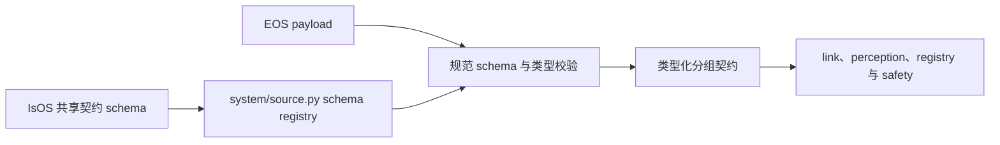

<!-- doc-navigation:start -->

目录：ei/core/runtime

浏览本目录的文档及下级目录。

- [上级目录](../README.md)
- 同级文档：
  - [EI 多后端运行](fleet.md)
  - [EI 操作员 IO 适配](io.md)
  - [optional](optional.md)
  - [EI 阶段数据流设计](pipeline.md)
  - [registry](registry.md)
  - [EI 运行时设计](runtime.md)
  - [沙盒层](sandbox.md)
  - [受监督 task 生命周期](supervisor.md)

<!-- doc-navigation:end -->

[English](../../../../docs/ei/core/runtime/contracts.md)

## 目录

- [架构](#架构)
- [数据流](#数据流)
- [运行条件](#运行条件)
- [相关文档](#相关文档)

## 架构

## 所属模块

IsOS 在 `contract/proto/` 维护共享南向载荷定义，在 `contract/schemas/` 保存生成的运行时 JSON schema。EI 包仅提供只读加载器、校验器和消费方类型模型。规范载荷形状的变更应先修改共享契约源码并重新生成 schema；EI 不编写该形状。

EI 契约模块按使用它们的节点分组组织：`io/link.py` 保存 EOS 设备、资源、原语、命令、确认和数值限制类型；`evidence/perception.py` 保存已准入的机身与世界快照类型；`governance/safety.py` 保存 action invocation、step context 和 gate verdict 值。目前只有这些分组需要类型化消费方契约。

非节点的 `system/` 模块提供共享机制：`source.py` 通过已检查 collision 的 `SharedResources` 解析 IsOS 管理的 JSON schema；`registry.py` 将已准入类型映射到模型和 schema 路径；`validate.py` 执行规范 JSON Schema 与 Pydantic 校验。这些模块消费契约定义，但不编写契约定义。

该布局在 2026-11-16 通过 EI 全量测试（744 项）、Ruff、Pyright、四项导入约束、干净的 wheel 构建和文档链接检查。从仓库根目录复现：`cd ei && .venv/bin/pytest -q`、`cd ei && .venv/bin/ruff check .`、`cd ei && .venv/bin/pyright`、`cd ei && PYTHONPATH=.:package .venv/bin/lint-imports --cache-dir ../data/cache/tools/import-linter-ei`、`uv build --project ei --wheel` 和 `python3 scripts/check_doc_links.py --all`。wheel 构建日志位于已忽略的 `data/test/20261116-ei-contract-groups/`。

## 数据流

启动时扫描逻辑 `contracts/` 与 `primitives/` 下的 JSON，并注册每个非空 `$id`。Southbound object 先按其规范 schema 校验，再转换为类型化 model。Discovery 把 protobuf common field 与 `device_class` 选定的 body contract 组合起来；world resource payload 根据 URI 和 discriminator 选择 model。

Primitive discovery 把精确 `{name, version}` descriptor 映射到对应 action schema。Descriptor version 必须是 SemVer，并等于 schema 的 `x-island-primitive-version`。Egress 前校验可移植 argument shape，再按选定 device limit 检查 numeric value。EOS acknowledgement 在成为 safety verdict 或操作端可见 result 前会连同 `primitive_version` 一起校验。

## 运行条件

正常 payload 生成且只生成一个类型化 body descriptor、world snapshot、command 或 acknowledgement。Nullable world field 保持 `null`；缺失不会被转换为健康数据。选定 class 所要求的 body `configuration` 与 `operational_state` field 必须存在，只有 schema 允许时，明确的未知值才可为 null。

在 `configure` 前使用资源、逻辑文件缺失、JSON malformed 或非 object、schema 缺少 `$id`、两个 schema 复用 `$id`，或无法构建 Draft 2020-12 registry 时配置失败。Payload 在规范 schema 或类型 model 不匹配时失败。未知 device class、primitive kind/version、resource kind 和 schema name 会被拒绝而非透传。

Numeric range 拒绝 boolean 和非 number、非有限 endpoint、没有 endpoint 的 range、缺少对应 endpoint 的 exclusivity、空 interval、缺失 required limit name 和未知 limit name。Invocation 在 capability 未公布或值超出准入 interval 时被拒绝。

Accepted acknowledgement 要求 rejection field 为 null。Rejected acknowledgement 要求非空 `reason` 和规范 `reason_code`；所有 acknowledgement 都要求精确 SemVer `primitive_version`。`speaker.play` 会拒绝缺失 stream identity、非法 media type 或 base64、超限 chunk、负 sequence 和未知 field。

## 相关文档

EOS interface 见 [EOS 交换设计](io.md)，生成的 northbound schema 见 [EI 运行时接口](../../interfaces/server_cn.md#runtime_cn)，transport 见 [连接设计](../io/link.md)，admission 见 [感知设计](../evidence/perception.md)，target binding 见 [注册表设计](registry.md)，资源 root 所有权见 [Island shared contracts](../../../isos/core/architecture_cn.md#跨所有者契约)。
