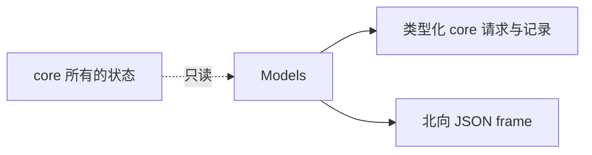
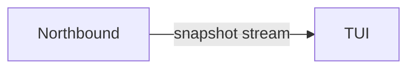

# EI 操作员 IO 适配

<!-- doc-navigation:start -->

目录：ei/core/runtime

浏览本目录的文档及下级目录。

- [上级目录](../README.md)
- 同级文档：
  - [contracts](contracts.md)
  - [EI 多后端运行](fleet.md)
  - [optional](optional.md)
  - [EI 阶段数据流设计](pipeline.md)
  - [registry](registry.md)
  - [EI 运行时设计](runtime.md)
  - [沙盒层](sandbox.md)
  - [受监督 task 生命周期](supervisor.md)

<!-- doc-navigation:end -->

[English](../../../../docs/ei/core/runtime/io.md) · [运行时接口](../../interfaces/server_cn.md#runtime_cn)

## 已发布状态

注入的 store 保存健康、后端、任务、上下文、规划器提示、模型 IO、原语、本地技能、场景和机身部件的可替换快照。流先发当前快照，再发较新版本。多机器人状态始终保留来源别名和设备 ID。

## 操作员输入

聊天或听觉输入成为已准入听觉观测。`/missions/command` 接收由服务器标注来源的操作员任务，并对待处理任务执行修订检查、优先级变更和取消。`/review` 进入记忆审核路径。`/primitive/invoke` 创建带明确目标的请求，通过注册表验证和普通安全门。`/skills/command` 精确解析所选机器人与技能身份，再交给专用 EOS `SkillService`；`/skills/execution` 验证单个游标请求并转发有序完整执行快照。

客户端不能指定任务来源、origin、score、生命周期状态或计划。任务命令仅改变规划输入，不能绕过原语验证、策略或安全门。没有 Agent 本地执行或栅格地图端点。[运行时接口](../../interfaces/server_cn.md#runtime_cn)定义具体路径与负载。

## 就绪状态

[北向线协议](../../interfaces/server_cn.md#runtime_cn)定义路径及负载。

## 数据生命周期与运行条件

每个可替换 store 拥有一个不可变快照及单调递增的进程内版本。订阅者先收到当前快照，再等待严格更新；替换会唤醒所有等待者。空 store 不产生领域值，Stop 返回 `None` 而不伪造最终帧。部件状态按稳定机器人与设备身份索引，不能合并同名设备。

目录投影把内部注册表转成经过操作员过滤、确定性排序的原语描述和独立版本的技能可用性。缺失后端、可选技能不可用和空目录都是有效快照；畸形发现会在链路准入处被拒绝。场景投影保留来源，并区分空场景和尚未收到场景。

监听绑定失败使启动失败。`/health` 在启动期间可用；其他来源未就绪时报告不可用。无 `Origin` 或配置的 Web UI 来源被接受，禁止的来源和未知路径不能进入领域逻辑。错误 JSON、类型校验、队列饱和、任务缺失、修订冲突、门控拒绝、出口失败和超时各有独立 wire 错误。客户端关闭时流取消等待任务；周期性健康和后端流继续轮询，版本化流只发替换。二进制输入须先解码 UTF-8 再验证 JSON。`accepted=false` 的有效后端确认仍是调用结果；传输或畸形确认是 `egress_failed`。

## 北向类型模型

模型迁移检查（2026-11-16）：Ruff、Pyright、全部 744 个 EI 测试、导入边界、北向 schema 对照、文档链接及干净的 wheel 构建均通过。wheel 不含 `ei/api` 包。可复现命令和构建输出位于已忽略的 `data/test/20261116-ei-io-models/`。

`ei/io` 负责外部传输处理器和序列化。`ei/io/models` 保存外部请求、回复及投影模型。`ei/core/system/models` 保存 core 与 IO 共用的记录。只有 `core/system/composition.py` 和 `core/system/launch.py` 为启动连接而导入 `io` 适配器；领域模块不导入。EI 实现该北向线接口。IsOS 在 `contract/schemas/northbound/` 维护共享 JSON Schema，并管理图及 IsOS 到 EI 的归属服务交换。EI 将线模型与这些 schema 核对；`scripts/ei/check_northbound_schemas.py` 仅执行检查。

### 概述

EI 模型定义类型化北向请求、核心记录和操作端投影。模型校验命令，状态仍由各生产者负责。

### 架构

### 所属模块

`chat.py`、`invoke.py` 与 `review.py` 定义命令请求及成功或错误回复。`mission.py` 定义任务命令、生命周期记录、历史、文档与表格快照。`plan.py` 定义语义 Plan 图、编辑、执行记录和操作端投影。

`context.py`、`observation.py` 与 `perceptions.py` 描述有界模型上下文和已准入 Observation 投影。`model_io.py` 描述模型消息、exchange、activity、Agent 状态与组合后的 model-I/O frame。

`primitives.py`、`skills.py` 与 `prompts.py` 描述已发现 catalog 和静态 prompt 投影。`skills.py` 还拥有严格 tagged skill command、cursor request、ack、error 和完整 execution snapshot。`status.py` 描述聚合运行时健康、子系统健康、安全状态、后端连接状态及逐设备状态。

### 数据流

北向 frame 先进入类型化请求模型，再由 EI 改变核心状态。

Core record 反向流向投影模型。投影模型选择操作端可见字段，同时保留稳定 robot alias、device ID、correlation ID、timestamp、revision、result 与 failure reason。投影不会成为独立事实源；Mission、memory、perception 与 link 所有者继续保存规范状态。

Decision graph 要求 node ID 唯一、引用已知、不能自引用，并且 `after` 依赖关系无环。

### 运行条件

正常输入生成类型化值或使用精确 enum literal 与字段名的 JSON frame。空的可选 collection 保持为空；生产者发布前可选 snapshot 可以不存在；nullable result 与 reason 字段保留各自语义。

Malformed JSON 在这些模型运行前由北向适配器拒绝。结构无效值、严格命令模型中的未知字段、无效 enum、越界值、不一致 acknowledgement 字段、重复 graph node、未知依赖、自依赖与依赖环都会校验失败，且不改变 core 状态。

### 相关文档

WebSocket route 见 [EI 运行时接口](../../interfaces/server_cn.md#runtime_cn)，适配器所有权见 [运行时 IO 设计](io.md)，Mission 状态见 [任务设计](../cognition/missions.md)，Plan 执行见 [决策设计](../cognition/decision.md)，存储的 Plan record 见 [记忆设计](../cognition/memory.md)。

## 终端工作台投影

### 架构

### 数据流

Process output 与 WebSocket frame 被规范化为有界 display state。Rendering 只改变表现；稳定 robot ID、device ID、Mission revision、correlation ID 与 backend reason 仍可追溯到来源。

### 运行条件

Feed unavailable、connection refused 或 reconnect delay 只影响相应 view，不授予 fallback execution path。Command timeout 与 server close code 1013 对 operator 可见。Attach mode 下 console 不拥有 runtime child；wrap mode 下 child startup failure 会被报告，不能误认为已经连接运行时。

### 相关文档

统一终端工作台通过 IsOS 服务运行，使用 `isos tui` 启动。

## 南向操作处理

IsOS 在 [`capabilities.proto`](../../../../contract/proto/capabilities.proto) 中维护共享能力和操作线协议契约。EI 使用生成的绑定，只准入与当前发现代次中的机器人、设备、primitive 和版本精确匹配的健康能力。Link 在 Submit、Watch、Get 和显式 Cancel 之间保留持久 operation ID。成功 Submit 只表示待处理，不代表物理执行完成。只有终态结果与 acknowledgement 的操作身份、primitive、版本和准入结果一致时，EI 才记录成功。拒绝、失败、取消、超时和未知结果都不算成功。如果响应或 watch 丢失，EI 使用同一 operation ID 查询；若仍无法确认结果，则阻止后续写操作。安全和任务设计描述相应 EI 状态；准确请求和响应字段由 EOS schema 定义。

## Eos Exchange

IsOS 维护共享线协议契约；EI 与 EOS 使用其生成的绑定。准确流程见 [EI–EOS 契约边界](../../../isos/core/architecture_cn.md#跨所有者契约)和 [operation 处理](#南向操作处理)。

## 数据流

\`\`\`mermaid
flowchart LR
  discover["Gateway discovery"] --> generation["Atomic robot/device generation"]
  capabilities["CapabilityService catalog"] --> binding["Exact ready capability join"]
  generation --> binding
  resources["Read/watch resources"] --> typed["Canonical schema validation"]
  binding --> registry["Executable registry"]
  typed --> perception["World + detection + ASR admission"]
  safety --> operation["SubmitOperation with operation_id"]
  operation --> terminal["WatchOperation terminal acknowledgement"]
  interrupt["Timeout or cancellation"] --> cancel["CancelOperation by operation_id"]
  cancel --> terminal
  terminal --> mission["Mission outcome + structured log"]
\`\`\`

每个可执行 binding 必须健康、匹配安装的精确版本 schema，并通过本地 policy。异常 binding 会保留用于诊断，但不可执行。刷新会原子替换完整 generation。

## 接口分组

- [机身](../../../../docs/ei/core/runtime/io.md)介绍 robot/device identity、状态、health、binding scope、rediscovery 和 status。
- [世界](../../../../docs/ei/core/runtime/io.md)介绍 typed world state、detection、speech、resource watch 和 camera capture。
- [Primitive](../../../../docs/ei/core/runtime/io.md)介绍 action version、持久 operation identity、终态、显式取消和不确定结果。
- [Skill](../../../../docs/ei/core/runtime/io.md)介绍专用 skill service 提供的 descriptor 与异步执行。

## Body

机器人描述符携带 `id`、`name`、`model`、`description`、运行 `state`、`health`、急停状态、可选电量百分比及机器人作用域原语绑定。`robot.stop`、`safety.estop` 等机器人作用域绑定使用空设备 ID 调用。

每个设备描述符携带 `id`、`class`、`part`、`description`、`state`、`health` 及设备作用域原语绑定。后端名称、驱动版本、端点、原始遥测、配置内部信息和媒体均不跨越该边界。

发现失败不会替换上一份完整代次。成功重新发现会一并移除已消失的设备、资源、技能和原语目标。监控器使用 `GetStatus.started_at` 作为 EOS 进程代次身份，并执行有界重新发现，避免健康状态和绑定长期陈旧。

## World

|---|---|---|
| `robots/{robot}/world/state` | `world.snapshot@1` | 融合实体与关系 |
| `robots/{robot}/detection/state` | `detection.snapshot@1` | 单次模型结果及带类型的 `human:*`、`obj:*` 身份 |
| `robots/{robot}/world/asr/state` | `asr.snapshot@1` | 已识别的外部语音 |

世界与检测含义不同。世界状态可随时间融合观测，检测则保留生产设备/模型来源与 `source_sequence`。检测属性是受 Schema 约束的语义事实；原始张量、掩码、检测框、关键点、嵌入、音频及供应商载荷留在 EOS 内部。

## Primitives

Capability 按 robot ID、primitive、精确 version 和 device ID 与 Gateway discovery 合并。Schema 仅描述有效 arguments，不会独立授予 action 权限。设备级调用要求精确的已发现 device；runtime 级 action 的 device ID 为空。

**相关页面：** [EOS 线协议交换](io.md#南向操作处理)、[safety](../governance/safety.md) 和 [mission recovery](../cognition/missions.md)。

## Skills

生成的传输绑定也包含异步执行 RPC。本集成阶段只使用 catalog discovery；受控执行将在后续阶段引入。
