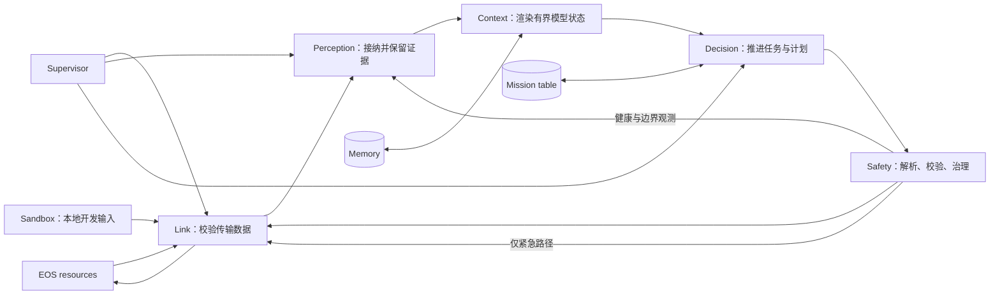
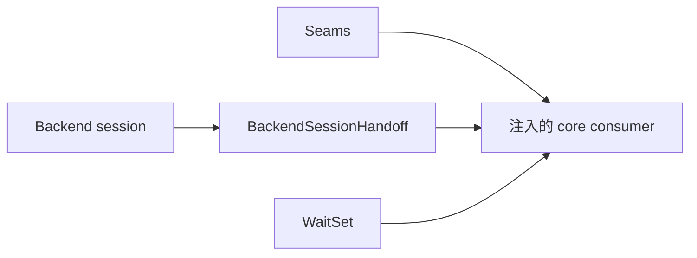

# EI 运行时设计

<!-- doc-navigation:start -->

目录：ei/core/runtime

浏览本目录的文档及下级目录。

- [上级目录](../README.md)
- 同级文档：
  - [contracts](contracts.md)
  - [EI 多后端运行](fleet.md)
  - [EI 操作员 IO 适配](io.md)
  - [optional](optional.md)
  - [EI 阶段数据流设计](pipeline.md)
  - [registry](registry.md)
  - [沙盒层](sandbox.md)
  - [受监督 task 生命周期](supervisor.md)

<!-- doc-navigation:end -->

[English](../../../../docs/ei/core/runtime/runtime.md)

## EGI Agent 术语

**EGI** 是 **Embodied General Intelligence**（具身通用智能）的缩写。**EGI Agent** 是本仓库中的 EI 运行时，负责协调已配置模型、感知、上下文、规划、记忆、任务、受安全门控的原语和恢复。

EI 负责认知和提议门控。EOS 负责设备集成、最终命令准入和物理安全。IsOS 负责保存图和监督进程生命周期。公开命令和配置使用 [EI 总览](../../../README_cn.md)中的 `ei` 包及路径。

## Runtime composition and module boundaries

目标图层级和各类节点的操作员行为从节点目录开始阅读。本页记录**当前 Python 模块实现**及算法，不重复定义阶段负载契约。

## 所有权映射

| 模块 | 所有权 | 不负责 | 详细文档 |
|---|---|---|---|
| `core/io/link` | EOS 通道、已校验发现代际、resource 与调用传输 | 规划和动作策略 | [Link](../io/link.md) |
| `core/evidence/perception` | 接纳队列、有界观测历史和可替换的当前证据 | 来源事实或提示词措辞 | [Perception](../evidence/perception.md) |
| `core/cognition/context` | 确定性提示词区段与动态消息总预算 | 观测存储和模型调用 | [Context](../cognition/context.md) |
| `core/system/registry` | 已解析 primitive 目录与规划器签名 | 传输和 native skill 执行 | [Registry](registry.md) |
| `core/cognition/missions` | 任务接纳、优先级、文档、检查点与生命周期 | 计划推理和 primitive 执行 | [Missions](../cognition/missions.md) |
| `core/cognition/decision` | 模型通道、语义计划、步骤推进与结果 | primitive 放行权限 | [Decision](../cognition/decision.md) |
| `core/cognition/decision` | 可选 profile DAG 市场、设备 bidder、zone lease | 虚构能力或绕过 gate | [Coordination](../cognition/coordination.md) |
| `core/governance/safety` | 普通动作接纳、审计、健康事件、硬边界、速率窗口与紧急锁存 | 物理放行保证 | [Safety](../governance/safety.md) |
| `core/cognition/memory` | working、episodic、已审核 reference 记录，以及可用时的向量回忆 | 任务权威状态 | [Memory](../cognition/memory.md) |
| `core/system/sandbox` | 隔离的本地开发输入进程与媒体设备 | 生产执行器权限 | [Sandbox](sandbox.md) |
| `core/system/supervisor` | 任务启动、就绪、重启观测、停止信号 | 领域状态 | [Supervisor](supervisor.md) |
| `core/system/composition.py` | 组合依赖、注册入口、关闭资源 | 子系统算法 | 本页 |

`core/system/` 还包含 EI 启动、配置、owner 控制、节点注册表、native 节点生命周期及本地阶段投递的实现。根目录只保留启动、配置与安全命令入口；`reader_features.py` 留在根目录，保证能力探测不会导入运行时。

2026-11-16 移除了隔离节点、注册表、节点运行时、owner 服务和阶段的五个根目录导入别名。调用方直接导入其 `ei.core.system` 实现。完整 EI 测试通过（744 项）；Pyright、Ruff、四项导入约束、文档链接和干净的 wheel 构建也通过。命令与输出位于已忽略的 `data/test/20261116-ei-root-alias-removal/`。

根目录模块迁移检查（2026-11-16）：`cd ei && .venv/bin/ruff check . && .venv/bin/pyright && .venv/bin/pytest -q` 通过（744 个测试）；`PYTHONPATH=.:package .venv/bin/lint-imports --cache-dir ../data/cache/tools/import-linter-ei` 保持四项边界契约。`python3 scripts/check_doc_links.py --all` 未发现相对链接错误。干净的 `uv build --project ei --wheel` 包含八个 system 实现模块及其根目录入口。完整构建输出位于已忽略的 `data/test/20261116-ei-root-merge/`。

## 端到端数据生命周期

1. 组合层解析配置与共享 schema，为每个稳定 backend alias 创建客户端，并在已解析 state/cache 根下创建存储。
2. Link 执行强制发现；只有完整且校验成功的代际才能原子替换旧快照。
3. EOS resource 与操作员 hearing 变为带来源的 `ObservationRecord`；事件保持顺序， 可替换状态按身份合并。
4. Context 读取快照并在一个总预算内渲染区段；舍入和摘要不修改 typed 原始状态。
5. 普通路径从有界 mission table 选取一个任务；显式启用 coordination 时可接纳多个 profile job。模型输出始终只是提议。
6. 普通调用必须指明 backend/device，经当前 registry 解析，通过 schema、设备限制、 策略、运行状态与速率检查后才到 link；EOS acknowledgement 作为证据返回。
7. 结果经 perception 回流，更新 plan/mission 并写 working checkpoint；结束计划写入 episodic，只有操作员提升才能进入 reference memory。
8. Safety 中独立受监督的监测任务观察链路、进度和测量边界；紧急升级先建立 fail-closed 屏障，再走专用 stop 路径。

## 生命周期与降级

`launch()` 只组合已配置子系统，由 supervisor 启动并等待就绪，运行中提供健康状态， 随后设置共享 stop 并关闭非托管资源。skill/model 发现、向量回忆、文档检索、proposer 和 coordination 可选降级，但不会改变权限链。强制发现、schema、配置或存储失败会被 显式暴露，不会用虚构数据替代。

空观测省略对应区段，空任务表等待；未知目标和畸形模型动作 fail closed。超大集合带 精确省略数。有身份语义的重复项幂等忽略，要求唯一处则拒绝。超时和取消绝不合成成功。 Raster map 目前仅保留 contract 类型，没有 source、存储、提示词区段或北向 producer。

## 架构不变量

- backend alias 是路由身份；EOS UUID 只标识进程代际。
- I/O 只投影状态并提交 typed request，不拥有核心状态。
- 只有 Safety 的紧急路径可绕过普通接纳，且仅用于紧急停止。
- 可变数据只写入已解析 `var/` 角色；依赖契约使 core 通过注入协议隔离 provider SDK 与北向 handler。

## 验证（2026-11-14）

在仓库根目录运行 `ei/.venv/bin/ruff check ei ei/tests`、`ei/.venv/bin/pyright -p ei/pyproject.toml`、`cd ei && PYTHONPATH=.:pkg .venv/bin/lint-imports` 和 `cd ei && .venv/bin/pytest -q`，均通过。EI 完整测试套件报告 758 项通过。完整输出位于已忽略的 `data/test/20261114-ei-layer-refactor/`。

## 目录验证（2026-11-16）

源码检出直接从外层 `ei/` 项目目录加载 EI Python 包。生成的 EOS 协议绑定位于 `ei/generated/eos`；它们是从 `contract/proto/` 重新生成并纳入版本控制的 Python protobuf 和 gRPC 消费方文件，而非可编辑的 schema 源码；安装包不再包含 `island` Python 包。私有外部程序位于 `ei/package`；安装后的 EI 软件包将它们与 wheel 放在同一个 `pkg` 目录。C 演示阶段源码与 ABI 头文件保留在 `ei/native`，因为 wheel 会编译并包含 `ei/native/libei_demo_stage.so`，选定图以 `native/libei_demo_stage.so` 引用它。扁平化布局通过 745 项 EI 测试、Ruff、Pyright、四项导入约束、wheel 构建、启动器能力探测、Rust 生成配置测试、Clippy、格式及文档链接检查。日志位于已忽略的 `data/test/20261116-ei-flatten/`。

从仓库根目录运行 `ei/.venv/bin/python scripts/ei/generate_eos_proto.py --check`，可以在不修改受版本控制文件的情况下核对生成的 EOS 绑定。IsOS 契约变更后去掉 `--check` 即可更新绑定。生成过程先暂存完整软件包，只有 protoc 成功后才替换 `ei/generated/eos`。2026-11-16 的整理移除了过时的软件包和 lint 条目；生成器专项测试、Ruff、Pyright 与干净的 wheel 构建通过。构建证据位于已忽略的 `data/test/20261116-ei-generated-cleanup/`。

本次边界整理后，EI 脚本位于仓库根目录的 `scripts/ei/`，原 `internal` 模块根据导入关系归入 `lib`、`contracts` 或 `core`。从仓库根目录复现当前检查：`cd ei && .venv/bin/pytest -q`、`cd ei && .venv/bin/ruff check .`、`cd ei && .venv/bin/pyright`、`cd ei && PYTHONPATH=.:package .venv/bin/lint-imports --cache-dir ../data/cache/tools/import-linter-ei`、`cargo test -p isos source_ei_inventory_excludes_build_and_test_trees --quiet`、`python3 -m unittest crates/isos/tests/test_product_installer.py -q`、`uv build --project ei --wheel` 以及 `python3 scripts/check_doc_links.py --all`。EI 测试 744 项通过；Ruff、Pyright、四项导入约束、两项受影响的 IsOS 检查、干净的 wheel 构建和文档链接检查均通过。完整 EI 测试和 wheel 构建日志位于已忽略的 `data/test/20261116-ei-boundary/`。

## Internal protocols and handoff

## 目录

- [架构](#架构)
- [数据流](#数据流)
- [运行条件](#运行条件)
- [相关文档](#相关文档)

## 架构

## 所属模块

`core/backend_handoff.py` 定义 `BackendSessionHandoff`，在 backend rebind 期间进程内交接已准入 Mission、active Plan 与有界 Observation state。`contracts/decision.py` 定义 `ActionInvocation`、`StepContext` 与 `GateVerdict`，它们把一个请求 action 经 policy 和 safety 传到可选 backend acknowledgement。

`lib/model.py` 定义 planning 使用的 `DecisionModel` protocol，使 core 不耦合单一 provider。`lib/recall.py` 定义 memory 使用的 `RecallIndex` protocol，可由可选 vector index 或其他实现提供。`lib/notify.py` 定义 `WaitSet`，供 replaceable store 使用的轻量 broadcast notification primitive。`lib/skills.py` 保存叶层技能协议值。这些位置移除了原来的 `internal` 包，同时保持 `lib` 的叶层导入约束。

## 数据流

Producer 从已经校验的 domain data 构造 internal value，并跨注入 protocol 传递。Action invocation 保留 primitive name、稳定 robot/device target、argument 与 intent；step context 添加 Mission origin 与 execution context；gate 返回区分 admission、refusal、backend acknowledgement 和 egress failure 的 verdict。

在替换 backend-owned client、watcher 与 registry 前，composition 将已准入 Mission、active Plan 与有界 Observation state 深拷贝进 handoff。下一 session 消费隔离副本并清空 pending value；单调递增 revision 标识一次新 capture。Model 与 recall call 将 protocol result 返回给 decision 或 memory owner，由后者决定 persistence 与 operator projection。`WaitSet.notify_all` 在 store version 改变后唤醒当前 waiter；consumer 唤醒后必须重新读取 owner state。

## 运行条件

正常调用保留类型化 value，不添加 policy。空的可选 target 与 acknowledgement 必须保持显式：admitted verdict 可携带 backend rejection acknowledgement；admitted verdict 没有 acknowledgement 则表示 egress failure，不能视为成功。

Malformed data 应在所属 boundary 被拒绝；protocol implementation 仍可抛出其文档规定的 provider、storage 或 transport failure。缺少 implementation 时由 composition 禁用依赖 feature，不进行隐藏 fallback。`WaitSet.wait` timeout 时返回 `False`，notification 时返回 `True`；caller 必须允许唤醒后 state 未变或已被替换。

Restart 创建新 protocol implementation 与新 backend handoff；本 package 没有 durable object。Cancellation 与 shutdown 由所属 subsystem 控制。Recall implementation 必须关闭资源，model implementation 应在适用时释放 provider resource，waiter 必须能通过 owner 的 stop condition 退出。

## 相关文档

依赖方向见 [模块目录](runtime.md)，backend session 见 [连接设计](../io/link.md)，model 与 action consumer 见 [决策设计](../cognition/decision.md)，gate verdict 见 [安全设计](../governance/safety.md)，recall implementation 见 [记忆设计](../cognition/memory.md)。

## Configuration, logging, and recovery

EI 在构建运行模块前从 `--etc` 或 `EI_ETC` 解析配置根目录；缺失时启动失败。`models.toml` 定义模型绑定和生成限制；`modes.toml` 选择 `profiles/` 下的配置；profile 定义 EOS 后端与操作员原语暴露。`prompts.toml` 是模型提示来源。`missions.toml` 可以定义规范命名任务及受保护计划的严格白名单；`[decision] load_mission_templates` 默认 `false`。`safety/gate.toml` 定义确定性出口界限。IsOS 选择组件启动路径，并通过 `EI_ETC` 将托管 EI 的配置根目录传入；EI 读取已声明的共享资源根目录以定位 EOS 契约和 schema。

dotenv 读取器把缺失文件当成空覆盖层，忽略注释、空行和格式错误的赋值，并保留已有进程变量。它只报告载入的变量名，不求值 shell 语法。秘密保留在环境查询中，不写入结构化配置输出。

## 日志与状态

一个经过清理的事件写入本地核心 JSONL 文件；独立运行时也可写入配置的控制台。未知日志键会被拒绝。在任何 sink 接收前，递归清理会遮蔽含秘密的键及 URL，排除原语参数、任意结果、提示、转录、提供商负载、图像和音频，并限制嵌套数据。关联和生命周期上下文仅在一次请求或执行期间有效。

源码检出中的单一核心文件为 `data/ei/log/<deployment>/ei.jsonl`（独立运行使用 `local`）。每行 JSON 包含时间、级别、来源、消息，以及可选事件码、run ID、关联 ID 和清理后的字段。来源使用 EI 节点 ID；系统代码使用 `ei.owner_service.py@aether-v0.2.3`。IsOS 直接读取该文件。本地文件默认记录 `DEBUG` 及以上；控制台通常从 `WARNING` 开始，在启动和关闭时显示 `INFO`。`--log-level` 与 `[logging]` 可调整详细程度。

模型客户端接收文本和支持的图像，将图像转为带 MIME 的数据 URL，并发送 chat-completions 请求。非流式回复必须有可用 choice；流式回复消费有效 SSE 增量并关闭响应。HTTP、URL、超时、解码、畸形 JSON、空 choice 与流中断失败都成为带有界详情的 `ModelClientError`。缺少用量字段不会改变返回文本。

## 事件映射与持久恢复

[归属事件接口](../../../isos/interfaces/server/ei_cn.md#events_cn)定义对外记录；[JSONL 夹具](../../../../ei/tests/fixtures/jsonl_events/README_cn.md)展示代表性记录。

### 映射和顺序

归属方本地最多 256 键的单调表只对重复的非关键诊断在 60 秒内抑制，发出有界计数。启动、就绪、状态变化、首次警告／故障、锁存、未知结果、终结和安全停止失败绕过抑制。当前 `_RepeatSuppressor` 对本地文件使用 4,096 项策略；封闭的生命周期发射器保留独立的类型字段与抑制规则。表淘汰和关闭时刷新安全计数，不阻塞停止。共享写失败增加有界归属计数；该失败不改变 EOS 致动状态。

### A03 持久恢复与共享策略修订

`OperationLedger` 在 EOS Submit 前原子预留 ID，传输不确定时保留待决条目。启动后只用同 ID 调用 `GetOperation`；匹配的终态收据结算检查点，缺失或不匹配的收据保持未知并阻止安全重置。`SafetyState` 在 estop 外发前将受影响 alias 和 EOS robot ID 集合写入仅所有者可读的原子文件并 fsync 目录。本机停止进程 CLI 使用与运行时同一把排他锁，写一次性授权；下次启动消费授权并两次检查所有 alias 后才持久解锁。

A03 独立实现审查修正：`safety-history.json` 先于锁存 payload 写入，曾锁存而 payload 缺失时关闭准入；`operations-history.json` 和每个操作索引先于操作 payload 写入，缺失文件会被检测。锁存和一次性授权都绑定 episode ID 与所选图 revision；操作预留还保存 EOS robot ID 与图 revision，终态不可重写。运行锁取得后立即消费授权，配置、发现或任务检查点失败也不会留下可重用授权。托管默认启动不会在恢复前清除未完成任务。
