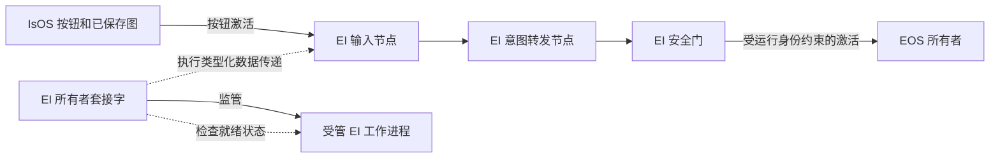

# EI 架构

EI 是独立的所有者服务。其私有 Unix 套接字验证独立的 `cores.ei` 投影，管理选定运行，并且一次监管一个受管工作进程。IsOS 拥有已保存图，并调用 Run、Status、Stop 和激活；IsOS 退出不会终止 EI。图 `0.2.0` 注册输入、意图和安全三个 EI 激活节点，以及输入、状态和监测三个机械臂监测节点。旧健康状态节点和仅声明型节点不再接纳。

## 运行路径

MVP 中所有者执行三个类型化数据传递阶段。每个阶段原样传递 `button_activation@v0.2` 事件；EI 不选择机械臂关节数值，也不创建执行器通道。在安全阶段，所有者检查运行身份、修订、声明的节点路径、工作进程存活状态和 EOS 所有者端点。EOS 接纳并执行机械臂命令。受管工作进程单独提供进程就绪状态和生命周期。这个仅报告健康状态的子进程不持有安全状态或执行器权限，因此不占用 EI 全局安全状态锁；完整 EI 运行时仍占用该锁。不同 IsOS 部署即使共用状态根目录，也可以同时保持各自的健康工作进程。

所有者在启动前验证工作程序摘要和运行身份。Stop 与激活串行执行，回收工作进程并关闭接纳；旧运行身份会被拒绝。下游结果不确定时，所有者报告而不重试。参见[配置及生命周期接口](../interfaces/setup.md)和[节点接口](../interfaces/node.md)。

只读回传路径为 EOS 模拟机械臂 → EOS 接口 egress → EI 输入 → EI 状态 → EI 监测 → IsOS UI 监测。EOS 以 100 Hz 对模拟机械臂采样；EI 以不超过 20 Hz 的频率请求最新且受运行身份约束的采样；IsOS UI 最多以 5 Hz 读取最终观测。EI 保留 EOS 序号、单调采样时间、状态、原因、关节名称和有效位置。过期或故障采样仍是观测，绝不是命令。Stop 拒绝后续读取并清空所有者缓存。

并行所有者检查（2026-11-09）：两个真实 `ei --managed --health-only` 子进程分别由不同所有者套接字管理且共用同一 `ISLAND_STATE`，均保持运行，随后 Stop 回收两者。`ei/.venv/bin/pytest ei/tests -q` 的 744 项测试通过；Ruff、Pyright、六项导入契约及双语链接检查均通过。完整输出保存在忽略的 `data/test/ei-arm-monitor-20261109/concurrent-health-*.log` 与 `links.log`。

## 未来资格验证

Q03 所有者资格验证目标使用重复的 stub stream 测量只读视觉入口。它不扩展一次性 Q01 重复代际测试套接字；所选 Q01 字节和身份比较仍是独立前提。目标入口与 Q01 回放仍需实现，并分别保存回放证据。
