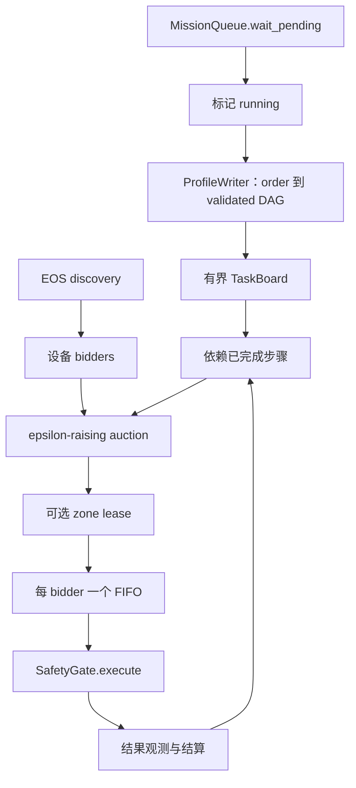

# 协同 profile 执行

[English](../../../../docs/ei/design/cognition/coordination.md) · [核心总览](../runtime/modules.md) · [决策](decision.md)

## 所有权与数据

- `bidders.py` 为每个至少公布一个 primitive 的设备生成 `BidderProfile`，身份为 `backend:device_id`，可变状态为健康、承诺时长、当前 zone、上一 primitive。
- `auction.py` 输入 ready step 与 bidder 快照，输出 award、价格、bid 和未分配 step。
- `board.py` 拥有有界 job 与 `WAITING -> READY -> RUNNING -> DONE | FAILED` 状态。
- `leases.py` 只管理内存中的互斥 zone claim，不是物理锁。
- `coordinator.py` 管理 intake、tick、执行队列、再发现、结果观测和 mission 结算。

## 完整流程

Intake 取出 pending mission、标记 running，并发构建 profile。writer 失败即失败任务； board 满则以 `coordination board full` 失败。根步骤初始 `READY`，其余等待所有 `after` 依赖变为 `DONE`。

带 zone 的 award 必须取 lease。当前 wiring 使用优先级 `1.0` 且只接受 `ACQUIRED`， 已有 holder 时延后 claimant；通用 lease 类型虽可表示抢占，本协调器不抢占运行步骤。 执行器复制参数，为非 fallback 设备补 `part_id`，构造显式目标调用并在 `step_timeout_s` 内通过 gate。成功必须同时满足 gate admitted、存在 ack、 `ack.accepted=true`。结果以 `kind=result` 进入 perception。成功释放 lease、结算负载、 完成步骤并释放依赖；最后一步完成会成功并移除 job。gate 拒绝、EOS 拒绝、缺 ack 或 超时都会失败步骤与 mission，下游不执行。

## 刷新、关闭与边界条件

无 mission、无 ready 工作、无可用 bidder、无可行 bid、zone 被占用时都等待而不虚构 分配。未知或重复状态转换抛错。空 profile 无法满足 `BoardJob.finished()`，必须由上游 profile 校验拒绝。意外 executor 退出只记录日志，不单独重启。关闭会取消并 drain intake、tick、discovery、executor 与 mission task，绝不把取消标成成功。

任务接纳见 [Missions](missions.md)，profile 校验见 [Decision](decision.md)，最终权限见 [Safety](../governance/safety.md)。
