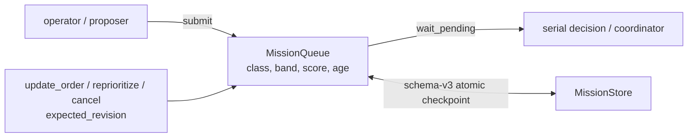

# 任务队列与生命周期

[English](../../../../docs/ei/design/cognition/missions.md)

> 本文是英文规范 `docs/ei/design/cognition/missions.md` 的中文伴随文档。代码、类型、方法、字段和错误码保持英文名称。

## 目录

- [架构](#架构)
- [API](#api)
- [设计](#设计)
- [测试](#测试)

## 概述


`MissionState.CANCELLED` 是持久化终态。`MissionPriorityBand` 是类型化优先级带：`low | normal | high | urgent`，默认 `normal`。`MissionRecord`、Mission document 和 Mission projection 均保留该字段。

## 架构



所有成功 mutation 都先写 durable checkpoint，再发布 in-memory state、history、archive callback 和 listener notification。写入失败时不允许出现 ghost mutation。公开 reader、`submit` 和 `wait_pending` 返回 deep snapshot，调用方不能通过修改返回对象改变 queue。

## API

`MissionQueue.get(mission_id)` 返回精确的 `MissionRecord` deep snapshot；不存在时返回 `None`。`pending()`、`records()`、`history()`、`running_mission`、`document()` 和 `revisions()` 同样不暴露内部可变对象。

Human INFO 日志记录 submit、selection、start、compact changed plan progress、finish、suspension、resubmission 与 restore 边界。`mission_progress` 包含 plan/document revision、decision mode、step-state count、current step、settled barrier count 和 latest outcome，并且仅在 compact progress signature 改变时发出。DEBUG 日志保留 document mutation、raw plan synchronization 和 step/action transition。事件只包含 ID、状态、revision、index、count、priority metadata 与布尔值；Mission text、Plan、primitive arguments、evidence 和 result payload 不进入日志。

`submit(..., priority_band=MissionPriorityBand.NORMAL)` 保存初始 band。plain Mission 创建普通可编辑 document；template Mission 保存 template ID/version 和受保护初始 Plan。

`update_order(mission_id, order, *, expected_revision)` 只允许修改 physically pending、普通且从未开始的 Mission。成功后 document revision 加一，并同步 `MissionRecord.order`、`MissionDocument.order` 和安全的 draft pending plan title。template、已开始步骤、已运行或 preempted work 都会被拒绝。

`reprioritize(mission_id, priority_band, *, expected_revision)` 可修改任何 physically pending Mission，包括已经 preempt 后重新进入 table 的 Mission。成功后 record/document band 同步，document revision 加一。

`cancel(mission_id, *, expected_revision, reason="cancelled")` 可取消任何 physically pending Mission。成功后 Mission 和 document 都变成 `CANCELLED`，设置 `finished_at`，从 pending table 移除，保留 terminal checkpoint，并执行正常 history、finished/archive callback 和 listener notification。启动恢复不会重新准入 cancelled checkpoint。

三个 mutation 都使用 Mission document revision 作为 compare-and-swap token。稳定 domain error 与 `code` 为：`MissionNotFoundError` / `mission_not_found`、`MissionConflictError` / `mission_revision_conflict`、`MissionNotPendingError` / `mission_not_pending`、`MissionProtectedError` / `mission_protected`、`MissionStartedError` / `mission_started`；其余 mutation validation 使用 `MissionMutationError` / `mission_mutation_failed`。

## 设计

pending table 使用升序 key：

$$ \mathrm{key}(r)=\big(\mathrm{class\_rank}(r),-\mathrm{band\_rank}(r),-\mathrm{score}(r,\mathrm{now}),\mathrm{submitted\_at}(r)\big) $$

`operator` class 始终优先于 `self` class，任何 band 或 score 都不能跨越 class。相同 class 内，较高 band 优先；相同 band 内才比较动态 score；最后用 `submitted_at` 确定性打破平局。动态 score 仍包含 urgency、value、cost 和饱和 age term。

preemption 保持 class-dominant：较高优先级 class 必然胜出，较低 class 不能 preempt。相同 class 内，较高 band 必然胜出，较低 band 不能 preempt；band 相同时才使用既有 `preempt_margin` score hysteresis。检查仍只发生在 step boundary，不会中断 primitive call。


模型侧使用确定性的 `MISSION_TABLE`：running Mission 位于最前，pending Mission 按 scheduler 顺序排列，每行明确包含 role、短 ID、lifecycle state、origin、band、queue position 和 quoted order。active planner 另外收到 `MISSION role=active`、`CURRENT_STEP` 和逐项 `STEP`；step role 使用 `current | ready | future | verify | settled`，并保留字面 runtime state。primitive outcome 包含 robot/device target。


### 队列准入与运行接口

`await submit(order, *, source, correlation_id=None, origin="operator", priority_band=MissionPriorityBand.NORMAL, urgency=0.5, value=0.5, est_cost_s=None, template=None)` 返回 `MissionRecord`，队列满时返回 `None`，记录 `mission_rejected`，且不留下记录。`origin="self"` 只改变优先级类别，不改变执行路径。普通提交建立空的可编辑文档；命名模板则保留模板 ID/版本和受保护的初始 Plan。

`await wait_pending(stop)` 等待并弹出当前最高优先级项；弹出后状态仍是 `pending`，直到 `mark_running(record)` 将其设为 `RUNNING` 并记录开始时间。`finish` 仅接受 `SUCCEEDED` 或 `FAILED`。`resubmit` 在步骤边界让出后将运行任务重新放入待处理表，并递增 `preempted_count`；超过上限返回 `PREEMPTION_CAP`，表满返回 `TABLE_FULL`。两种拒绝都不修改原记录，由调用者带明确原因结束为 `FAILED`。`best_pending` 不弹出，`check_preemption` 返回需要让出的待处理任务；`restore_checkpoints` 将持久化的非终态任务恢复为待处理项，并返回规划器续跑所需的最新计划，超过容量则失败。

`pending()`、`records()`、`history()`、`running_mission`、`document()`、`revisions()` 与 `get(mission_id)` 都返回隔离的深拷贝。`self_pending_count()` 供 proposer 的待处理上限使用；`add_listener` 返回取消订阅函数，成功的表或文档变更会通知北向流。`records()` 保存本进程会话的全部准入记录；`history()` 只保留最近更新的 100 个任务，每个任务一条生命周期记录。北向 `/missions/stream` 发送有界历史、当前文档修订和最近 20 个已完成任务。

### 命名任务模板

模板步骤拥有稳定 ID、语义结果、`required`、`after` 和 `terminal` 元数据。规划器命令不能编辑或删除必需步骤。普通待处理步骤只有在全部依赖为 `DONE` 后才可执行；终结清理步骤允许在依赖以 `DONE` 或 `FAILED` 结束后执行。必需步骤的原语成功后进入 `VERIFYING`，只有后续带非空证据的 `plan complete` 才将其设为 `DONE`；`plan retry` 使其返回 `PENDING`，`plan fail` 记录阻塞原因。任务最终结算要求所有必需步骤为 `DONE` 或 `FAILED`，且所有终结步骤为 `DONE`。模板保护仍受文档编辑校验约束，不能通过普通修订绕过。

### 文档与动作接口

`document` 返回当前 `MissionDocument`；`plan_steps` 将根 Plan 投影为规划器记录，作为模板初始计划入口。`sync_plan` 把最新状态、结果、证据、依赖和保护元数据同步进文档，随后建立检查点并通知监听器。`revisions` 按时间顺序返回接受过的修订；`revise` 先执行 `validate_edit`，再接受未开始工作的修改。`complete_action` 记录单项终态：有原因时为 `FAILED`，否则为 `DONE`；最后一项结束后汇总步骤和文档结果。

`await execute_next(mission_id, executor)` 选出下一条可执行屏障，先开始步骤，再以 `asyncio.gather` 并发调用该步骤的动作，每个调用取得隔离的 `MissionAction` 快照，最后分别写入结果或异常原因。没有待执行步骤时返回 `None`。`executor` 是安全门/原语边界；接受文档修订不能绕过下一次执行的安全准入。

`MissionDocument` 保存任务 ID、指令、动态优先级、band、递增修订、状态、结果/原因和步骤；`completeness` 是终态动作所占比例，空文档为 0。`MissionPlan` 保存计划 ID、标题、修订、状态、结果/原因、步骤和子计划。`MissionStep` 保存稳定步骤 ID、索引、状态、`required`、`after`、`terminal`、证据和动作；同一步骤中机器人 ID 不得重复，动作索引必须唯一且有序。`MissionAction` 保存明确的 `robot_id`、动作、参数、意图、状态和结果。`validate_edit` 要求任务 ID 不变、修订恰好加一，已离开 `PENDING` 的步骤不变；模板必需步骤即使待处理也不可编辑。

### 持久化与恢复

`MissionStore(root)` 为每个任务写一个 `<mission-id>.mission.json`。`save_mission` 保存生命周期与文档并保留最新计划；`save_plan` 记录规划进度和执行阶段；`load` 读取单个检查点，`load_active` 严格验证所有文件并按提交顺序返回待处理或运行任务。未知 schema 版本、身份不符、修订链畸形、UTF-8 无效或文件名不符都抛出 `MissionStoreError`，不能悄悄丢弃工作。写入使用同目录临时文件、文件 `fsync`、`os.replace` 和目录 `fsync`；清理也同步目录。

关闭时运行中的计划以 `aborted` 建立检查点，任务回到持久 `PENDING`；只有启用任务预载的后续启动才恢复。抢占后重新选中任务时从文档中的最新 Plan 开始新规划器运行；已完成屏障保留为执行历史，待处理语义步骤继续可用。情景记忆提供额外召回，但不是唯一连续性来源。

### 排序、抢占与回压

`score_mission` 以注入时钟计算 urgency、value、cost 和饱和 age 的加权分数；每次选择或抢占比较都会重新计算。`operator` 类别总在 `self` 前；同类按 band (`low < normal < high < urgent`)，同 band 按分数，最后按提交时间确定顺序。较高类别或 band 在步骤边界可抢占；同类别、同 band 需超过 `preempt_margin = 0.5`，以避免分数波动导致振荡。原语调用期间不抢占。待处理表满会拒绝新的或重新入表的任务，不驱逐已有工作。`decision_entry` 的 `wait_pending → mark_running → planner.run` 是单个串行循环，避免两个任务在同一机器人上交错调用原语。

## 测试

focused tests 使用 plugin isolation：

```bash
cd ei
PYTEST_DISABLE_PLUGIN_AUTOLOAD=1 uv run --extra dev pytest -p pytest_asyncio.plugin tests/ei/test_missions.py tests/ei/test_mission_table.py -q
```

## 注册节点行为

**输入：** intent、可选 result。**输出：** selected、lifecycle。[阶段数据流设计](../pipeline.md)描述 EI 运行值。图端口、设置及连线优先级和频率的契约归 IsOS 所有。

**算法与故障：** 验证身份、修订与队列容量；持久化已接受状态变化后按任务策略选取工作。空队列等待；过期修订失败；关闭时保存终结或暂停状态。
