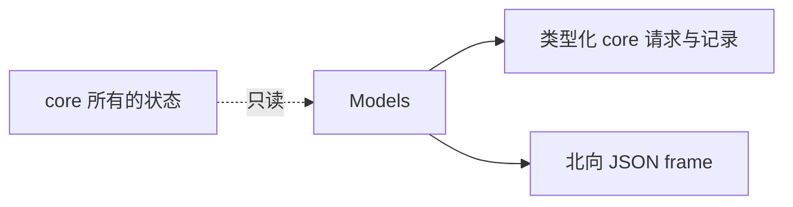

[English](../../../../docs/ei/design/runtime/api.md)

## 目录

- [架构](#架构)
- [数据流](#数据流)
- [运行条件](#运行条件)
- [相关文档](#相关文档)

## 概述

EI 模型定义类型化北向请求、核心记录和操作端投影。模型校验命令，状态仍由各生产者负责。

## 架构

## 所属模块

`chat.py`、`invoke.py` 与 `review.py` 定义命令请求及成功或错误回复。`mission.py` 定义任务命令、生命周期记录、历史、文档与表格快照。`plan.py` 定义语义 Plan 图、编辑、执行记录和操作端投影。

`context.py`、`observation.py` 与 `perceptions.py` 描述有界模型上下文和已准入 Observation 投影。`model_io.py` 描述模型消息、exchange、activity、Agent 状态与组合后的 model-I/O frame。

`primitives.py`、`skills.py` 与 `prompts.py` 描述已发现 catalog 和静态 prompt 投影。`skills.py` 还拥有严格 tagged skill command、cursor request、ack、error 和完整 execution snapshot。`status.py` 描述聚合运行时健康、子系统健康、安全状态、后端连接状态及逐设备状态。

## 数据流

北向 frame 先进入类型化请求模型，再由 EI 改变核心状态。

Core record 反向流向投影模型。投影模型选择操作端可见字段，同时保留稳定 robot alias、device ID、correlation ID、timestamp、revision、result 与 failure reason。投影不会成为独立事实源；Mission、memory、perception 与 link 所有者继续保存规范状态。

Decision graph 要求 node ID 唯一、引用已知、不能自引用，并且 `after` 依赖关系无环。

## 运行条件

正常输入生成类型化值或使用精确 enum literal 与字段名的 JSON frame。空的可选 collection 保持为空；生产者发布前可选 snapshot 可以不存在；nullable result 与 reason 字段保留各自语义。

Malformed JSON 在这些模型运行前由北向适配器拒绝。结构无效值、严格命令模型中的未知字段、无效 enum、越界值、不一致 acknowledgement 字段、重复 graph node、未知依赖、自依赖与依赖环都会校验失败，且不改变 core 状态。

## 相关文档

WebSocket route 见 [EI 运行时接口](../../interfaces/runtime.md)，适配器所有权见 [运行时 IO 设计](io.md)，Mission 状态见 [任务设计](../cognition/missions.md)，Plan 执行见 [决策设计](../cognition/decision.md)，存储的 Plan record 见 [记忆设计](../cognition/memory.md)。
