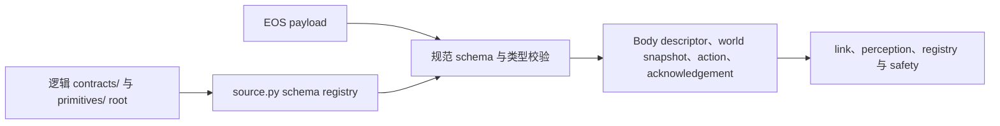

[English](../../../../docs/ei/design/runtime/contracts.md)

## 目录

- [架构](#架构)
- [数据流](#数据流)
- [运行条件](#运行条件)
- [相关文档](#相关文档)

## 架构

## 所属模块

`source.py` 通过已检查 collision 的 `SharedResources` 解析 JSON 文档、加载全部 schema 并构建跨 schema registry。`validate.py` 执行规范 JSON Schema 与 Pydantic 校验。`registry.py` 将 resource/primitive kind 映射到 schema path 和 Python model。`endpoints.py` 分类 world-resource URI，并声明支持的 resource/primitive kind。`limits.py` 解析 numeric capability interval 并检查 invocation argument。

## 数据流

启动时扫描逻辑 `contracts/` 与 `primitives/` 下的 JSON，并注册每个非空 `$id`。Southbound object 先按其规范 schema 校验，再转换为类型化 model。Discovery 把 protobuf common field 与 `device_class` 选定的 body contract 组合起来；world resource payload 根据 URI 和 discriminator 选择 model。

Primitive discovery 把精确 `{name, version}` descriptor 映射到对应 action schema。Descriptor version 必须是 SemVer，并等于 schema 的 `x-island-primitive-version`。Egress 前校验可移植 argument shape，再按选定 device limit 检查 numeric value。EOS acknowledgement 在成为 safety verdict 或操作端可见 result 前会连同 `primitive_version` 一起校验。

## 运行条件

正常 payload 生成且只生成一个类型化 body descriptor、world snapshot、command 或 acknowledgement。Nullable world field 保持 `null`；缺失不会被转换为健康数据。选定 class 所要求的 body `configuration` 与 `operational_state` field 必须存在，只有 schema 允许时，明确的未知值才可为 null。

在 `configure` 前使用资源、逻辑文件缺失、JSON malformed 或非 object、schema 缺少 `$id`、两个 schema 复用 `$id`，或无法构建 Draft 2020-12 registry 时配置失败。Payload 在规范 schema 或类型 model 不匹配时失败。未知 device class、primitive kind/version、resource kind 和 schema name 会被拒绝而非透传。

Numeric range 拒绝 boolean 和非 number、非有限 endpoint、没有 endpoint 的 range、缺少对应 endpoint 的 exclusivity、空 interval、缺失 required limit name 和未知 limit name。Invocation 在 capability 未公布或值超出准入 interval 时被拒绝。

Accepted acknowledgement 要求 rejection field 为 null。Rejected acknowledgement 要求非空 `reason` 和规范 `reason_code`；所有 acknowledgement 都要求精确 SemVer `primitive_version`。`speaker.play` 会拒绝缺失 stream identity、非法 media type 或 base64、超限 chunk、负 sequence 和未知 field。

## 相关文档

EOS interface 见 [EOS 交换设计](../io/eos-exchange.md)，生成的 northbound schema 见 [EI 运行时接口](../../interfaces/runtime.md)，transport 见 [连接设计](../io/link.md)，admission 见 [感知设计](../evidence/perception.md)，target binding 见 [注册表设计](../io/registry.md)，资源 root 所有权见 [Island shared contracts](../../../island/architecture_cn.md#跨所有者契约)。
