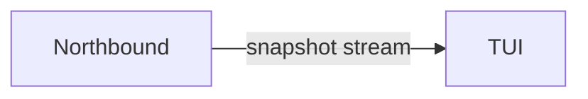

[English](../../../../docs/ei/design/runtime/extensions.md)

## 目录

- [架构](#架构)
- [数据流](#数据流)
- [运行条件](#运行条件)
- [相关文档](#相关文档)

## 架构

## 数据流

Process output 与 WebSocket frame 被规范化为有界 display state。Rendering 只改变表现；稳定 robot ID、device ID、Mission revision、correlation ID 与 backend reason 仍可追溯到来源。

## 运行条件

Feed unavailable、connection refused 或 reconnect delay 只影响相应 view，不授予 fallback execution path。Command timeout 与 server close code 1013 对 operator 可见。Attach mode 下 console 不拥有 runtime child；wrap mode 下 child startup failure 会被报告，不能误认为已经连接运行时。

## 相关文档

统一终端工作台通过 IsOS 服务运行，使用 `isos tui` 启动。
