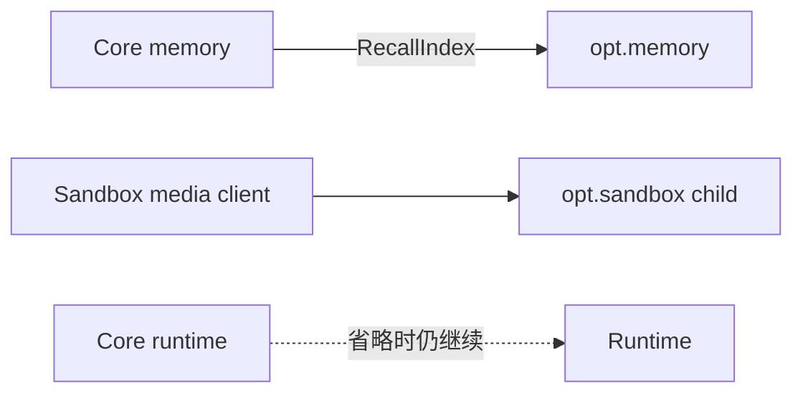

[English](../../../../docs/ei/design/runtime/optional.md)

## 目录

- [架构](#架构)
- [数据流](#数据流)
- [运行条件](#运行条件)
- [相关文档](#相关文档)

## 架构

## 所属模块

`memory/vec.py` 在 internal `RecallIndex` protocol 后提供 sqlite-vec recall index。它 embed 已完成 Plan，按稳定 plan ID 替换 index row，并返回排序 ID，供 core memory 对照权威 record 解析。

`sandbox/__main__.py` 启动隔离 playground。`sandbox/server.py` 拥有本地 EOS-compatible 与 media endpoint，`sandbox/devices.py` 产生已配置 microphone、camera 与 speaker 行为。Sandbox 是 development input surface，不是 production device runtime 或 safety bypass。

## 数据流

对于可选 memory，core 提供 completed plan 或 query text。Vector implementation 创建 deterministic embedding，更新或查询 index，并返回 identifier 与 score；core 重新加载匹配的 plan record、丢弃未知 ID，并构造有界 recall digest。

## 运行条件

正常 vector indexing 替换具有相同稳定 ID 的已有 Plan entry，并排序可用 match。空 index 或空 authoritative corpus 不产生 recall。Malformed stored vector、缺少 sqlite-vec support、database failure 或返回未知 plan ID 会降级可选 recall，而不改变 episodic-memory authority。

正常 sandbox startup 只暴露已配置 loopback service 与 enabled device。Disabled device 产生其文档规定的 disabled state；空 media 不伪造 Observation。Invalid configuration、非 loopback bind、malformed media、child IPC unavailable 或 child startup timeout 会使 sandbox route unavailable，而不会关闭 northbound API 或 core runtime。

Restart 重建 process-local sandbox state，并重新打开可选 vector storage。Shutdown 时关闭 vector connection，停止 sandbox task、socket、device resource 与 child process。任一 feature disabled 或 dependency absent 时，composition 使用文档规定的 core behavior，而不是静默模拟。

## 相关文档

Vector recall 细节见 [memory.md](../optional/memory.md)，playground protocol 见 [sandbox.md](../optional/sandbox.md)，权威 memory 见 [记忆设计](../cognition/memory.md)，EOS validation 见 [EOS 交换设计](../io/eos-exchange.md)，sandbox proxy 行为见 [EI 运行时接口](../../interfaces/runtime.md)。
