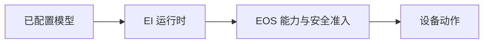

# EGI Agent 术语

[English](../../../docs/ei/design/terminology.md) · [EI 总览](../README_cn.md) · [EOS 接口](../interfaces/eos.md)

**EGI** 是 **Embodied General Intelligence**（具身通用智能）的缩写。**EGI Agent** 是本仓库中的 EI 运行时，负责协调已配置模型、感知、上下文、规划、记忆、任务、受安全门控的原语和恢复。

EI 负责认知和提议门控。EOS 负责设备集成、最终命令准入和物理安全。IsOS 负责保存图和监督进程生命周期。公开命令和配置使用 [EI 总览](../README_cn.md)中的 `ei` 包及路径。
