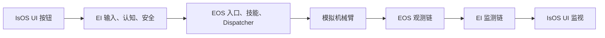

# IsOS 架构

<!-- doc-navigation:start -->

目录：isos/core

浏览本目录的文档及下级目录。

- [上级目录](../README_cn.md)
- 同级文档：
  - [IsOS 核心](README_cn.md)
  - [IsOS 命令行](cli_cn.md)
  - [IsOS 配置](config_cn.md)
  - [本地核心日志](logger_cn.md)
  - [IsOS 软件包](pkg_cn.md)
  - [IsOS 路线图](roadmap_cn.md)
  - [IsOS 服务端](server_cn.md)
  - [IslandOS 服务](service_cn.md)
- 下级目录：
  - [ui/](ui/)

<!-- doc-navigation:end -->

[English](../../../docs/isos/core/architecture.md) · [设计索引](README_cn.md) · [接口](../interfaces/README_cn.md)

IsOS 负责已保存图修订、精确软件包验证、Apply、本地 API 和部署运行身份。它是机器人运行时的控制平面：注册节点类型描述归属位置和类型化端口，实例提供身份与设置，各归属方只运行获准的自身投影。字段和线协议由所属的[节点](../interfaces/node/README_cn.md)、[软件包](../interfaces/package/README_cn.md)和[管理器](../interfaces/manager_cn.md)契约定义。

## 当前运行边界

图 `0.2.1` 包含 `isos`、`ei` 和 `eos` 核心。IsOS 合并归属方目录，验证无软件包的 17 节点[起始图](../../../crates/isos/templates/generic-graph.toml)或 17 节点[混合示例](../../../examples/mixed-mujoco.nodes.json)，仅将各自投影送往 EI 和 EOS。混合示例需要已验证的 `island/mujoco-sim@0.2.4` 软件包及其配置。起始图的命令链从 UI 按钮经过 EI 安全门，到 EOS Dispatcher 和模拟机械臂。混合示例使该链缺少激活源，因此无法向机械臂发送命令。独立的只读链经 EOS 和 EI 将机械臂观测送回 UI 监视，不创建执行器通道。

EOS 在回复前持久接纳命令事件，并按事件 ID 提供最终结果。EOS 独立于 UI 读取者检查本地机械臂采样。EI 和 EOS 各自监管持久归属服务和工作进程；IsOS 启动或重连服务，分别查询 Status，并记录 Stop 确认。Stop 和运行替换清除旧监测值。当前机制见[归属方健康设计](server_cn.md)和[控制路径](server_cn.md)。

## 跨所有者契约

IsOS 准入完整类型化图并分发归属方投影。各归属方重新验证自己的载荷、运行身份和修订；图连接本身不会授予其他核心执行器权限。图声明路线，归属服务传递实时数据。IsOS 汇总归属状态和日志，但不取代 EI 安全门或 EOS Dispatcher。准确线协议仍由所属接口树定义。

IsOS 在 `contract/` 统一维护共享契约源码：`node/` 保存图和注册节点 schema，`proto/` 保存跨归属方的 EOS 服务和载荷定义。生成的运行时 schema 位于 `schemas/actions/`、`schemas/body/` 和 `schemas/world/`，EI 北向 schema 位于 `schemas/northbound/`，North HTTP OpenAPI 位于 `schemas/north-http.openapi.json`。EI 与 EOS 只读消费这些定义，校验各自选中的图投影和载荷，并继续负责安全和执行。Protobuf 包名与 JSON Schema ID 独立于源码目录。EI 的北向 WebSocket 模型与传输位于 `ei/io`；EI 运行时共用记录位于 `ei/core/system/models`。共享 schema 编辑、图和部署状态由 IsOS 管理。

本次源码迁移可运行 `ei/.venv/bin/python scripts/generate_eos_contracts.py --check`、`ei/.venv/bin/python scripts/generate_north_http_openapi.py --check`、`ei/.venv/bin/python scripts/ei/check_northbound_schemas.py`、`cd ei && .venv/bin/pytest -q`、`python3 -m unittest crates/isos/tests/test_product_installer.py -q` 和 `python3 scripts/check_doc_links.py --all`。这些检查在 2026-11-16 通过（EI：744 项测试）。完整的 `cargo test --workspace --quiet` 编译了工作区，但已有的两个 `aether-runtime` `package_observer` 用例因夹具图连接了不同数据类别而失败；契约源码迁移未修改这些夹具。完整 Rust 输出位于已忽略的 `data/test/20261116-ei-boundary/shared-contract-cargo.log`。

未来方向见[路线图](roadmap_cn.md)。
