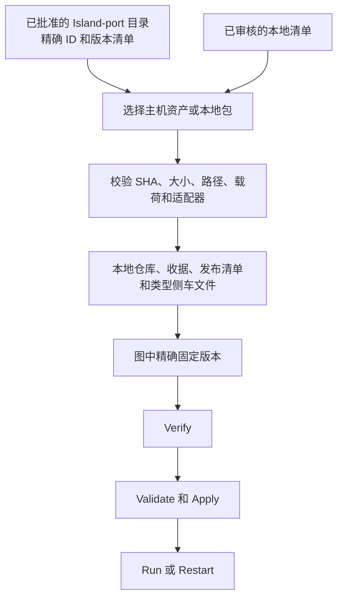

# IsOS 软件包

<!-- doc-navigation:start -->
<details>
<summary>目录：isos/core</summary>

浏览本目录的文档及下级目录。

- [上级目录](../README_cn.md)
- 同级文档：
  - [IsOS 核心](README_cn.md)
  - [IsOS 架构](architecture_cn.md)
  - [IsOS 命令行](cli_cn.md)
  - [IsOS 配置](config_cn.md)
  - [本地核心日志](logger_cn.md)
  - [IsOS 路线图](roadmap_cn.md)
  - [IsOS 服务端](server_cn.md)
  - [IslandOS 服务](service_cn.md)
- 下级目录：
  - [ui/](ui/)

</details>
<!-- doc-navigation:end -->

[English](../../../docs/isos/core/pkg.md) · [核心索引](README_cn.md)

## IsOS 包管理器：当前路径与未来设计

[English](../../../docs/isos/core/pkg.md) · [当前软件包准入](../../../docs/isos/core/README.md) · [软件包发布契约](../../../docs/isos/interfaces/package/README.md#release) · [架构目标](roadmap_cn.md#目标架构尚未实现)

**状态：**当前软件包行为与明确标记的未来设计。标记为目标的章节不描述已实现的行为。软件包、图、节点配置、进程、模拟器及 IsOS 产品版本相互独立。

## 当前包管理器：已实现的路径



IsOS 目前通过 `https://www.os-island.com/api/packages/v1` 查询 Island-port 目录并获取指定版本的发布元数据。`isos pkg install` 从发布清单选择匹配平台的资产，通过 HTTPS 下载，检查声明的大小与 SHA-256，拒绝不安全的归档路径和符号链接，验证声明的可执行文件、资源和适配器库，然后以原子方式发布到本地仓库。`isos pkg link` 接受明确指定的本地包和清单，记录文件指纹；字节发生变化后必须重新链接。`isos pkg install --source <绝对源码路径> --allow-source-build --version <精确版本>` 记录本地源码检出。若检出干净、HEAD 与收据一致且已安装字节通过验证，Apply 和 Run 复用该候选包；源码提交变化时才在准入前重新构建。构建失败时保留旧候选包并拒绝本次操作。本地仓库位于用户数据目录的 `packages/<namespace>/<name>/<version>`，包含 schema-2 收据、规范化的 `release.json`，以及可选的生成文件 `node-types.json`。搜索结果本身不会触发安装或启动。

精确版本固定值有两种不同的安装模式。源码安装保留 `source_kind=local_source`，在图准入前检查干净检出及已验证的安装载荷；`isos pkg refresh-sources` 也可按需检查当前绑定图中的源码包。明确执行 `isos pkg install --source` 即使 HEAD 未变化也会重新构建。目录安装保留经过验证的已下载发行字节，不会切换到本地源码。`./install_dev.sh` 构建 IsOS、EI 和 UI 后默认刷新绑定图中的源码包；传入 `--no-source-refresh` 可跳过。此命令不会刷新从目录安装的发行版。

2026-11-18 的本地缓存回放位于忽略目录 `data/test/20261118-source-build-cache/`。对变化的 HEAD 执行一次 Apply 后，`target/debug/isos --deployment default pkg refresh-sources` 在 0.80 秒内复用已验证的 MuJoCo 包，未变化的 Apply 记录了 `source_build_cached`。未跟踪的检出文件被拒绝。随后 Run 未执行源码构建，并启动 EOS、EI 和包服务；其 28.47 秒包含所有者及服务启动。代码检查复现命令为 `cargo fmt --all -- --check`、`cargo clippy -p isos --bin isos -- -D warnings` 和 `cargo test -p isos source_install_tests`。

图节点以精确 `{id, version}` 选择软件包。在图准入及 Run/Restart 时，IsOS 重新检查收据、发布清单哈希、完整载荷哈希、侧车文件、注册节点类型、资源 ID、所有者及生命周期能力。若保存的图或当前运行状态仍引用该精确版本，则拒绝删除。软件包 ID 和可执行文件名不决定特殊的运行时行为。EOS 拥有硬件适配器和命令准入；经 IsOS 验证的软件包声明不会自动获得执行器控制通道。数字形式的旧清单会被拒绝；已安装软件包必须提供当前契约。

当前 CLI 提供搜索、详情、安装、链接、列出、验证、移除、更新检查、升级安装、节点集预览、检查、发行、发布与上传。当前 HTTP API 在 `/api/isos/v1` 下提供列出、安装、链接与链接预览。已发布的软件包契约是 `isos.package@v1`，清单 schema 为 `0.1.0`。目前**尚无通用依赖求解器、事务性图及软件包升级、离线注册表信任缓存或已签名的注册表信任根**。`isos update` 列出统一的 GitHub 发布版本；`isos upgrade` 验证并安装更新的产品包。`isos doctor` 报告本地身份与就绪状态。

`pkg update` 根据本地已验证的软件包生成去重的 ID 查询集合，只向目录依次查询该 ID 的后续连续且已批准的精确补丁发行版，最多查询 32 次。从已安装的最高稳定语义版本开始，遇到首个缺失补丁即停止，且不发现其他主/次版本线。它将最后验证的结果与已安装版本比较，并把有界的 schema-1 发现状态写入所选 IsOS 数据目录下的 `state/package-updates.json`。某个 ID 的目录查询失败会单独报告，不影响检查其他 ID。快照没有有效期，因为 `pkg upgrade` 会重新获取所选精确发行版；快照不能授权下载。`pkg upgrade` 先确认完整的本地已验证安装清单仍与快照一致，再复用精确发行预览、绑定工件的批准和安装验证器。新版本与现有精确版本并存。两个命令均不修改图修订、已 Apply 状态或当前工作进程。操作员行为以[软件包 CLI 契约](../interfaces/package/README_cn.md)为准。

若 GitHub Release 已公开但 Island-port 提交未完成，即使后续版本已发布，也可恢复该精确旧版本；草稿或缺失的精确 GitHub Release 不适用。恢复流程会重新验证已发布工件字节和托管回放，然后提交目录。2026-11-13 的发行顺序重点测试、完整 IsOS 测试、格式检查、Clippy 和双语链接检查均通过；完整命令及输出保存在忽略目录 `data/test/20261113-release-recovery-order/`。

目录只在通过受检发布流程后才包含该发行版。发布门禁从最新远端 `v0.2.x` 标签开始，每次只前进一个补丁版本，并检查目录中不存在该精确版本记录。已检查的 `0.2.3` 候选包不能跳过尚未发布的 `0.2.2`；每个版本都需要自己的受检源码提交、不可变的 `v<版本>` 标签、匹配的资格证明、精确字节重建及重新下载验证，以及成功的目录提交。发布顺序与本地并存安装及图重新锁定版本相互独立。可执行门禁以[软件包接口](../interfaces/package/README_cn.md)为准。

任何远程软件下载前，IsOS 都先预览精确版本，并要求操作者对该预览明确批准。版本、摘要或工件发生变化后，批准失效。本地 `link` 不下载。`v0.2.x` 源码发行使用 `isos pkg check --source <绝对源码路径> --version <精确版本> --output <空的绝对目录> --graph <候选图>` 进行资格检查；`0.2.1` 清单需为每项声明的运行时服务重复传入 `--graph`，并加入 `--package-config <TOML 绝对路径>`。检查重新构建、隔离安装、探测所需原生 ABI、验证准确配置及预设设备覆盖，并重放服务启动、EOS 就绪、所有选定观测与命令模式、拒绝路径、绑定运行身份的日志、Stop 证明及套接字清理。`isos pkg release --checked <目录>` 要求通过的资格证明及匹配的不可变标签，对重新下载的工件再次重放，然后发布 GitHub 和 Island-port 元数据。已发布修复使用下一个补丁版本。精确门槛及失败行为见[软件包接口](../interfaces/package/README_cn.md)。

## 目标所有权图

| 所有者 | 可以执行 | 不得执行 |
| --- | --- | --- |
| IsOS 包管理器 | 验证注册表元数据、清单、资产、本地收据、兼容性、图引用和暂存更新；维护已安装清单与审计证据。 | 将不透明硬件载荷解释为授权、启动未经准入的进程、暗中修改已应用的图。 |
| IsOS 图管理器 | 固定精确的软件包发布版本与节点／配置版本；以原子方式验证和应用修订。 | 在 Run 时解析 `latest`、自动改写用户图设置，或绕过软件包验证。 |
| EOS | 验证 EOS 所有的包贡献，按需监管模拟器／后端子进程，并通过 Dispatcher 控制全部执行器准入与 Stop。 | 仅凭软件包元数据授予设备权限，或创建第二条执行器通道。 |
| EI | 验证 EI 所有的扩展，并按其生命周期契约运行智能工作负载。 | 直接写入已应用的图或执行器。 |
| 公共注册表 | 为公共软件包发布经过审核、无敏感信息的发布元数据与不可变资产。 | 保存真实硬件设置、密钥、标定、设备身份或私有调试证据。 |
| 私有注册表／私有集成仓库 | 在访问控制下保存硬件软件包与设置证据，并采用相同的软件包契约和验证规则。 | 向公共索引、源码快照、日志或发行说明泄露私有元数据。 |
| IsosUI | 通过 IsOS API 呈现搜索、已安装清单、计划、验证与更新同意。 | 绕过 IsOS 独立下载、安装或启动软件包。 |

私有集成仓库 是私有**源码**仓库。私有软件包注册表是单独受控的分发渠道；源码仓库本身不会自动成为安全的软件包注册表。注册表凭据保存在用户凭据存储中，绝不写入图文件或受版本控制的配置。

## 版本与支持映射

纳入版本控制的 `config/version-support.toml` 是对应 IsOS 构建的本地兼容性依据。CI 根据实际注册契约生成或校验它。它列出产品版本、接受的图格式、精确的软件包清单身份、节点／配置版本、IsOS 与所有者进程之间的契约、EOS/EI 接口契约以及软件包约束。无论在线或离线，运行时都使用该映射。注册表元数据可以提示更新，却不能扩大已安装二进制文件的兼容范围。

**当前实现阶段：**内置映射通过命令行与 HTTP 版本接口报告产品、目标图格式、HTTP 和软件包契约身份。软件包清单准入从该映射读取契约与 schema。IsOS 设置身份在启动和就绪前检查所选 EOS／EI 产品版本。Apply／Run 的图及所有者检查使用当前验证器；更广的准入集成仍属于目标工作。

| 身份 | 示例／当前值 | 目标检查 |
| --- | --- | --- |
| IsOS 产品 | `0.2.3` | 用于显示、来源追溯和版本选择；不能代替接口检查。 |
| 注册类型／配置 | `isos.<layer>.<name>@v0.2` | 精确检查类型 ID、位置、设置、端口、能力及所有者。 |
| 软件包清单 | 当前为 `isos.package@v1`、schema `0.2.1` | 导入器精确匹配所接受的契约／schema；运行时仓库存放规范化的当前记录。 |
| 软件包发布 | `{id, version, source commit, asset digest}` | 精确固定不可变版本及匹配主机的资产。 |
| EOS/EI／进程通信 | 独立版本化的契约 | 就绪前握手确认精确支持的契约集合；拒绝不匹配及过期修订／代次。 |

外部软件包在支持映射中的记录包含接受的清单身份、所有者、所需进程／适配器契约和平台限制；只有所有者测试过版本范围时才记录最低／最高支持版本，并可附精确摘要白名单。活动图使用精确版本和摘要。软件包的 SemVer 不代表通信协议匹配。`isos doctor` 报告本地兼容性，且不会改变正在运行的实例。

## 注册表模型

在 v0.2.1 中，**Island-port 继续作为公共软件包元数据目录**，**GitHub 承载公开的 IsOS 产品发布以及适合公开的已批准软件包资产**，真实硬件软件包使用独立的认证私有渠道。注册表客户端接口与托管地址解耦。一个客户端契约支持两个软件包渠道：

1. **公共渠道：**经过审核、不可变的软件包发布索引，提供搜索／发现、精确发布元数据、资产摘要／大小／平台、契约声明、发布者来源、审核状态及撤销状态。可用时允许匿名读取；作者发布须认证并接受审核。
2. **私有渠道：**用于真实硬件软件包、驱动构建、依赖标定的适配器及现场证据的访问控制索引。登录只允许发现和下载；软件包存在不等于获得设备控制权。公共搜索响应不得泄露私有软件包名称或元数据。

注册表条目是元数据，不是可执行信任。目标信任链由固定的注册表信任根、带签名及过期时间的索引／发布元数据、按内容寻址的资产组成。CI 与客户端验证签名、新鲜度、防回滚、资产摘要，以及发布者／审核策略。在该信任链实现前，现有的精确批准目录与摘要验证仍是已实现的边界；不得声称已有签名。离线缓存索引仅在其签名有效期内可用于授权。过期缓存可以显示清单，但不能批准新安装。若最近一次可信快照中的策略未撤销某个精确固定版本，完整本地验证后，该已安装版本仍可离线使用；实现前须明确定义撤销信息的有效期限。

**发布流程：**


修正必须创建新版本，不得覆写已有 `{id,version}` 对应的字节。撤销会阻止新安装并给出有限范围内的原因；除非有明确安全策略，否则不会暗中删除已安装软件包或停止运行中的执行器。

## 操作员工作流图

```mermaid
flowchart TD
  source["发现或选择本地来源"] --> inspect["查看精确发布版本、渠道、契约、平台及来源"]
  inspect --> plan["对照支持映射、图固定版本、所有者能力及依赖"]
  plan -->|不兼容| incompatible["指出精确字段；不修改状态"]
  plan -->|兼容| consent["同意安装、链接或更新"]
  consent --> stage["下载至暂存区并验证策略、清单、摘要及安全目录树"]
  stage -->|失败| cleanup["删除暂存区；已安装内容、图和运行状态不变"]
  stage -->|通过| publish["以原子方式发布不可变软件包版本及收据"]
  publish --> graph["验证拟议图修订及各所有者的投影"]
  graph -->|失败| unselected["保留已安装软件包但不选用；运行状态不变"]
  graph -->|有效| apply["Apply 精确修订"] --> ready["就绪预检"] --> run["Run 或 Restart"]
  run --> monitor["监控、安全 Stop，再显式移除未被引用的旧软件包"]
```

| 操作 | 必需输入 | 状态影响 | 拒绝行为 |
| --- | --- | --- | --- |
| 搜索／详情 | 渠道、查询或精确 ID／版本 | 只读。在线结果仅供发现，不代表批准。 | 离线／认证失败时报告状态；本地清单仍可用。 |
| 安装规划 | 精确发布版本、平台、本地支持映射 | 只读的兼容性和依赖计划。 | 精确指出不支持的契约、缺失依赖、平台或策略路径。 |
| 安装 | 精确发布版本及操作员同意 | 发布不可变的已验证仓库版本；图／运行状态不变。 | 删除暂存区，保留此前版本。 |
| 链接（开发／私有） | 精确本地清单及软件包 | 记录已验证的本地指纹；图／运行状态不变。 | 字节变化须显式重新链接；不会自动信任本地路径。 |
| 验证 | 精确已安装固定版本或全部已选版本 | 只读；检查收据、清单、载荷、侧车文件及适配器文件哈希。 | 以有限诊断安全拒绝；Run 期间不尝试修复。 |
| 选择／Apply | 精确图固定版本及修订 | 所有所有者验证后，原子修改期望图。 | 保存的字节／修订及活动运行状态不变。 |
| Run／Restart | 已应用修订、已验证的精确固定版本及所有者就绪 | 启动绑定修订的代次；EOS 控制执行器安全。 | 不返回部分健康结果；遵守安全 Stop／不确定结果规则。 |
| 移除 | 精确已安装固定版本 | 仅当保存／活动／恢复状态均无引用时删除。 | 拒绝移除被引用的软件包并列出各引用。 |

已应用的图中不允许出现 `latest`。若支持依赖，其精确版本必须构成有界无环图；求解器可以*建议*固定版本，却不能暗中选择。v0.2.1 可以拒绝未声明的传递依赖，而不是交付不完整的求解器。更新采用并存暂存方式，以便回滚时仍有已验证的软件包和保存的图修订。执行器 Stop 结果不确定时绝不自动回滚。

## IsOS 产品更新与软件包更新

联网时，`isos update check` 将已安装的 IsOS 产品版本与公共 `Island-Team/isos` 的最新**已发布**版本比较。IsosUI 提供相同的显式检查操作；两者都不在启动时自动执行在线检查。如果 GitHub 访问需要登录，则提示登录 GitHub；启动、Run 与本地兼容性检查不依赖登录。离线或未认证时，报告 `online status unknown` 并检查本地支持映射。不能因为 GitHub 上存在发布版本，就推断本地图、软件包或通信契约兼容。


## 硬件信息与公开审查

所有**真实硬件专属**信息放在 私有集成仓库 或限制更严格的私有存储中：机器人 ID／序列号、标定、设备配置、驱动端点与局域网拓扑、凭据，以及可识别实际部署的现场日志、影像和调试轨迹。公共 `isos` 可以包含通用硬件接口、合成测试数据、模拟适配器、脱敏示例，以及不使用真实设备身份的可复现测试。公共快照流程必须扫描受版本控制的源码、每个新提交、归档、生成绑定、文档和测试数据；每条发现由对应所有者审核。两个仓库的可复用示例均不得使用用户绝对路径或真实部署配置。提供 `.example` 文件和文档化的默认值，活动设置文件应被 Git 忽略。

## 通用 EOS 进程准入（2026-11-11）

IsOS 现在根据精确的软件包字节、资源选择、所有者及生命周期适配器校验贡献的 `eos/process/...` 节点，并将获准进程绑定到单个运行。在选择启动或 Stop 后端前，它会拒绝第二个 EOS 软件包进程。在较早的交接检查点，已发布的 `0.1.1` 桥接仍可读取但不可执行，本地 `0.1.2` 候选版本也无法通过执行准入。当前已验证的 `v0.2.x` 摄像头观测路线见 [EOS 软件包观测契约](../interfaces/server/eos_cn.md#package_observer_cn)；软件包执行器仍受限。

从仓库根目录执行 `ISOS_AETHER_BIN_DIR="$PWD/target/debug" cargo test -p isos --bin isos`、`cargo clippy -p aether-node-profile -p aether-runtime -p isos --all-targets -- -D warnings` 和 `python3 scripts/check_doc_links.py --all`，均通过。IsOS 测试覆盖软件包进程投影、重复进程拒绝、生命周期准入、直接子进程交接和 Stop 计账。完整输出和重放脚本位于被忽略的 `data/test/20261111-general-hal/`；模拟器的构建与链接证据位于其仓库的同名忽略目录。

## 下载同意与源码检查证据（2026-11-11）

当前受检发行路径在向 Island-port 提交元数据前，验证不可变标签、源码与归档内容、资格证据以及重新下载的已发布工件。schema `0.2.1` 服务包重放全部选定服务图、观测、命令、拒绝场景、日志和已确认的 Stop。可执行步骤和恢复规则见[软件包发行契约](../interfaces/package/README_cn.md)。

通用软件包与核心边界通过 `cargo fmt --all -- --check`、`cargo clippy --workspace --all-targets -- -D warnings`、`cargo test -p aether-node-profile --tests`、`cargo test -p aether-runtime --test profile_setup_packages`、`python3 scripts/check_doc_links.py --all` 和 `python3 crates/isos/tools/check_isos_docs.py` 检查。IsosUI 通过类型检查、212 项测试及本地、托管和终端构建。串行工作区测试排除七项读取图文件的测试后通过；用户预先在 `config/graph-pool/demo.nodes.json` 添加的未注册摄像头实例导致完整未过滤测试中的这些失败。完整输出位于忽略目录 `data/test/20261112-generic-package-core-boundary/`。

在此分支执行 `cargo build -p aether-runtime --bin aether-profile`、`cargo fmt --all -- --check`、`cargo clippy -p isos --bin isos -- -D warnings`、`ISOS_AETHER_BIN_DIR="$PWD/target/debug" cargo test -p isos --bin isos --quiet`（300 通过、2 忽略）、`python3 scripts/check_doc_links.py --all`（378 个文件、0 个断链）、`npm run typecheck` 及 `npx vitest run src/services/isos/node-graph.test.ts`（23 通过）。UI 测试使用本地安装的依赖；主机 Node 18 低于仓库要求的 Node 22，合并前需在 Node 22 重新检查。

## 实现阶段与验收

2. **支持映射：**增加版本化文件／schema、解析器、与注册契约的一致性检查、本地 CLI／HTTP 状态、失配诊断及离线测试。
3. **注册表边界：**区分公共／私有渠道、受认证的私有发现、签名元数据与缓存策略、不可变发布、撤销及公开审查。不得将注册表登录绑定到 IsOS 启动。
4. **软件包规划／更新：**精确依赖和兼容性计划、并存暂存、操作员同意、图修订更新、安全重启、回滚及不确定结果测试。
5. **产品更新：**可选的 GitHub 检查和登录、发布验证、同意、暂存、安全切换、回滚及离线回退。
6. **资格验证：**空白用户目录安装／链接 → 图 Validate/Apply → 所有者就绪 → 相机／已准入控制 → 故障／重启 → Stop；测试载荷变化、过期索引、错误签名／摘要／平台／契约、缓存到期、版本撤销、所有者失败及 Stop 结果不确定。完整日志保存至 `data/test/<run-id>/`。

## 软件包自有硬件注册回放（2026-11-12）

EOS 内建目录现在只保留模拟硬件；其他硬件类型定义及其层和分组位置由已验证发行包持有。IsOS 接受 `isos_node_v2` 声明，并在 Apply 时要求已验证的类型定义；历史服务列表本身不会注册类型。MuJoCo 0.2.2 候选版声明七种类型，每个实例同时在类型和适配器边界锁定精确版本。已发布的 0.2.1 字节不变。

从仓库根目录运行 `cargo fmt --all -- --check`、`cargo clippy -p isos -p aether-node-profile -p aether-runtime --all-targets -- -D warnings`、`ISOS_AETHER_BIN_DIR="$PWD/target/debug" cargo test -p isos`、`cargo test -p aether-node-profile`、`cargo test -p aether-runtime --tests`、`python3 scripts/check_doc_links.py --all`，以及 UI 类型检查、测试和构建，均通过。`isos pkg check --source "$PWD/../isos-mujoco-sim" --version 0.2.2 --output "$PWD/data/test/20261112-package-node-mvp/qualification" --graph "$PWD/data/test/20261112-package-node-mvp/native-candidate-graph.json" --graph "$PWD/data/test/20261112-package-node-mvp/robocasa-candidate-graph.json" --package-config "$PWD/data/test/20261112-full-mujoco-ui/package.toml"` 报告 `qualified:true`；两张图均完成 Apply、就绪、接口命令、拒绝、日志和 Stop 回放。完整输出保存在忽略目录 `data/test/20261112-package-node-mvp/`。

## 已安装软件包更新 CLI 验证（2026-11-13）

从仓库根目录运行 `cargo fmt --all -- --check`、`cargo clippy -p isos --all-targets -- -D warnings`、`ISOS_AETHER_BIN_DIR="$PWD/target/debug" RUST_TEST_THREADS=1 cargo test -p isos` 和 `python3 scripts/check_doc_links.py --all`，均通过。`ISOS_HOME=<empty-test-home> target/debug/isos pkg update` 未请求目录服务便写入空的本地快照；随后 `pkg upgrade` 报告没有可用的目录升级。单元测试覆盖最高版本比较、查询范围、逐 ID 目录失败、过期与重复快照拒绝、目录身份检查及无指定软件包时的批准拒绝。完整输出位于忽略目录 `data/test/20261113-pkg-update-upgrade/`。

`20261113-pkg-update-patch-discovery` 检查运行了 `cargo fmt --all -- --check`、`cargo clippy -p isos --all-targets -- -D warnings`、`ISOS_AETHER_BIN_DIR=<source-checkout>/target/debug RUST_TEST_THREADS=1 cargo test -p isos` 和 `python3 scripts/check_doc_links.py --all`。还使用工作树中的二进制文件及 `ISOS_HOME=<source-checkout>`，确认本地安装的 `island/mujoco-sim@0.2.2` 可以发现已批准的 `0.2.3`。完整输出位于忽略目录 `data/test/20261113-pkg-update-patch-discovery/`。首次完整测试因未设置 `ISOS_AETHER_BIN_DIR` 且工作树缺少 EOS 二进制文件而有五项依赖 EOS 的测试失败；配置后重跑通过。

## 软件包准入与启动

本设计说明已实现的从精确软件包版本引用到候选运行的路径。[发布](../interfaces/package/README_cn.md#release)、[资源](../interfaces/package/README_cn.md#resources)和[进程](../interfaces/package/README_cn.md#process)页面定义公开字段。

IsOS 验证发布与负载，解析注册节点类型和声明的资源 ID，检查受控文件摘要，并依据注册位置选择归属方。图准入和启动使用同一个精确版本验证器。软件包 ID、可执行文件名和元数据扩展都不会选择特殊解析器。归属核心在就绪前验证自己的生命周期适配器及软件包特有语义。

当前有类型的 Start/Restart 包装器组合保存修订、有序进程规格、已解析输入和归属模式。监管器创建运行 ID 并管理就绪与停止。绑定的交接信息携带已验证的可执行文件和资源、所选归属方、运行 ID 与修订。IsOS 只监管自己直接启动的子进程。当前软件包进程交接支持 EOS；其他归属方返回有类型的不可用错误。后续计划整合和归属方集成见[架构目标](roadmap_cn.md#目标架构尚未实现)。

缺少已注册输入时，系统在已连接边准入之后收集警告。Apply 仍执行软件包与所有者验证，然后原样发布所编辑的图。已保存图的读取分别返回警告与致命诊断，因此未完成的路径不会使工作台变成只读。

2026-11-14 验证：`cargo fmt --all && cargo fmt --all -- --check`、`cargo test -p isos --bin isos -- --test-threads=1`（348 项通过、2 项忽略）、`cargo test -p isos --test edge_admission`、`cargo test -p aether-node-profile --test profile` 和 `cargo test -p aether-runtime --bin aether-profile`、`cargo clippy -p isos -p aether-node-profile -p aether-runtime --all-targets -- -D warnings`、`ei/.venv/bin/pytest ei/tests -q`（757 项通过）、EI Ruff、Pyright 与导入规则、`cd ui && npm test && npm run typecheck && npm run build`（236 项 UI 测试），以及 `python3 scripts/check_doc_links.py --all` 均通过。在隔离的开发主目录中，EI 与 EOS 激活输入断开的图通过验证和 Apply，Run 达到就绪状态，直接 EOS 激活被 `activation_path_incomplete` 拒绝，完整断开的 EOS 链上的监控读取被 `monitor_path_incomplete` 拒绝，EI/EOS Stop 得到确认。完整 IsOS 二进制测试将 `ISOS_AETHER_BIN_DIR=target/debug`、`ISOS_EI_BIN_DIR=ei/bin` 和 `EI_PYTHON=ei/.venv/bin/python` 设为绝对路径。完整输出与已应用的夹具保存在忽略的 `data/test/20261114-incomplete-chain-warning/`。

## 外部软件包运行时后续工作

[English](../../../docs/isos/core/pkg.md) · [发行契约](../../../docs/isos/interfaces/package/README.md#release) · [EOS 节点贡献](../../../docs/isos/interfaces/server/eos.md#node_contributions)

## 当前支持

IsOS 验证精确软件包锁定、发行与载荷摘要、贡献节点类型及选中资源。当前合格的进程内节点 ABI 是 C 或 C++ 构建的 Linux `.so` 中的 `isos_node_v1`。EOS 可通过该 ABI 载入贡献的软件节点。所有者进程在宿主进程之外受监管，且仅在生命周期适配器可用时准入。软件包构建文件本身不能证明 ABI 或运行时支持。不支持的所有者、适配器、库和平台工件均保持拒绝。

## 未来工作

- 在接受要求 IsOS 进程内节点执行的软件包前，增加 IsOS 所属的外部节点能力探测与工作进程。
- 增加受监管的 Python 进程适配器，明确解释器、环境、启动、健康、输入、输出及 Stop 契约。不在 IsOS、EI 或 EOS 宿主进程中嵌入 Python，以避免解释器所有权与 GIL 耦合。
- 其他语言绑定须通过针对 `isos_node_v1` 的 C ABI 表、所有权规则与失败测试后才予以合格认定。
- 为非 Linux 主机增加平台专属库加载器及工件标签。在此之前，即使软件包含有构建文件，Windows 和 macOS 原生节点工件仍不受支持。
- 为每个新增所有者或平台增加软件包检查用例，覆盖 ABI 不匹配、字节变化、依赖缺失、拒绝、崩溃及不确定 Stop。
