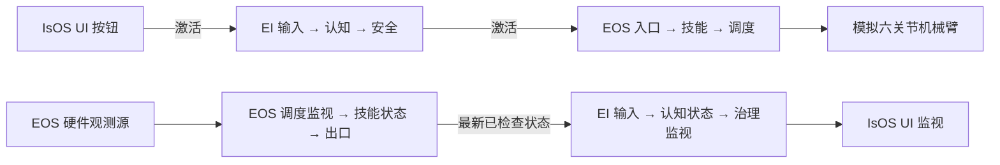

# IsOS 架构

[English](../../../docs/isos/design/architecture.md) · [设计索引](README_cn.md) · [接口](../interfaces/README_cn.md)

IsOS 负责保存图修订、精确软件包验证、Apply、本地 API 和部署运行身份。Graph `0.2.0` 包含 `isos`、`ei`、`eos` 核心。IsOS 合并核心节点目录，验证完整的 16 节点图及其 由两条独立链组成的 14 条类型化连接，再仅向 EI 和 EOS 发送各自的核心投影。[起始图](../../../crates/isos/templates/generic-graph.toml)和[节点契约](../interfaces/node/README_cn.md)规定当前实例与类型规则。

按钮路径是获准执行的命令路径。EOS 在回复前持久接受事件；其工作进程独立执行，并按事件 ID 提供关联结果。监视链与命令链之间没有图连接；观测源在本地读取同一个模拟适配器，不创建另一条驱动路径。EOS 以 100 Hz 检查本地采样；状态过期或无效时阻止运动，直到新的有效采样恢复。EI 独立于读取者，以最高 20 Hz 刷新一个按运行隔离的最新快照。IsOS 将一个经过验证的 EI 快照在最多 200 ms 内共享给 UI 读取者；UI 最高以 5 Hz 刷新。归属方交换检查运行与修订围栏，Stop 或运行切换清除旧数值。IsOS 不负责机械臂的运动安全判断。

EI 和 EOS 各自拥有持久的私有核心服务与工作进程。IsOS 启动缺失的服务，在管理器重启后重新连接；各核心监管自己的工作进程。Status 分别查询两核心。显式 Stop 请求两者停止并持久化确认。[运行时设计](runtime/owner-health_cn.md)说明核心重放与命令。

## 目标架构（尚未实现）

未来算法节点可以替换演示图中的认知与技能透传，同时保持注册类型、负载及归属边界。未来监视交付可以采用异步、有界的最新值队列，并按运行检查序列；UI 和 EI 不能对 EOS 本地采样校验造成反压。传输变更成为当前行为前，须先更新归属方接口契约和拒绝测试。

其他目标包括贯通图准入、Apply、Run、Restart 的统一类型化计划；绑定准确输出端口、类型、运行和修订的已验证展示描述符；以及具有签名、过期、撤销与明确离线策略的公有／私有软件包注册表信任根。这些目标需要跨无关软件包族的生命周期与拒绝资格测试，以及涵盖展示、日志和 Stop 的真实核心重放。键盘失焦、断线、租约到期和停止失败后的恢复仍需单独验证。
